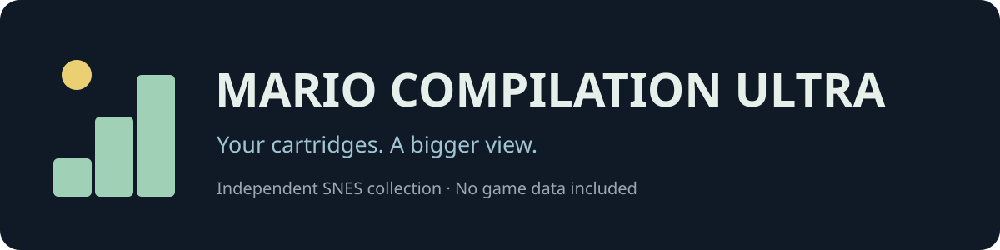
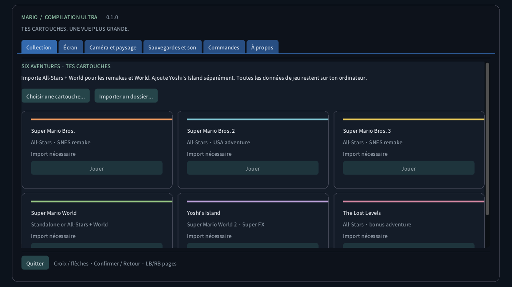

<a href="https://github.com/vhaloo/MarioCompilationUltra/releases">Download</a> · <a href="docs/QUICK_START_FR.md">Démarrage en français</a> · <a href="docs/FEATURES.md">Features</a> · <a href="docs/BUILD.md">Build</a>

**Play your own SNES copies of the All-Stars remakes, Super Mario World and
Yoshi's Island in a PC collection with adaptable views and controller menus.**
Windows, Linux and macOS · English and French · Keyboard and two gamepads.

| Download | Validation status |
|---|---|
| Windows x64 | Built and exercised locally on Windows |
| Linux x64 | Automated build and ROM-free checks; physical desktop gameplay untested |
| macOS Intel x64 | **Experimental — not tested on a physical Mac** |
| macOS Apple Silicon arm64 | **Experimental — not tested on a physical Mac** |

macOS packages are ad-hoc signed, not notarized. Automated runner checks do not
establish controller, sound, graphics or Gatekeeper behaviour on your Mac.

No Nintendo ROMs, game code, music, artwork, extracted level packs or game
screenshots are bundled. Game data stays on your computer.

## Start playing

1. Download and extract the complete package. On Windows open
   `MarioCompilationUltra.exe`; on macOS open the app; on Linux run `Play.sh`.
2. Choose **Choose cartridge…**, or drop your `.zip`, `.smc` or `.sfc` into the
   window. Import **Super Mario All-Stars + Super Mario World** for the four
   main Mario games and Lost Levels. Add **Yoshi's Island** separately.
3. Choose **Play**. The supported US All-Stars editions navigate to your
   selected game using the original menu. **Enter / Start** advances the
   original title screen; if an attract demo is playing, press it again.
4. Move with arrows / left stick, jump with **Z / bottom face button**, run or
   grab with **A / left face button**. Open options with **Esc / F10 / View**.

The menu pauses the game. D-pad and face buttons navigate it, shoulder buttons
change pages and triggers scroll. Cartridge files and existing emulator saves
are preserved; this app has its own save folder. [Complete controls](docs/FEATURES.md).

*The published screenshot shows only the original application interface.*

## A bigger view

Choose **Original framing**, **Panorama**, **Pixel world** or **Stage atlas**.
The default atlas decodes Mario World's complete **loaded area** from live
Map16 data and your cartridge's tile definitions. Its placed-object markers
show possible spawn positions without changing their original activation.

For Mario 1, Lost Levels, Mario 2, Mario 3 and ordinary supported Yoshi scenes,
the expanded view accumulates the terrain observed as the native camera moves.
Unknown areas have a subdued checker pattern. This is a growing exploration
map, not a reconstruction of every unseen level. Special projections and
unsupported scenes keep their original framebuffer.

The authoritative native region is retained inside expanded views. An atlas
close-up, player locator, minimap, native-camera guide, free camera, pixel zoom,
soft scenery backgrounds and quality presets help across small windows and
very wide or multiple displays. Pixel world samples one game pixel per output
pixel at 1× within the documented memory bounds.

## The collection

| Game | Cartridge source | Presentation |
|---|---|---|
| Super Mario Bros. | All-Stars remake | Native + observed terrain |
| Super Mario Bros. 2 | All-Stars USA remake | Native + observed terrain |
| Super Mario Bros. 3 | All-Stars remake | Native + observed terrain |
| Super Mario World | All-Stars + World or standalone | Native + loaded-area terrain atlas |
| Yoshi's Island | Separate SNES cartridge, Super FX | Native + observed ordinary terrain; special scenes remain native |
| The Lost Levels | All-Stars bonus game | Native + observed terrain |

Nine manual save slots per game, automatic resume, original battery SRAM and
a bounded 32-second rewind history are available throughout the collection.
Saved states include their framebuffer, so loading or rewinding displays the
restored image immediately. Files are checked against the cartridge, engine
version and integrity checksum.

## Preview scope

This is **0.1.0, an experimental enhanced collection**. Snes9x supplies the
complete SNES cartridge simulation, including Super FX; this project adds the
interface and presentation. It is not a new native decompilation of all five
games. Expanded artwork can differ from hardware composition outside the
original camera, particularly with raster effects, streamed graphics and
unobserved tiles. Full-game completion and every device are not certified.
See [measured validation](docs/TEST_REPORT.md) and [known limits](docs/FEATURES.md#known-limits).

Use game data you are entitled to use. This independent, noncommercial project
is not affiliated with Nintendo. Game names identify compatible cartridges.
The original host code is MIT-licensed; the complete executable includes the
noncommercial Snes9x core and its licence conditions. [Distribution boundary](docs/DISTRIBUTION.md)
· [Third-party notices](THIRD_PARTY_NOTICES.md) · [Research catalogue](docs/RESEARCH.md).
