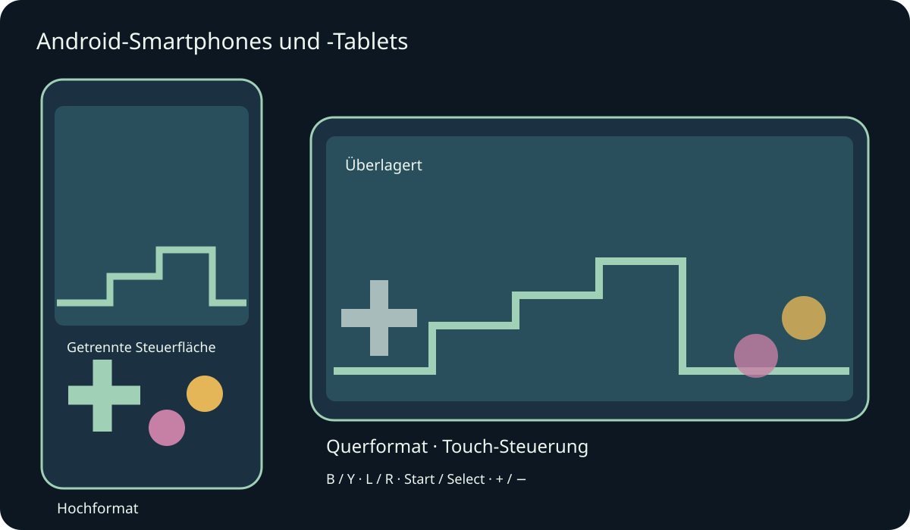
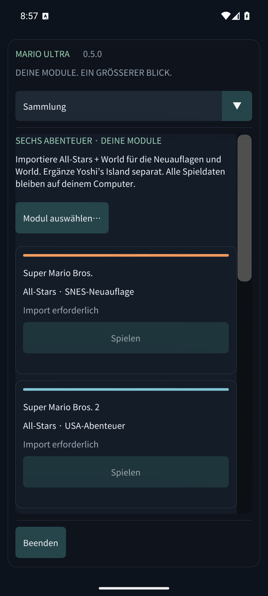

# Mario Compilation Ultra 0.5.0 · Android-Smartphones und -Tablets

[English](../en/MOBILE.md) · [Français](../fr/MOBILE.md) · [Español](../es/MOBILE.md) · [日本語](../ja/MOBILE.md) · [Deutsch](../de/MOBILE.md) · [Italiano](../it/MOBILE.md) · [Português](../pt/MOBILE.md) · [Русский](../ru/MOBILE.md) · [简体中文](../zh/MOBILE.md) · [한국어](../ko/MOBILE.md)

Das Android-APK für Smartphone/Tablet installieren und Mario Compilation Ultra öffnen. Das öffentliche GitHub-APK fragt nach eigenen Modulen; die persönliche ROM-Ausgabe enthält bereits alle sechs Spiele. Das Quest-APK ist eine separate Headset-App. Benötigt Android 8 oder neuer und OpenGL ES 3; ARM64, ARMv7 und x86_64 sind enthalten.

Drehen und Fenstergrößenänderungen erhalten das laufende Spiel. Sichere Ränder berücksichtigen Aussparungen und Systemnavigation.

Mit mehreren Fingern gleichzeitig bewegen, rennen und springen. Ein verbundenes Gamepad blendet automatische Touch-Tasten aus. Android-Zurück öffnet das Menü.

Die Tasten entsprechen dem SNES: meist B zum Springen und Y zum Rennen. L, R, Start und Select bleiben verfügbar. Ansicht schaltet fünf Modi durch; Minus/Plus ändern den Pixelzoom. Rückspulen gedrückt halten. Optionen pausiert sofort. Menüs mit dem Finger scrollen; auf schmalen Bildschirmen oben einen Bereich wählen.

- Mobile Ausrichtung
- Touch-Steuerung
- Touch-Anordnung
- Größe der Touch-Tasten
- Deckkraft der Touch-Tasten
- Linkshändige Anordnung
- Vibration bei Berührung
- Bildschirm beim Spielen eingeschaltet lassen

Spielstände, Rückspulen und Batteriespeicher liegen im privaten App-Speicher. Beim Wechsel in den Hintergrund werden Batteriespeicher und, falls aktiviert, Fortsetzungsslot 0 geschrieben. Updates mit gleicher Signatur erhalten den Fortschritt. Deinstallation oder Datenlöschung entfernt lokale Module und Spielstände. Speicherplätze stehen unter Spielstände & Ton.

Tests auf Smartphone-/Tablet-Emulatoren werden von echter Hardware getrennt ausgewiesen. Leistung, Controller, Aussparungen und Fensterverhalten können je nach Gerät abweichen. macOS bleibt experimentell und wurde nicht auf einem echten Mac getestet. Der Prüfbericht nennt den genauen Umfang.

[Android APK](https://github.com/vhaloo/MarioCompilationUltra/releases/download/v0.5.0/MarioCompilationUltra-0.5.0-Android-public.apk) · [HTML](mobile.html) · [Guide](README.md) · [Quest](XR.md) · [Validation](../TEST_REPORT.md)

[Adaptive Android apps](https://developer.android.com/develop/adaptive-apps/guides/support-different-display-sizes) · [16 KiB page sizes](https://developer.android.com/guide/practices/page-sizes)
