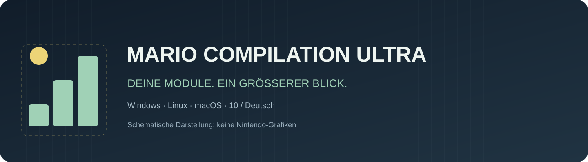
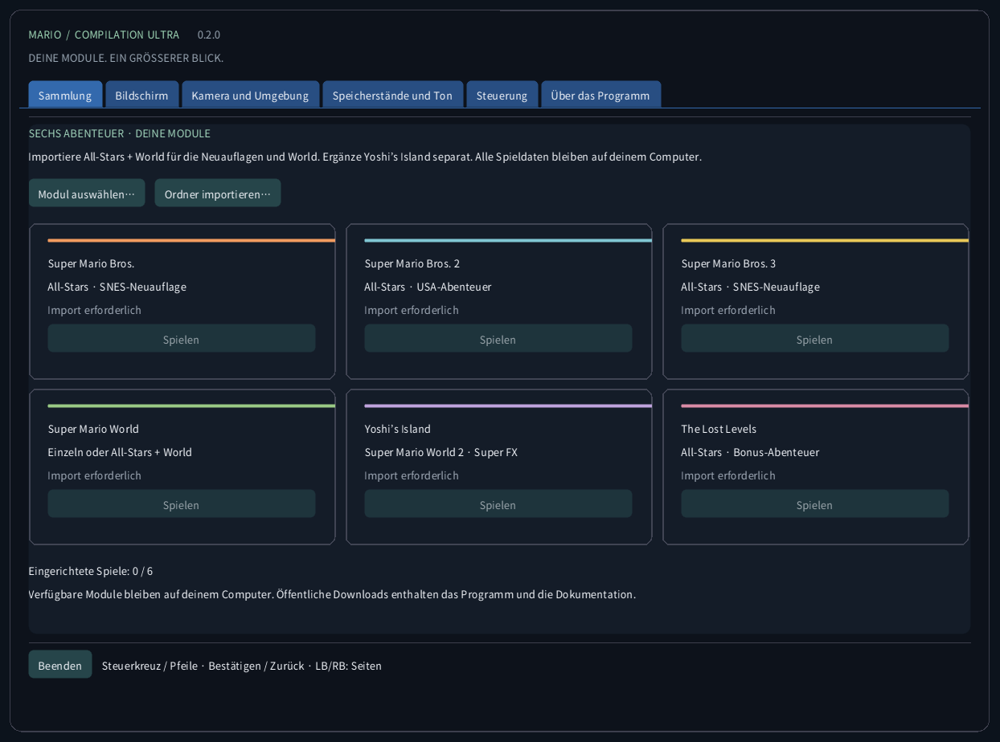
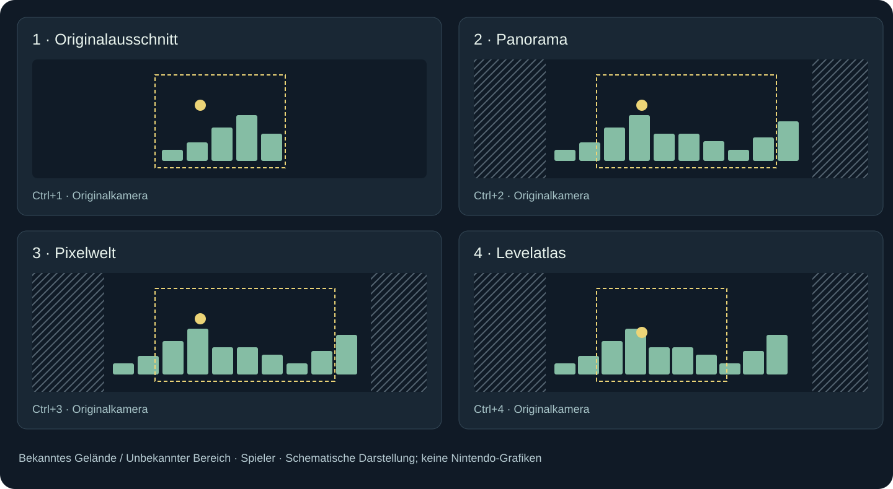
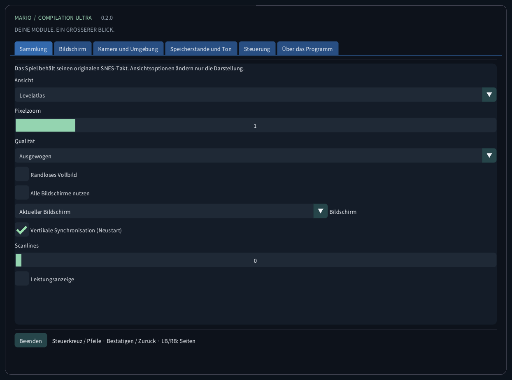
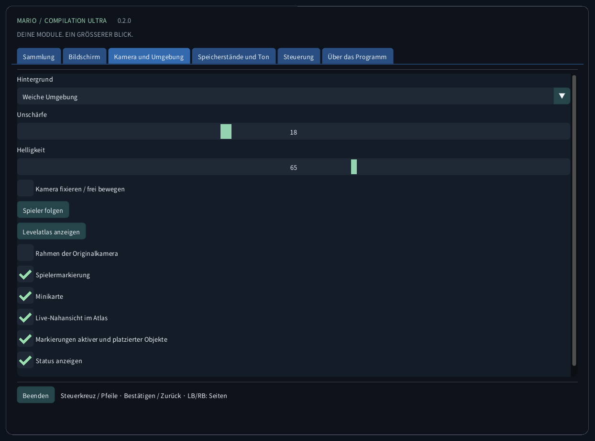
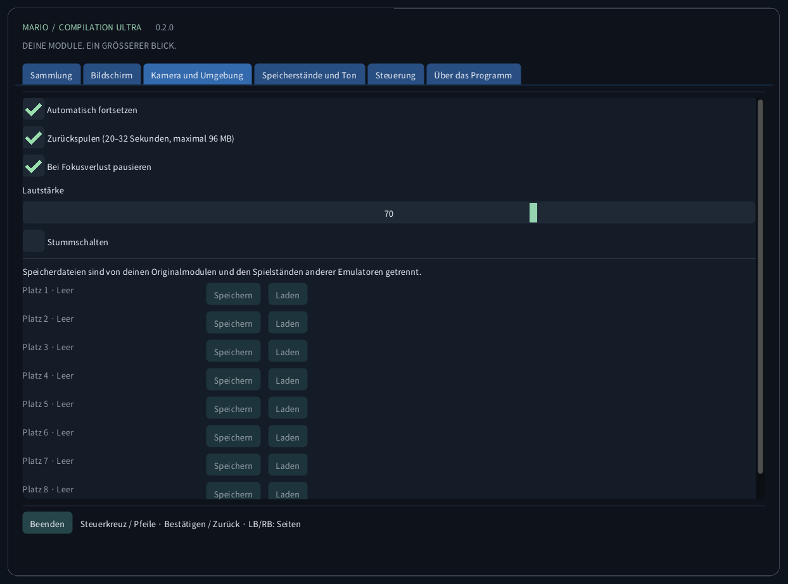
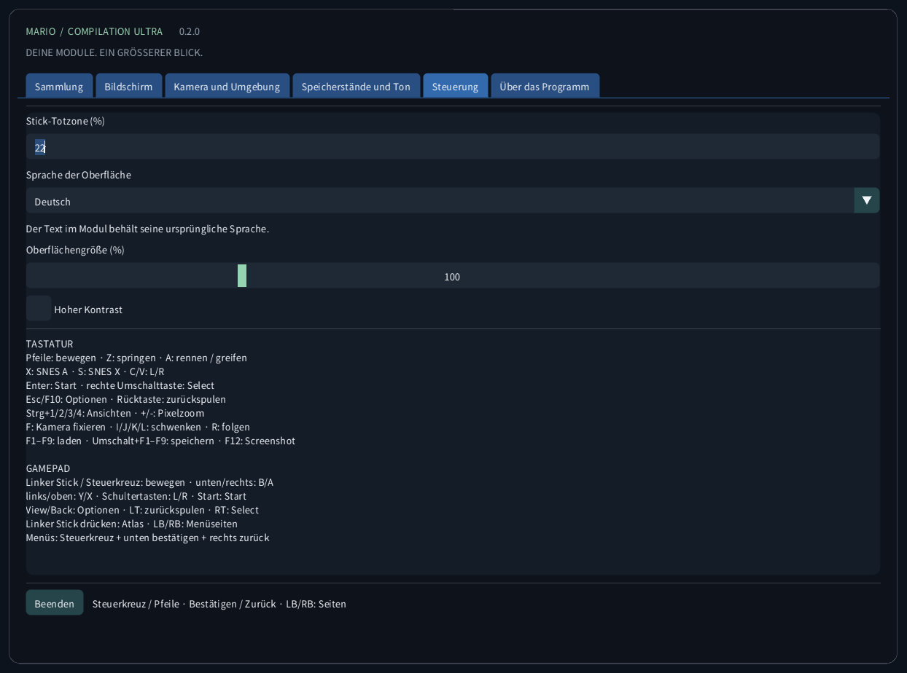
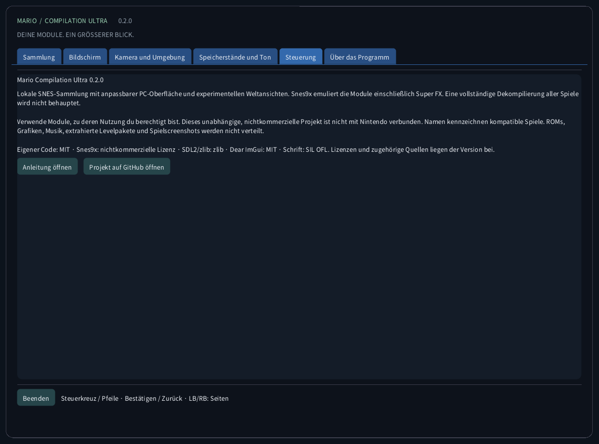

<!-- Generated by tools/guides.py; edit docs/guide-texts.json and assets/locales. -->


[English](../en/README.md) · [Français](../fr/README.md) · [Español](../es/README.md) · [日本語](../ja/README.md) · [Deutsch](../de/README.md) · [Italiano](../it/README.md) · [Português](../pt/README.md) · [Русский](../ru/README.md) · [简体中文](../zh/README.md) · [한국어](../ko/README.md)

# Mario Compilation Ultra 0.2.0

Lokale SNES-Sammlung mit anpassbarer PC-Oberfläche und experimentellen Weltansichten. Snes9x emuliert die Module einschließlich Super FX. Eine vollständige Dekompilierung aller Spiele wird nicht behauptet.

[Download und Start vom Desktop](https://github.com/vhaloo/MarioCompilationUltra/releases/tag/v0.2.0) · [HTML](guide.html) · [GitHub](https://github.com/vhaloo/MarioCompilationUltra)

## Download und Start vom Desktop

1. Lade das Paket für deinen Computer herunter und entpacke das gesamte ZIP. Programm, SDL, Ressourcen und Anleitungen müssen zusammenbleiben. Windows: MarioCompilationUltra.exe öffnen. Linux: Play.sh starten. Mac: die App öffnen.
2. Importiere eigene .sfc-, .smc- oder ZIP-Dateien mit einem einzelnen Modul über Modul auswählen, Ordner importieren oder Drag-and-drop. Die Dateiauswahl öffnet den lokalen Datenordner. Dort abgelegte kompatible Module werden beim nächsten Start erkannt.
3. All-Stars + Super Mario World enthält Mario Bros. 1, Mario Bros. 2 USA, Mario Bros. 3, World und The Lost Levels. Ergänze Yoshi’s Island separat. Wähle Spielen und drücke am Originaltitel Enter oder Start; bei einer laufenden Demo nochmals drücken.

Windows: Install-Windows.ps1 kopiert das vollständige Paket in deinen Programs-Ordner und erstellt eine Desktop-Verknüpfung. Linux: Install-Linux.sh registriert diesen portablen Ordner im Menü und auf dem Desktop. Mac: App nach Programme verschieben und einen Desktop-Alias erstellen. Den gewählten Ordner beibehalten.

```powershell
# Windows
powershell -NoProfile -ExecutionPolicy Bypass -File .\Install-Windows.ps1
```

```sh
# Linux
sh ./Install-Linux.sh
```



*Die Aufnahmen stammen aus der echten App ohne geladenes Modul. Diagramme nutzen eigene illustrative Geometrie, keine Spielgrafiken. Öffentliche Downloads enthalten keine Nintendo-ROMs, Sprites, Musik, extrahierten Level oder Spielaufnahmen.*

## Pakete und Prüfung

- Windows x64: lokaler Desktop-Start und Modulausführung geprüft; zusätzlich automatische Tests.
- Linux x64: automatischer Build und ROM-freie Prüfungen. Spielbetrieb auf einem physischen Linux-PC ist ungetestet.
- **macOS Intel x64 und Apple Silicon arm64: EXPERIMENTELL, NICHT AUF EINEM PHYSISCHEN MAC GETESTET. Automatische Prüfungen betreffen Build und ROM-freie Oberfläche. Ad-hoc-signiert, nicht notarisiert; Controller, Ton, Grafik und Gatekeeper auf echter Hardware ungeprüft.**

## Ansichtsmodi



Worlds Atlas zeigt den aktuell geladenen Bereich, nicht alle Spielbereiche zugleich. Mario 1, Lost Levels, Mario 2, Mario 3 und normale Yoshi-Szenen sammeln beim Bewegen beobachtetes Gelände. Unbekannte Bereiche bleiben schraffiert. Außerhalb der Originalkamera können Effekte und Sprites abweichen. Sonderprojektionen nutzen das Originalbild.

Erweiterte Speicherprofile und die automatische All-Stars-Auswahl gelten für die aufgeführten US-Ausgaben. Erkannte Ausgaben ohne geprüftes Profil verwenden den Originalausschnitt. Die Oberfläche übersetzt weder Geschichte noch Grafiken des kommerziellen Moduls. Eine neue native Dekompilierung aller fünf Spiele wird nicht behauptet.

| CRC32 | SNES |
|---|---|
| `f84305b1` | All-Stars + World (US) |
| `925637c7` | All-Stars (US) |
| `b19ed489` | Super Mario World (US) |
| `d138f224` | Yoshi’s Island 1.0 (US) |
| `cf98ddaa` | Yoshi’s Island 1.1 (US) |

## Steuerung

TASTATUR<br>
Pfeile: bewegen · Z: springen · A: rennen / greifen<br>
X: SNES A · S: SNES X · C/V: L/R<br>
Enter: Start · rechte Umschalttaste: Select<br>
Esc/F10: Optionen · Rücktaste: zurückspulen<br>
Strg+1/2/3/4: Ansichten · +/-: Pixelzoom<br>
F: Kamera fixieren · I/J/K/L: schwenken · R: folgen<br>
F1–F9: laden · Umschalt+F1–F9: speichern · F12: Screenshot<br>
<br>
GAMEPAD<br>
Linker Stick / Steuerkreuz: bewegen · unten/rechts: B/A<br>
links/oben: Y/X · Schultertasten: L/R · Start: Start<br>
View/Back: Optionen · LT: zurückspulen · RT: Select<br>
Linker Stick drücken: Atlas · LB/RB: Menüseiten<br>
Menüs: Steuerkreuz + unten bestätigen + rechts zurück

## Speicherstände und Ton

Pro Spiel gibt es neun manuelle Plätze, automatisches Fortsetzen, Batterie-SRAM und begrenztes Zurückspulen. Bis zu 96 MiB speichern etwa 20–32 Sekunden. F1–F9 laden; Shift+F1–F9 speichern. Modul-CRC, Engine-Version und Integrität werden geprüft. Andere Emulator-Saves bleiben getrennt.

## Lokale Dateien

Dieser Ordner enthält settings.ini, Modulverweise, states/, sram/ und screenshots/. Importieren lädt das Modul nicht hoch und ändert das Original nicht. Sichere den Ordner vor einem Computerwechsel. Zustände benötigen dasselbe Modul und dieselbe Engine; SRAM ist separat.

| OS | Lokaler Modulordner |
|---|---|
| Windows | `%APPDATA%/ValentinWittwe/MarioCompilationUltra/` |
| Linux | `$XDG_DATA_HOME/ValentinWittwe/MarioCompilationUltra/` or `~/.local/share/ValentinWittwe/MarioCompilationUltra/` |
| macOS | `~/Library/Application Support/ValentinWittwe/MarioCompilationUltra/` |

## Wenn ein Spiel weiter einen Import verlangt

Wähle das Modul erneut, wenn die Datei verschoben oder das Laufwerk getrennt wurde. ZIPs müssen eine .sfc oder .smc enthalten, unverschlüsselt und gespeichert oder DEFLATE-komprimiert. Prüfe die Liste der Ausgaben und Header. Bei fehlender Schrift oder SDL das gesamte Paket erneut entpacken.

## Galerie der echten Oberfläche

### Sammlung


### Bildschirm



### Kamera und Umgebung



### Speicherstände und Ton



### Steuerung



### Über das Programm



## Pakete und Prüfung · 0.2.0

Automatische Prüfungen umfassen 63 Laufzeit-/Controller-Prüfungen, 165 Texte in zehn Katalogen, Schriftabdeckung und 240 echte Aufnahmen in vier Größen. Kurze private Spieltests bedeuten keinen vollständigen Durchlauf. Bericht und Release-Workflow trennen geprüfte Funktionen von ungetesteter Hardware.

[CTest / CI](https://github.com/vhaloo/MarioCompilationUltra/actions) · [Report](../TEST_REPORT.md) · [Build](../BUILD.md) · [Source / research](../RESEARCH.md)

Verwende Module, zu deren Nutzung du berechtigt bist. Dieses unabhängige, nichtkommerzielle Projekt ist nicht mit Nintendo verbunden. Namen kennzeichnen kompatible Spiele. ROMs, Grafiken, Musik, extrahierte Levelpakete und Spielscreenshots werden nicht verteilt.

Eigener Code: MIT · Snes9x: nichtkommerzielle Lizenz · SDL2/zlib: zlib · Dear ImGui: MIT · Schrift: SIL OFL. Lizenzen und zugehörige Quellen liegen der Version bei.

[Licence](../../LICENSE) · [Third-party notices](../../THIRD_PARTY_NOTICES.md)
