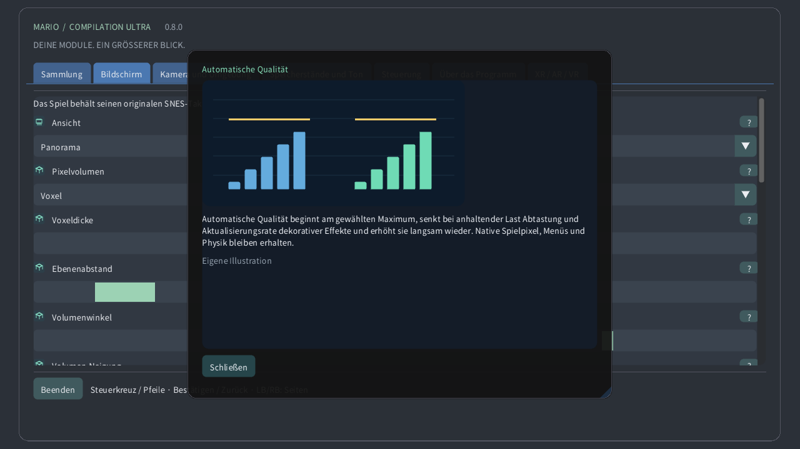

# Illustrierte Einstellungen

## Sammlung

Wähle ein lokales Modul, starte ein Spiel oder öffne seine Anleitung. Öffentliche Downloads enthalten weder Spiele noch persönliche Spielstände.

## Ansicht

Original zeigt den Konsolenbildschirm, Panorama erweitert ihn. Atlas umfasst verfügbares Gelände; die vollständige Karte liest bei unterstütztem Format das gesamte geladene Gebiet, auch unerforschte Stellen. Türen können das Gebiet wechseln.

## Kamera und Umgebung

Die Ansicht folgt der Originalkamera, der Spielfigur oder einer festen Position. Das verändert nur den Ausschnitt, bewegt keine Figur und aktiviert keine entfernten Gegner.

## Uhrenzoom

Zoom bestimmt den sichtbaren Bereich. Auf der Uhr zeigt 0% die gesamte geladene Karte, 100% die Originalkamera. Die Spielgeschwindigkeit bleibt gleich.

## Fisheye für runde Displays

Auf runden Uhren biegt die Linse das gesamte Spielrechteck zum Kreis, ohne Quellränder abzuschneiden. Bedienelemente und Text bleiben eben. Ausgeschaltet erscheint ein unverzerrtes Rechteck.

## Kronenempfindlichkeit

Eine erkannte Krone oder Drehlünette zoomt im Spiel und scrollt durch Menüs. Empfindlichkeit bestimmt die Wirkung jeder Drehung, Umkehren vertauscht die Richtung. Touch-Zoom funktioniert auch ohne Krone.

## Bildfilter

Nächste Pixel erhält harte Kanten. Scharf bleibt auch bei ungeraden Größen deutlich. Weich glättet Vergrößerungen. Quellbild und Kollisionen bleiben unverändert.

## Seitenverhältnis

Quadratische Pixel erhalten die ursprüngliche Pixelform; TV 4:3 bildet ein Fernsehbild nach. Pixelwelt verwendet quadratische Pixel und ganzzahligen Zoom.

## Automatische Qualität

Automatische Qualität beginnt am gewählten Maximum, senkt bei anhaltender Last Abtastung und Aktualisierungsrate dekorativer Effekte und erhöht sie langsam wieder. Native Spielpixel, Menüs und Physik bleiben erhalten.

## Leistungsreserve

Reserve lässt Zeit für unerwartete Arbeit frei. Mehr Reserve begünstigt flüssige Ausgabe. Extra flüssig nutzt 40%, Quest mindestens 35%. Bei dauerhaftem Spielraum steigt die Qualität wieder.

## Auf Gerätewärme reagieren

Androids lokaler Wärmestatus kann dekorative Details bei zunehmender Hitze begrenzen. Dafür sind weder zusätzliche Rechte noch Netzwerk nötig. Das System bestimmt weiterhin reale Taktraten und Bildfrequenz.

## Vertikale Synchronisation

Vsync folgt dem Bildschirm und vermindert Bildrisse. Das Spiel behält seinen eigenen Takt. Quest verwendet die gewählte Headset-Frequenz; die Reserve richtet sich nach ihr.

## VR-Shader

Effizienter CRT erhält den Retro-Look mit weniger Rechenarbeit. Automatisch startet effizient und erlaubt die Referenz erst nach dauerhaft gemessener GPU-Reserve. Referenz erzwingt die aufwendigere Berechnung.

## Bildschirm

Wähle Fenster, Bildschirm und Vollbildverhalten. Diese Optionen ändern den Anzeigeort, nicht das geladene Gebiet oder die Spielstände.

## Hintergrund

Der Hintergrund füllt den Raum um das Spiel. Weiche Landschaft übernimmt dessen Farben; Mitternacht und Schwarz sind ruhiger. Unschärfe und Helligkeit betreffen diese Umgebung.

## Unschärfe

Unschärfe glättet die umgebende Landschaft, Helligkeit regelt ihr Licht. Das native Spielbild bleibt unverändert. Bei Last kann die Automatik diese Dekoration seltener aktualisieren.

## Weiche Panoramaränder

Weiche Ränder blenden die Erweiterung nahe der Originalkamera in die Umgebung. Ausgeschaltet bleibt eine klare Kante. Vollständige Karten behalten ihren eigenen Ausschnitt.

## Spielermarkierung

Die Markierung zeigt die Spielfigur, der Rahmen die Originalkamera, die Minikarte ihre Lage im Gebiet. Eine Nahansicht hält den nativen Bildschirm beim Herauszoomen lesbar.

## Platzierte Gegner voranzeigen

Vorschauen zeigen geprüfte Platzierungen oder lokal beobachtetes Aussehen. Blasse Objekte und Umrisse sind Hinweise, keine zusätzlich aktiven Gegner. Deckkraft und Beschriftungen ändern ihre Sichtbarkeit.

## Status anzeigen

Bestimme Ecke, Größe, Deckkraft und Dauer der Bedienhinweise. Bei Zeitlimit null bleiben sie sichtbar. Diese Einblendungen ändern weder Spiel noch Kamera.

## Sprache

Passe Menüsprache, Größe und Kontrast zum angenehmen Lesen an. Illustrierte Anleitungen sind offline verfügbar. Spielgrafik und Modulsprache sind davon unabhängig.

## Steuerung

Wähle Tastenbelegung und Stick-Totzonen. Größere Totzonen ignorieren mehr kleine Bewegungen. Schnellsteuerung ergänzt Kamerakürzel; normale Spielaktionen bleiben verfügbar.

## Touch-Steuerung

Touch-Tasten unterstützen mehrere Finger gleichzeitig. Automatisch zeigt sie ohne verbundenes Gamepad. Position, Größe, Deckkraft und Händigkeit ändern die Bedienung, nicht die Spielphysik.

## Zurückspulen

Halte die gewählte Taste, um exakte jüngere Zustände zurückzuspulen. Die Dauer hängt von Speicher und Spiel ab. Rückwärtston und Anzeige sind optional; Speicherplätze bleiben getrennt.

## Speicherstände und Ton

Ein Speicherplatz enthält den aktuellen Maschinenzustand. Laden stellt ihn wieder her; automatische Fortsetzung hat einen eigenen Platz. Batterie-Fortschritt ist getrennt. Ersetzen verlangt eine Bestätigung.

## Lautstärke

Lautstärke und Stummschaltung steuern die lokale Wiedergabe. Sie verändern weder Spieltempo noch Spielstände. Rückspulton wird separat eingestellt.

## Bei Fokusverlust pausieren

Pause löst gehaltene Eingaben. Fokus und Tracking bestimmen automatische Pausen. Fortsetzen behält das Spiel bei; Beenden schreibt den Batterie-Fortschritt.

## Darstellungsmodus

Wähle schwebenden Bildschirm, Wand, Bodenatlas, Arcade-Tisch, CRT-Raum oder gebogenen Bildschirm. Dasselbe Spiel läuft weiter; nur seine räumliche Darstellung ändert sich.

## Betrachtungsabstand

Größe, Abstand, Höhe, Neigung und Lücke platzieren das virtuelle Objekt im Raum. Es gelten die angezeigten Einheiten. Zentrieren bringt es ohne Spielneustart wieder in Reichweite.

## Bildschirmverankerung

Automatische Wandplatzierung nutzt freigegebene Raumdaten, sofern vorhanden. Sperren oder Speichern hält die Position fest. Trackingverlust kann pausieren; manuelle Platzierung bleibt möglich.

## Quest-Touch-Controller verwenden

Virtuelle Fernbedienung, Hände und direkte Berührung bedienen dieselben Spielaktionen. Größe und Hinweise verbessern die Bedienbarkeit. Haptikstärke verändert die Rückmeldung, nicht den Eingabezeitpunkt.

## Beweglicher nativer CRT-Monitor

CRT ergänzt Scanlines, RGB-Maske, gewölbtes Glas und Reflexionen. Mehr Stärke ist ein visueller Stil, keine neue Spielinformation. Automatische Qualität kann teure Dekoration vereinfachen.

## VR-Umgebung

Passthrough zeigt deinen echten Raum; ohne ihn liefert die virtuelle Umgebung den Hintergrund. Transparenz, umgebende Landschaft und Helligkeit verändern die Spielumgebung.

## Adaptive periphere Details

Leinwand- und Augendetail begrenzen unterschiedliche Ebenen. Die Automatik passt beide an. Die unabhängige Menüebene bleibt scharf; periphere Foveation ist bei Unterstützung optional.

## Bebilderte Einstellungshilfe

Das Fragezeichen öffnet eine illustrierte Erklärung. Mauszeiger oder Controller-Fokus zeigen eine Vorschau; Berührung öffnet die Karte. Die Illustrationen sind eigene Beispiele, keine Modulbilder.

## Manuelle Qualität

Manuelle Qualität stoppt die automatische Anpassung und behält die gewählte Detailstufe. Automatische Qualität aktiviert sie wieder; Extra flüssig lässt mehr Leistungsreserve.

## Adaptive periphere Details

Auf kompatiblen Quest-Systemen kann Dauerlast periphere Bilddetails reduzieren und die Mitte erhalten. Menüs bleiben in einer separaten scharfen Ebene. Ohne Unterstützung greift der normale Renderer. Die Qualität im realen Headset ist ungeprüft.

## Pixelvolumen

Optionale prozedurale 3D-Darstellung: Pixel werden zu festen Säulen; Gelände, Hintergründe und Figuren liegen auf getrennten Tiefenebenen. Relief ist flach, Voxel sind dicker. Dicke ändert die Tiefe, Winkel die Bildschirmansicht. Automatische Qualität reduziert Details unter Last. HUD und native Nahansichten behalten Originalpixel. Spezialszenen verwenden den Originalbildschirm. Dies ist eine Interpretation, keine Rekonstruktion unsichtbarer Rückseiten. Leistung auf echten Geräten ist ungetestet. Abgerundete Formen erzeugen gestufte 3D-Körper aus der Transparenz der Figuren. Ohne diese Option bleibt die Extrusion gleichmäßig. Die Neigung ändert die Höhe der Bildschirmansicht. Ursprüngliche Positionen und Spielphysik bleiben erhalten. Der Ebenenabstand trennt Tiefenebenen, ohne ihre Reihenfolge zu ändern.

[Guide](README.md) · [Watch](WATCH.md)
