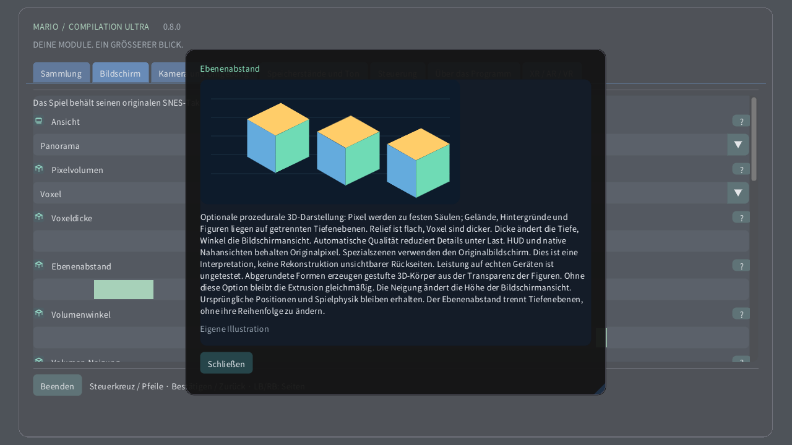

# Pixelvolumen

[English](../en/VOXELS.md) · [Français](../fr/VOXELS.md) · [Español](../es/VOXELS.md) · [日本語](../ja/VOXELS.md) · [Deutsch](../de/VOXELS.md) · [Italiano](../it/VOXELS.md) · [Português](../pt/VOXELS.md) · [Русский](../ru/VOXELS.md) · [简体中文](../zh/VOXELS.md) · [한국어](../ko/VOXELS.md)

Am Computer oder Mobilgerät öffnest du Bildschirm → Pixelvolumen. Probiere zuerst Pixelrelief für dezente Tiefe und dann Voxel. Die Dicke ändert den Pixelkörper; der Abstand trennt Ebenen, ohne ihre Reihenfolge zu ändern. Auf Quest gibt es die Seite Volumen der Raumfernbedienung. Auf der Uhr zoomt die Krone vom ganzen Bereich bis zur Originalansicht.

Optionale prozedurale 3D-Darstellung: Pixel werden zu festen Säulen; Gelände, Hintergründe und Figuren liegen auf getrennten Tiefenebenen. Relief ist flach, Voxel sind dicker. Dicke ändert die Tiefe, Winkel die Bildschirmansicht. Automatische Qualität reduziert Details unter Last. HUD und native Nahansichten behalten Originalpixel. Spezialszenen verwenden den Originalbildschirm. Dies ist eine Interpretation, keine Rekonstruktion unsichtbarer Rückseiten. Leistung auf echten Geräten ist ungetestet. Abgerundete Formen erzeugen gestufte 3D-Körper aus der Transparenz der Figuren. Ohne diese Option bleibt die Extrusion gleichmäßig. Die Neigung ändert die Höhe der Bildschirmansicht. Ursprüngliche Positionen und Spielphysik bleiben erhalten. Der Ebenenabstand trennt Tiefenebenen, ohne ihre Reihenfolge zu ändern.

| Pixelvolumen | |
|---|---|
| 0 | Originales 2D |
| 1 | Pixelrelief |
| 2 | Voxel |

- **Voxeldicke**: 1–16 px
- **Ebenenabstand**: 1–12 px
- **Volumenwinkel**: −30° … +30°
- **Volumen-Neigung**: −30° … +30°
- **Abgerundete Voxelformen**

[Sammlung](README.md) · [Illustrierte Einstellungen](SETTINGS.md) · [HTML](voxels.html) · [Technical research](../VOXEL_RESEARCH.md)
