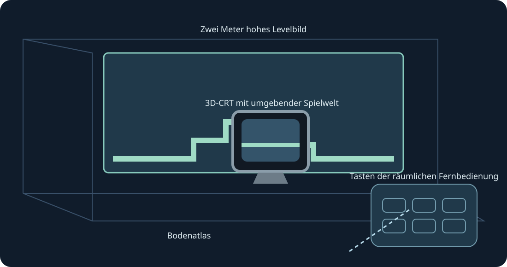

# Mario Compilation Ultra 0.5.0 · Quest VR / AR

[English](../en/XR.md) · [Français](../fr/XR.md) · [Español](../es/XR.md) · [日本語](../ja/XR.md) · [Deutsch](../de/XR.md) · [Italiano](../it/XR.md) · [Português](../pt/XR.md) · [Русский](../ru/XR.md) · [简体中文](../zh/XR.md) · [한국어](../ko/XR.md)

Levelwände, Bodenansicht, Arcade-Tisch, CRT und gebogene Galerie. Experimentelle XR-Vorschau. Beide Griffe skalieren.

Experimentelle XR-Vorschau. Der Nutzer bestätigte die sichtbare 0.4-Sammlung auf Quest 3; übermittelte Frames wurden protokolliert. 0.5 wird separat gebaut und geprüft. Tracking, Komfort, Passthrough, Raumplatzierung und längeres Spielen benötigen echte Gerätetests.

Für den späteren Test Entwicklermodus aktivieren und die öffentliche ARM64-APK mit SideQuest oder adb install -r installieren. Mario Compilation Ultra XR unter Unbekannte Quellen öffnen, eine Cartridge oder ZIP im Systemdialog wählen und starten. All-Stars + World und Yoshi’s Island separat importieren. Die öffentliche APK enthält keine ROMs oder Spielstände.

Räumlicher Bildschirm | An gescannte Wand anpassen | Zwei Meter hohes Levelbild | Bodenatlas | Arcade-Spieltisch | 3D-CRT mit umgebender Spielwelt | Gebogene Levelgalerie

Level, natives CRT, Fernbedienung oder Optionen als Ziel wählen. Ein Griff verschiebt/dreht; zwei skalieren das Level auch bei gesperrter Position. Feinsteuerung und Halbieren/Verdoppeln/Zurücksetzen sind ebenfalls verfügbar. Wiederherstellen holt die Oberfläche zurück. Y öffnet Optionen; die Spielseite enthält alle SNES-Tasten.

Stick mit Pinch ziehen, andere Hand für Tasten. Mittelfinger-Pinch greift Griffe. Trackingverlust löst Eingaben.

Neue Installationen fordern 90 Hz und ein transparentes zwei Meter hohes AR-Wandbild an. Nicht unterstützte Raten fallen zurück; die Simulation behält ihr Originaltempo. Raumscan und Szene-/Ankerrechte sind für automatische Wände optional. Manuelle Platzierung und Bodenkalibrierung bleiben verfügbar. Passthrough liefert die Laufzeit; keine Internet-, Mikrofon- oder Kamerabildrechte.

Geisterbilder sind Hinweise und simulieren keine entfernten Objekte. Geprüfte Positionen können sofort erscheinen; gelernte Bilder stammen nur aus dem lokalen Spiel.

Der Arcade-Tisch zeigt den geladenen Bereich. Physik und Objektaktivierung bleiben original.

PC-Schnellsteuerung: rechten Stick gedrückt halten; Steuerkreuz links/rechts zoomt, oben 1:1, unten ganze Karte, A fixiert, B Originalkamera, X Screenshot, Y Spieler verfolgen. Loslassen stellt SNES-Steuerung wieder her. F1 oder Y-Hilfe im Menü öffnet die bebilderte Erklärung.

SNES: D-pad · A · B · X · Y · L · R · Start · Select

Touch: A → SNES B · B → SNES Y · X → SNES A · RT → SNES X · R3 → Start · LT → Rewind · Y → Optionen bewegen

[HTML](xr.html) · [Guide](README.md) · [Build](../BUILD.md) · [Parity](../PARITY.md) · [Validation](../TEST_REPORT.md)

[Meta developer mode](https://developers.meta.com/vr/documentation/android-apps/enable-developer-mode/) · [Meta refresh API](https://developers.meta.com/vr/documentation/native/android/mobile-display-refresh-rate/) · [Meta passthrough](https://developers.meta.com/vr/documentation/native/android/mobile-passthrough/)
