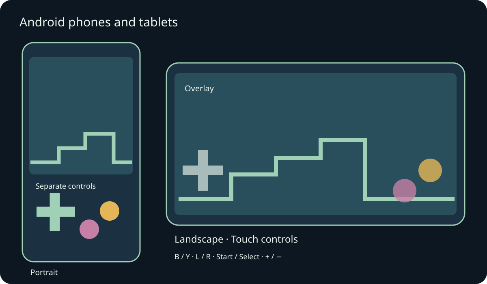
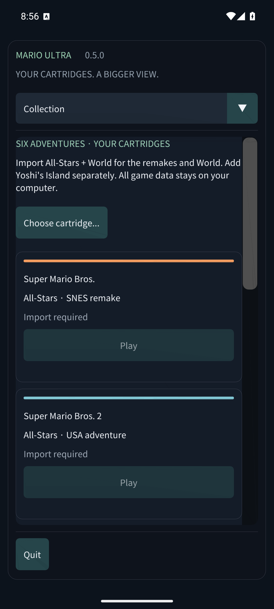

# Mario Compilation Ultra 0.5.0 · Android phones and tablets

[English](../en/MOBILE.md) · [Français](../fr/MOBILE.md) · [Español](../es/MOBILE.md) · [日本語](../ja/MOBILE.md) · [Deutsch](../de/MOBILE.md) · [Italiano](../it/MOBILE.md) · [Português](../pt/MOBILE.md) · [Русский](../ru/MOBILE.md) · [简体中文](../zh/MOBILE.md) · [한국어](../ko/MOBILE.md)

Install the Android phone/tablet APK, then open Mario Compilation Ultra from the launcher. The public GitHub APK asks you to choose your own cartridges; the personal ROM edition is already populated with all six games. The Quest APK is a separate headset application. Android 8 or later and OpenGL ES 3 are required; ARM64, ARMv7 and x86_64 are included.

Rotation and window resizing preserve the current game. Safe areas protect cutouts and system navigation.

Use several fingers to move, run and jump together. A connected gamepad hides automatic touch controls. Android Back opens the menu.

The labels match SNES buttons: use B to jump and Y to run in most Mario games. L, R, Start and Select remain available. View cycles through five picture modes; minus/plus adjust pixel zoom. Hold rewind to travel backwards. Options pauses immediately. Menus scroll with a finger; choose a section from the top list on narrow screens.

- Mobile orientation
- Touch controls
- Touch placement
- Touch button size
- Touch opacity
- Left-handed controls
- Touch vibration
- Keep screen awake while playing

Save slots, rewind and battery saves use app-private storage. Going to the background flushes battery saves and, when enabled, saves resume slot 0. Updating the same signed APK preserves progress. Uninstalling the app or clearing its data removes local cartridges and saves. Settings and save slots are under Saves & sound.

Phone and tablet emulator testing is reported separately from physical hardware. Performance, controller mappings, cutouts and manufacturer window behavior can differ on your device. macOS builds remain experimental and have not been tested on a physical Mac. See the release validation report for exact coverage.

[Android APK](https://github.com/vhaloo/MarioCompilationUltra/releases/download/v0.5.0/MarioCompilationUltra-0.5.0-Android-public.apk) · [HTML](mobile.html) · [Guide](README.md) · [Quest](XR.md) · [Validation](../TEST_REPORT.md)

[Adaptive Android apps](https://developer.android.com/develop/adaptive-apps/guides/support-different-display-sizes) · [16 KiB page sizes](https://developer.android.com/guide/practices/page-sizes)
