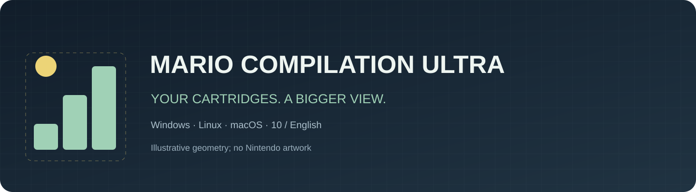
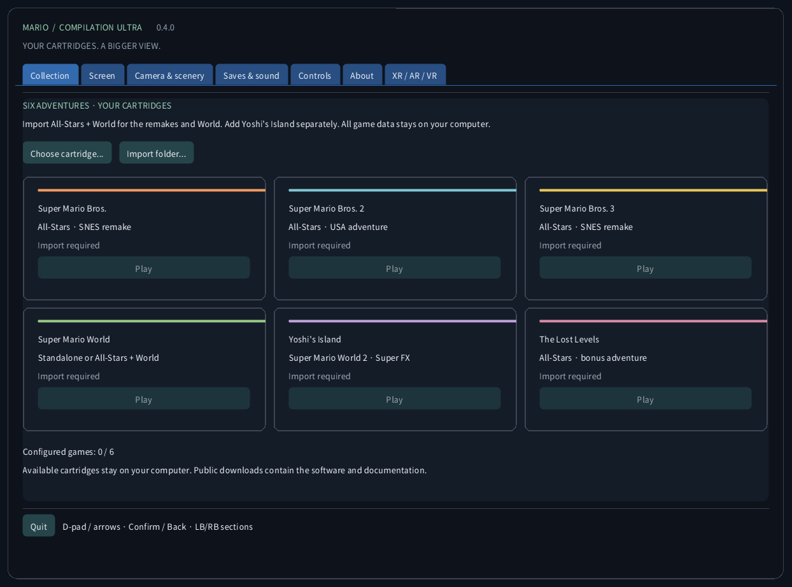
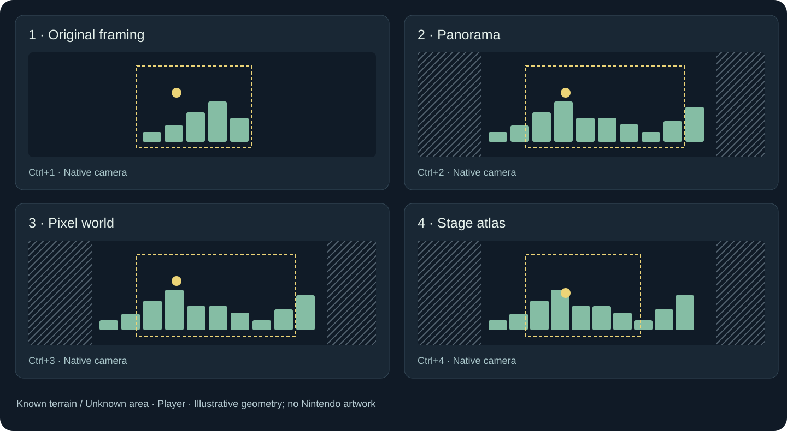
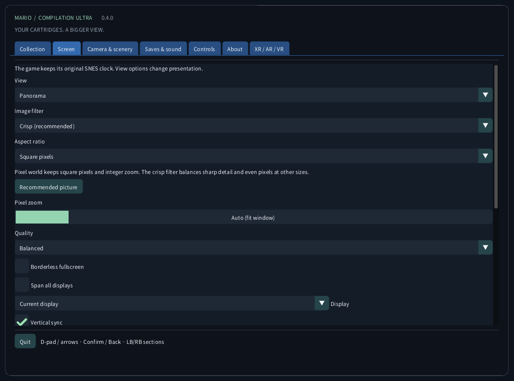
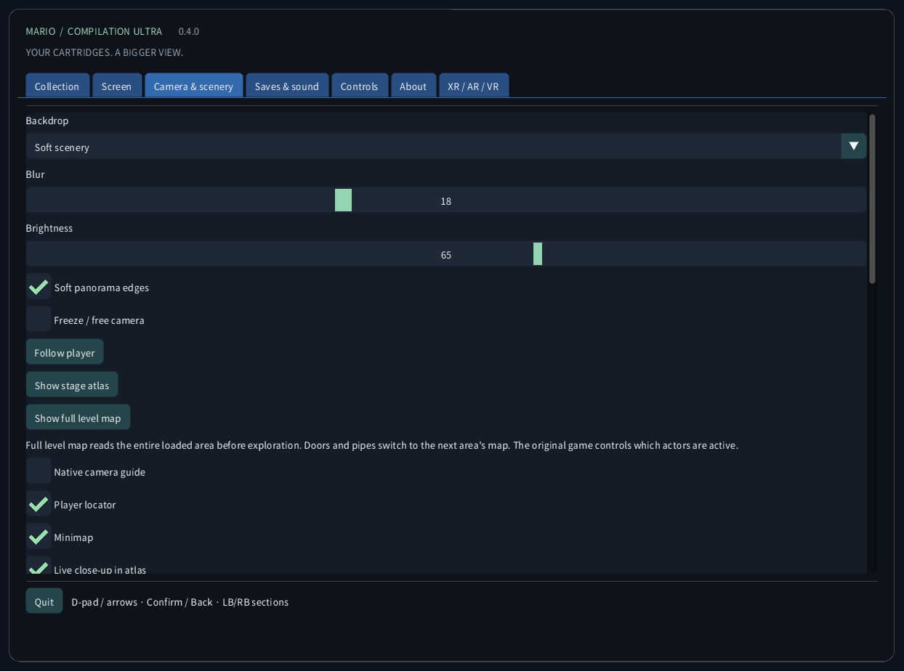
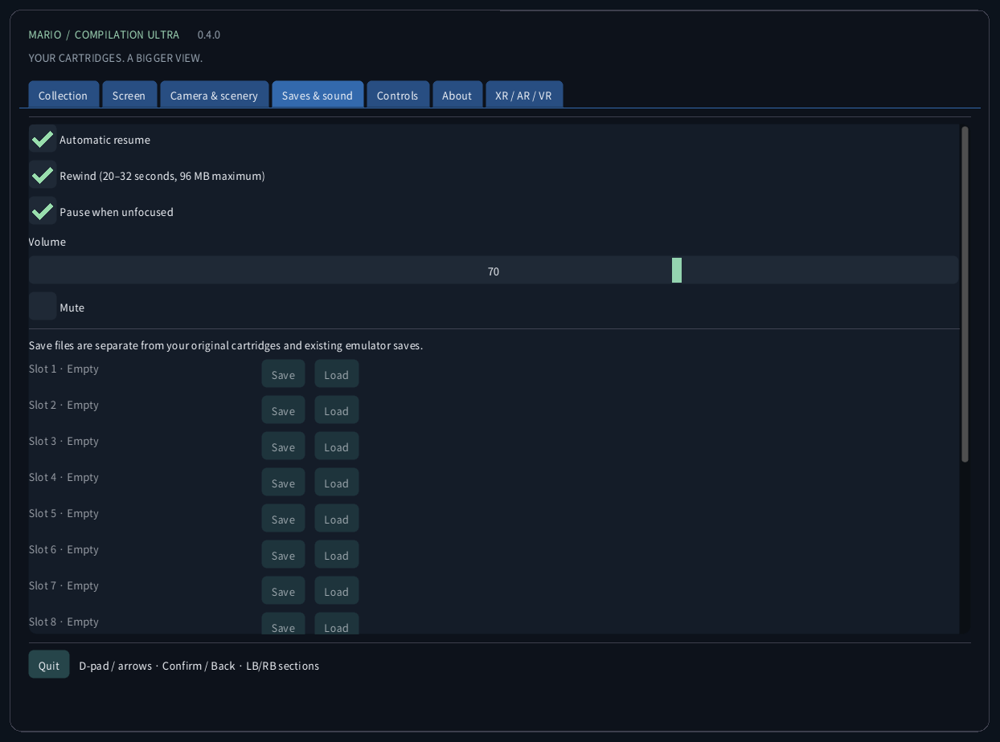
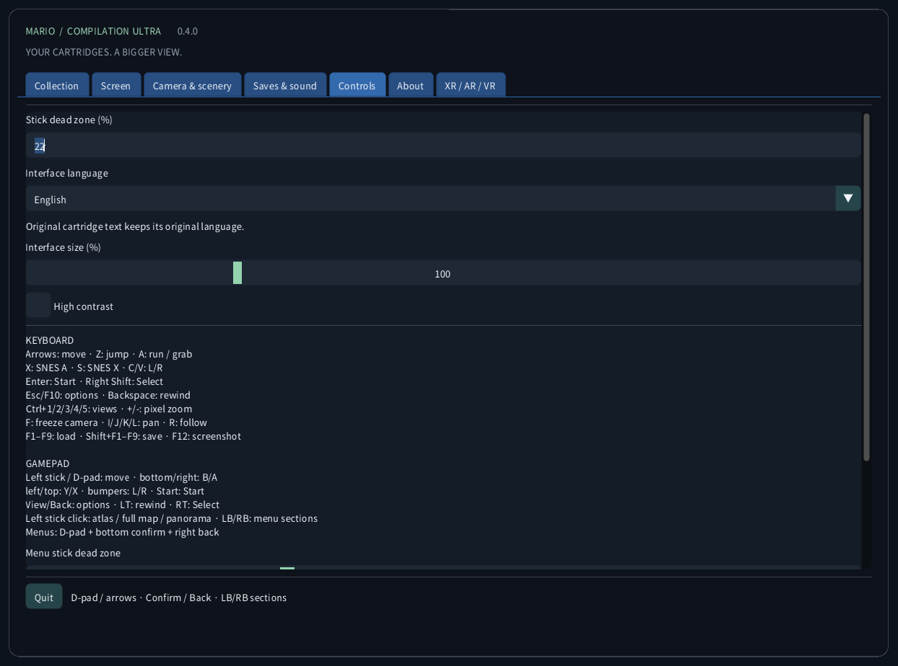
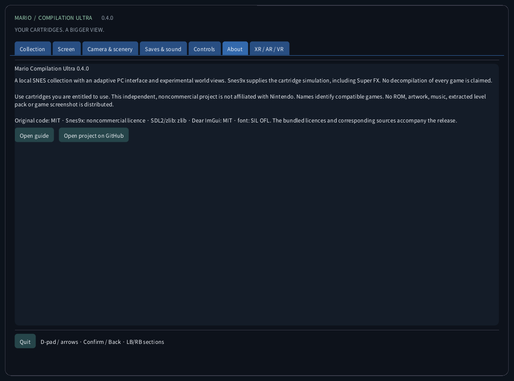
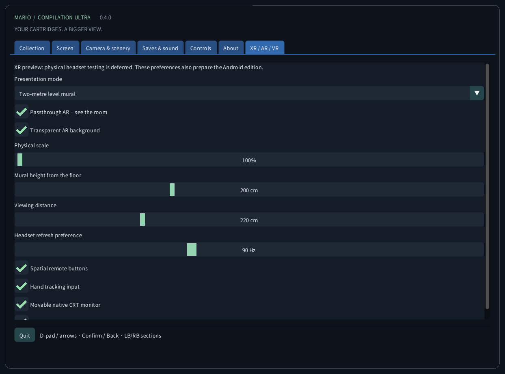

<!-- Generated by tools/guides.py; edit docs/guide-texts.json and assets/locales. -->


[English](../en/README.md) · [Français](../fr/README.md) · [Español](../es/README.md) · [日本語](../ja/README.md) · [Deutsch](../de/README.md) · [Italiano](../it/README.md) · [Português](../pt/README.md) · [Русский](../ru/README.md) · [简体中文](../zh/README.md) · [한국어](../ko/README.md)

# Mario Compilation Ultra 0.4.0

A local SNES collection with an adaptive PC interface and experimental world views. Snes9x supplies the cartridge simulation, including Super FX. No decompilation of every game is claimed.

[Download and desktop startup](https://github.com/vhaloo/MarioCompilationUltra/releases/tag/v0.4.0) · [HTML](guide.html) · [GitHub](https://github.com/vhaloo/MarioCompilationUltra)

## Download and desktop startup

1. Download the package for your computer and extract the entire ZIP. Keep the executable, SDL library, assets and guides together. Windows: open MarioCompilationUltra.exe. Linux: run Play.sh. Mac: open the app.
2. Import your own .sfc, .smc or single-cartridge .zip with Choose cartridge, Import folder, or drag and drop. The file picker opens the app’s local data folder. Compatible cartridges placed directly there are detected at the next launch.
3. All-Stars + Super Mario World supplies Mario Bros. 1, the USA Mario Bros. 2, Mario Bros. 3, World and The Lost Levels. Add Yoshi’s Island separately. Choose Play, then Enter or Start at the original title screen; press again if an attract demo is playing.

Windows: run Install-Windows.ps1 to copy the complete package into your user’s Programs folder and create a desktop shortcut. Linux: run Install-Linux.sh to register this portable folder in the application menu and on the desktop. Mac: move the app to Applications and create a desktop alias. Keep the chosen portable folder in place.

```powershell
# Windows
powershell -NoProfile -ExecutionPolicy Bypass -File .\Install-Windows.ps1
```

```sh
# Linux
sh ./Install-Linux.sh
```



*These screenshots come from the actual application without a loaded cartridge. Diagrams use original illustrative geometry, not game artwork. Public downloads contain no Nintendo ROMs, sprites, music, extracted levels or gameplay captures.*

## Packages and validation

- Windows x64: local desktop launch and cartridge runtime checked; automated tests also run.
- Linux x64: automated build and ROM-free checks. Gameplay on a physical Linux desktop remains untested.
- **macOS Intel x64 and Apple Silicon arm64: EXPERIMENTAL, NOT TESTED ON A PHYSICAL MAC. Automated runner checks cover building and the ROM-free interface. Packages are ad-hoc signed, not notarized; controller, sound, graphics and Gatekeeper remain unverified on real hardware.**

## View modes



Recommended picture: Panorama, Auto zoom, Crisp filter, square pixels, soft edges and a dimmed ambient surround. Use Screen → Recommended picture to apply it without changing language, sound or saves. Nearest and Smooth filters and TV 4:3 are also available. Pixel world always retains square pixels and integer zoom. Scanlines follow game rows and turn off below 2× to avoid moiré.

Full level map (Ctrl+5) shows all decoded terrain in the loaded area from its first playable frame, for all six games. No camera tour is needed. Doors and pipes replace it with the next area's map; disconnected rooms are not stitched together. Mario World includes both terrain planes where present. A player arrow and a live close-up, when there is spare space, help you play. The four existing views remain: Original, Panorama, Pixel world and Stage atlas. The older views in games other than World still accumulate observed terrain. Off-camera actors, moving platforms and special effects retain the original simulation and activation range; the terrain map does not turn them all on. Special arenas without a terrain layout retain their native view. Press the left stick to cycle Stage atlas → Full level map → Panorama.

Expanded memory profiles and automatic All-Stars selection target the listed US editions. A recognized edition without a verified profile uses original framing. Interface translation does not translate the commercial cartridge’s story or graphics. No new native decompilation of all five games is claimed.

| CRC32 | SNES |
|---|---|
| `f84305b1` | All-Stars + World (US) |
| `925637c7` | All-Stars (US) |
| `b19ed489` | Super Mario World (US) |
| `d138f224` | Yoshi’s Island 1.0 (US) |
| `cf98ddaa` | Yoshi’s Island 1.1 (US) |

## Quest VR / AR

[Quest ARM64 APK](https://github.com/vhaloo/MarioCompilationUltra/releases/download/v0.4.0/MarioCompilationUltra-0.4.0-Quest-public.apk) · [Quest VR / AR](XR.md) · [HTML](xr.html) · [Parity](../PARITY.md)

## Controls

KEYBOARD<br>
Arrows: move · Z: jump · A: run / grab<br>
X: SNES A · S: SNES X · C/V: L/R<br>
Enter: Start · Right Shift: Select<br>
Esc/F10: options · Backspace: rewind<br>
Ctrl+1/2/3/4/5: views · +/-: pixel zoom<br>
F: freeze camera · I/J/K/L: pan · R: follow<br>
F1–F9: load · Shift+F1–F9: save · F12: screenshot<br>
<br>
GAMEPAD<br>
Left stick / D-pad: move · bottom/right: B/A<br>
left/top: Y/X · bumpers: L/R · Start: Start<br>
View/Back: options · LT: rewind · RT: Select<br>
Left stick click: atlas / full map / panorama · LB/RB: menu sections<br>
Menus: D-pad + bottom confirm + right back

## Saves & sound

Nine manual slots per game, automatic resume, battery SRAM and a bounded rewind history are available. Rewind uses at most 96 MiB for roughly 20–32 seconds. F1–F9 load; Shift+F1–F9 save. States are checked against cartridge CRC, engine version and integrity. Your other emulators’ saves are kept separate.

## Local files

This folder contains settings.ini, local cartridge references, states/, saves/ and screenshots/. Imports do not upload your cartridge or modify the original file. Back up this folder before moving computers. Save states depend on the exact cartridge and engine; battery SRAM is a separate file.

| OS | Local cartridge folder |
|---|---|
| Windows | `%APPDATA%/ValentinWittwe/MarioCompilationUltra/` |
| Linux | `$XDG_DATA_HOME/ValentinWittwe/MarioCompilationUltra/` or `~/.local/share/ValentinWittwe/MarioCompilationUltra/` |
| macOS | `~/Library/Application Support/ValentinWittwe/MarioCompilationUltra/` |

An explicit --data-dir folder overrides this default. Windows shortcut updates preserve that option. The Local files page shows the folder actually used by your running app.

## If a game still asks for importing

Choose cartridge again if its file was moved or a drive is disconnected. ZIPs must contain one .sfc or .smc and use stored or DEFLATE compression without encryption. Check the supported header/edition list. A missing font or SDL library usually means only the executable was extracted; extract the complete package again.

## Real interface gallery

### Collection


### Screen



### Camera & scenery



### Saves & sound



### Controls



### About



### Quest VR / AR



## Packages and validation · 0.4.0

Five automated suites check original fixtures, menus, spatial interaction and rendering. The ten-language interface is captured at four sizes. Six locally supplied games are checked separately. Quest AR/VR and physical macOS gameplay remain experimental and untested. See the versioned validation report for scope.

[CTest / CI](https://github.com/vhaloo/MarioCompilationUltra/actions) · [Report](../TEST_REPORT.md) · [Build](../BUILD.md) · [Source / research](../RESEARCH.md)

Use cartridges you are entitled to use. This independent, noncommercial project is not affiliated with Nintendo. Names identify compatible games. No ROM, artwork, music, extracted level pack or game screenshot is distributed.

Original code: MIT · Snes9x: noncommercial licence · SDL2/zlib: zlib · Dear ImGui: MIT · font: SIL OFL. The bundled licences and corresponding sources accompany the release.

[Licence](../../LICENSE) · [Third-party notices](../../THIRD_PARTY_NOTICES.md)
