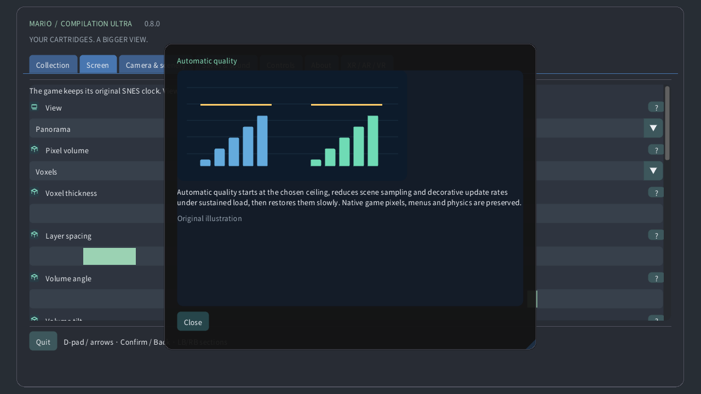

# Illustrated settings

## Collection

Choose a local cartridge, start a game or open its guide. Public downloads never include the games or your saves.

## View

Original keeps the console screen. Panorama extends it. Atlas fits available terrain; Full level map reads the entire loaded area where its decoder is supported, including unexplored terrain. Doors can load another area.

## Camera & scenery

Choose what the view follows: the original camera, the player or a fixed position. This changes the view, without moving the character or activating distant enemies.

## Watch zoom

Zoom changes how much of the area fits on screen. On a watch, 0% shows the complete loaded map and 100% reaches the original camera. Game speed stays unchanged.

## Round-screen fisheye

On a round watch, the lens bends the whole game rectangle into a circle. Source edges remain visible. Controls and text stay flat; switch it off for an undistorted rectangle.

## Crown sensitivity

A detected crown or rotating bezel controls zoom during play and scrolls menus. Sensitivity changes each turn’s effect; Reverse swaps directions. Touch zoom works without a crown.

## Image filter

Nearest preserves hard pixel edges. Crisp keeps them sharp at uneven sizes. Smooth softens enlargement. The source image and collision rules remain unchanged.

## Aspect ratio

Square pixels use the source pixel shape; TV 4:3 reproduces a television-shaped picture. Pixel world keeps square pixels and whole-pixel zoom.

## Automatic quality

Automatic quality starts at the chosen ceiling, reduces scene sampling and decorative update rates under sustained load, then restores them slowly. Native game pixels, menus and physics are preserved.

## Performance reserve

Reserve keeps part of each frame budget free for unexpected work. A larger reserve favors smoothness. Extra smooth uses 40%; Quest reserves at least 35%. Quality can recover when there is room.

## React to device heat

Android’s local heat status can lower decorative detail before overheating grows. No temperature permission or network is needed. The operating system still controls real clocks and refresh rate.

## Vertical sync

Vsync follows the display to reduce tearing. The game keeps its original clock. Quest uses its selected headset rate; the performance reserve is measured against that rate.

## VR shader

Efficient CRT keeps the retro look with cheaper calculations. Automatic starts efficient and permits the reference only after sustained measured GPU headroom. Reference forces the more expensive calculation.

## Screen

Select the window, display or fullscreen behavior. These options change where the picture appears, without changing the loaded level or its saves.

## Backdrop

The backdrop fills empty space around the game. Soft scenery uses sampled game colors; Midnight and Black are quieter choices. Blur and brightness affect this surround.

## Blur

Blur softens the surrounding scenery; brightness controls its light level. Neither changes the native game image. Automatic quality may refresh this decoration less often under load.

## Soft panorama edges

Soft edges blend the expanded scene into the surround near the original camera. Turn them off for a harder seam. Full level maps retain their own complete framing.

## Player locator

The locator marks the player; the guide outlines the original camera; the minimap shows its position in the area. A close-up keeps the native screen readable when the map is far away.

## Preview placed enemies

Previews show verified placements or locally observed appearances. Faded objects and outlines are guides, not extra active enemies. Opacity and labels change their visibility.

## Display status

Choose the corner, size, opacity and duration of control reminders. Zero timeout keeps a reminder visible. These overlays do not change the game or its camera.

## Language

Adjust menu language, size or contrast for comfortable reading. The illustrated guides are available offline. Game rendering and cartridge language are independent.

## Controls

Choose button mapping and stick dead zones. A larger dead zone ignores more small movement. Quick controls add camera shortcuts; normal game actions remain available.

## Touch controls

Touch buttons support simultaneous fingers. Automatic shows them when no gamepad is attached. Placement, size, opacity and handedness change the controls, not game physics.

## Rewind

Hold the selected rewind control to move through recent exact snapshots. History depends on memory and the cartridge. Reverse audio and the indicator are optional; disk saves remain separate.

## Saves & sound

A save slot stores the current machine state. Load returns to it; automatic resume uses its own slot. Battery progress is separate. Replacing a slot requires confirmation.

## Volume

Volume and mute control local playback. They do not change game speed or erase saves. Rewind audio is adjusted separately.

## Pause when unfocused

Pause releases held controls. Focus and tracking options decide when play pauses automatically. Returning or resuming keeps the current game; quitting flushes battery progress.

## Presentation mode

Choose a floating screen, wall, floor atlas, arcade table, CRT room or curved screen. The same game continues; each mode changes only its spatial presentation.

## Viewing distance

Size, distance, height, tilt and gap place the virtual object in your room. Values use the displayed units. Recenter brings it back into reach without restarting the game.

## Screen anchoring

Automatic wall placement uses permitted scene data when available. A locked or saved placement keeps the chosen location. Tracking loss can pause play; manual placement remains available.

## Use Quest Touch controls

The virtual remote, hands and direct touch operate the same game controls. Size and hints affect their usability. Haptic strength changes feedback, without changing button timing.

## Movable native CRT monitor

CRT controls add scanlines, RGB mask, curved glass and reflections. More strength is a visual choice, not new game detail. Automatic quality can simplify expensive decoration under pressure.

## VR surroundings

Passthrough shows your real room; the virtual environment supplies a backdrop when it is off. Transparency, surrounding scenery and brightness change what surrounds the game.

## Adaptive peripheral detail

Canvas detail and eye detail set quality ceilings for different layers. Automatic quality scales both when needed. The independent menu layer stays sharp; peripheral foveation is optional when supported.

## Illustrated setting help

Use the question mark for an illustrated explanation. Mouse hover and controller focus show a quick preview; touch can open the full card. Illustrations are original examples, not cartridge screenshots.

## Manual quality

Manual quality disables the automatic governor and keeps your chosen detail ceiling. Select Automatic quality to restore adaptation, or Extra smooth for a larger performance reserve.

## Adaptive peripheral detail

On compatible Quest runtimes, sustained load can reduce peripheral eye-image detail while retaining the center. Menus use a separate sharp layer. Unsupported devices fall back automatically. Physical headset quality remains untested.

## Pixel volume

Optional procedural 3D: pixels become solid columns, with terrain, backgrounds and sprites on separate depth bands. Relief is shallow; voxels are thicker. Thickness changes depth, angle changes the desktop view. Automatic quality reduces grid and raster detail under load. HUD and native close-ups keep original pixels. Special scenes fall back to the original screen. This is an interpretation, not a reconstruction of unseen object backs. Physical-device performance remains untested. Rounded shapes generate stepped 3D bodies from sprite transparency; disabling them makes uniform extrusions. Tilt changes the elevation of the screen view. Original positions and game physics stay unchanged. Layer spacing separates depth bands while preserving their order.

[Guide](README.md) · [Watch](WATCH.md)
