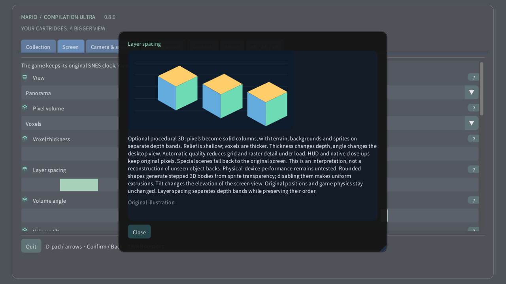

# Pixel volume

[English](../en/VOXELS.md) · [Français](../fr/VOXELS.md) · [Español](../es/VOXELS.md) · [日本語](../ja/VOXELS.md) · [Deutsch](../de/VOXELS.md) · [Italiano](../it/VOXELS.md) · [Português](../pt/VOXELS.md) · [Русский](../ru/VOXELS.md) · [简体中文](../zh/VOXELS.md) · [한국어](../ko/VOXELS.md)

On a computer or handheld, open Screen → Pixel volume. Start with Pixel relief for subtle depth, then try Voxels. Thickness changes the body of each pixel; spacing moves the layers apart without changing their draw order. On Quest, use the Volume page of the spatial remote. On a watch, the crown still zooms from the entire area to the original screen at its closest position.

Optional procedural 3D: pixels become solid columns, with terrain, backgrounds and sprites on separate depth bands. Relief is shallow; voxels are thicker. Thickness changes depth, angle changes the desktop view. Automatic quality reduces grid and raster detail under load. HUD and native close-ups keep original pixels. Special scenes fall back to the original screen. This is an interpretation, not a reconstruction of unseen object backs. Physical-device performance remains untested. Rounded shapes generate stepped 3D bodies from sprite transparency; disabling them makes uniform extrusions. Tilt changes the elevation of the screen view. Original positions and game physics stay unchanged. Layer spacing separates depth bands while preserving their order.

| Pixel volume | |
|---|---|
| 0 | Original 2D |
| 1 | Pixel relief |
| 2 | Voxels |

- **Voxel thickness**: 1–16 px
- **Layer spacing**: 1–12 px
- **Volume angle**: −30° … +30°
- **Volume tilt**: −30° … +30°
- **Rounded voxel shapes**

[Collection](README.md) · [Illustrated settings](SETTINGS.md) · [HTML](voxels.html) · [Technical research](../VOXEL_RESEARCH.md)
