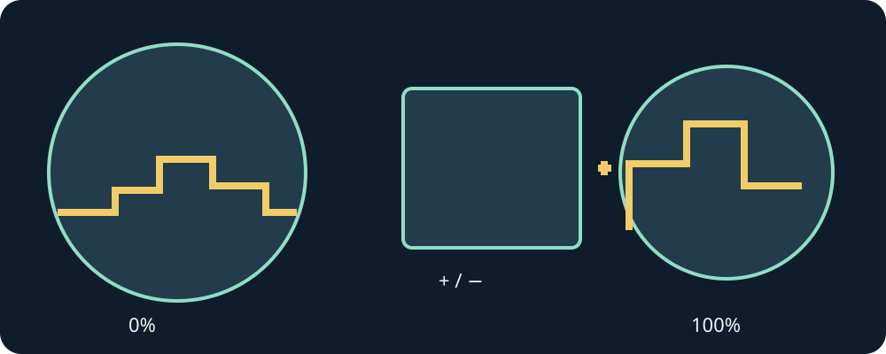
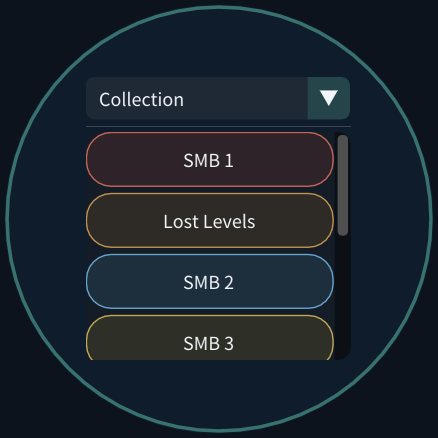

# Mario Compilation Ultra 0.12.2 · Watch view

[English](../en/WATCH.md) · [Français](../fr/WATCH.md) · [Español](../es/WATCH.md) · [日本語](../ja/WATCH.md) · [Deutsch](../de/WATCH.md) · [Italiano](../it/WATCH.md) · [Português](../pt/WATCH.md) · [Русский](../ru/WATCH.md) · [简体中文](../zh/WATCH.md) · [한국어](../ko/WATCH.md)



Turn the crown or bezel to zoom. In menus it scrolls; touch + and - also work.

0%: whole loaded area. 100%: original camera. Doors and pipes may load another area.

Turn the crown to zoom in. From 85% to 100% the image stays flat. Zoom out for a gentle curve, curved edges with a flatter center, or a fisheye. Choose Flat for straight lines at every zoom.

In most games, B jumps and Y runs or grabs. Hold direction and action buttons with different fingers.

Pause with the pause icon or Android Back. Resume keeps your game. Quit is at the bottom of Collection.

A personal package includes your local cartridges. Public packages need your own compatible cartridge files.

Transfer cartridges to CartridgeInbox, then choose Check transferred cartridges or restart the app. Existing files are preserved.

Updating a signed APK preserves app data. Uninstalling or clearing app data removes local cartridges and saves.

Watch tests use touch and rotary input events on a Galaxy Watch8 Classic. Comfort and long-session performance still need evaluation.



```text
/sdcard/Android/data/com.vhaloo.mariocompilationultra.wear/files/CartridgeInbox/

adb install -r MarioCompilationUltra-0.12.2-Wear-public.apk
adb push cartridge.sfc /sdcard/Android/data/com.vhaloo.mariocompilationultra.wear/files/CartridgeInbox/
```

[Wear APK](https://github.com/vhaloo/MarioCompilationUltra/releases/download/v0.12.2/MarioCompilationUltra-0.12.2-Wear-public.apk) · [HTML](watch.html) · [Illustrated settings](SETTINGS.md) · [Guide](README.md)
