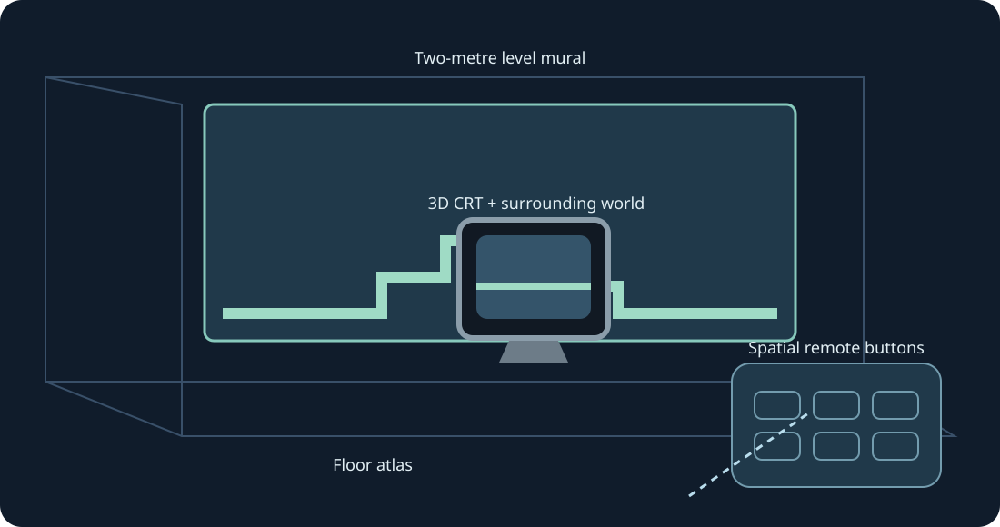

# Mario Compilation Ultra 0.5.0 · Quest VR / AR

[English](../en/XR.md) · [Français](../fr/XR.md) · [Español](../es/XR.md) · [日本語](../ja/XR.md) · [Deutsch](../de/XR.md) · [Italiano](../it/XR.md) · [Português](../pt/XR.md) · [Русский](../ru/XR.md) · [简体中文](../zh/XR.md) · [한국어](../ko/XR.md)

Whole-level walls, floor views, arcade tables, CRTs and curved galleries. Experimental XR preview; use both grips to resize.

Experimental XR preview. The user confirmed that the 0.4 collection is visible on a Quest 3 after installation; runtime frame submission was logged. The 0.5 build is compiled and checked separately. Tracking, comfort, passthrough, room placement and sustained gameplay still need physical testing.

For a later test, enable developer mode and install the public ARM64 APK with SideQuest or adb install -r. Open Mario Compilation Ultra XR in Unknown Sources, choose a cartridge or ZIP using the system picker, then Play. Import All-Stars + World and Yoshi’s Island separately. Public APKs contain no ROMs or progress.

Spatial screen | Fit a scanned wall | Two-metre level mural | Floor atlas | Arcade table | 3D CRT + surrounding world | Curved level gallery

Select the level, native CRT, remote or options as the placement target. One grip moves/rotates it; two grips resize the level even while position is locked. Use the remote’s fine controls or half/double/reset actions as alternatives. Recover brings the interface back nearby. Y opens options; the Play page has all SNES buttons.

Pinch and drag the stick; use the other hand for buttons. Middle-finger pinch grabs handles. Tracking lost: controls release.

New Quest data requests 90 Hz and a transparent two-metre AR mural. Supported refresh falls back when unavailable; native simulation speed is unchanged. Scene/anchor permissions and a room scan are optional for automatic walls. Manual placement and floor calibration remain available. Passthrough is supplied by the runtime; the app requests no Internet, microphone or camera-image permission.

Ghost images are informative and do not simulate distant objects. Verified placements can appear at entry; learned pictures come only from your local game.

The arcade table shows the loaded area. Original cartridge physics and object activation remain unchanged.

Desktop quick controls: hold right-stick click, then D-pad left/right for zoom, up for 1:1, down for the whole map, A to freeze, B for the original camera, X for a screenshot, Y to follow the player. Releasing the modifier restores normal SNES controls. F1 or the menu’s Y help opens an illustrated setting explanation.

SNES: D-pad · A · B · X · Y · L · R · Start · Select

Touch: A → SNES B · B → SNES Y · X → SNES A · RT → SNES X · R3 → Start · LT → Rewind · Y → Move options

[HTML](xr.html) · [Guide](README.md) · [Build](../BUILD.md) · [Parity](../PARITY.md) · [Validation](../TEST_REPORT.md)

[Meta developer mode](https://developers.meta.com/vr/documentation/android-apps/enable-developer-mode/) · [Meta refresh API](https://developers.meta.com/vr/documentation/native/android/mobile-display-refresh-rate/) · [Meta passthrough](https://developers.meta.com/vr/documentation/native/android/mobile-passthrough/)
