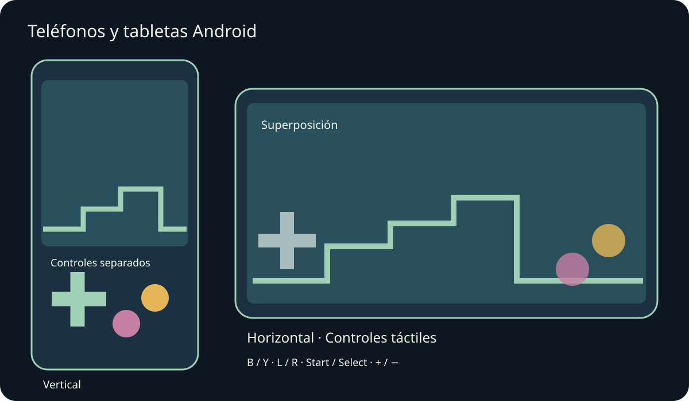
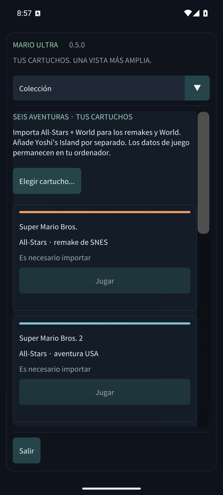

# Mario Compilation Ultra 0.5.0 · Teléfonos y tabletas Android

[English](../en/MOBILE.md) · [Français](../fr/MOBILE.md) · [Español](../es/MOBILE.md) · [日本語](../ja/MOBILE.md) · [Deutsch](../de/MOBILE.md) · [Italiano](../it/MOBILE.md) · [Português](../pt/MOBILE.md) · [Русский](../ru/MOBILE.md) · [简体中文](../zh/MOBILE.md) · [한국어](../ko/MOBILE.md)

Instala el APK para teléfonos y tabletas Android y abre Mario Compilation Ultra. El APK público de GitHub pide tus cartuchos; la edición personal con ROMs ya incluye los seis juegos. El APK Quest es una aplicación distinta para el visor. Requiere Android 8 o posterior y OpenGL ES 3; incluye ARM64, ARMv7 y x86_64.

La rotación y el cambio de tamaño conservan la partida. Los márgenes protegen recortes y navegación del sistema.

Usa varios dedos para moverte, correr y saltar a la vez. Un mando conectado oculta los controles táctiles automáticos. Atrás de Android abre el menú.

Las letras corresponden a SNES: B salta e Y corre en la mayoría de Mario. L, R, Start y Select siguen disponibles. Vista recorre cinco modos; menos/más ajustan el zoom. Mantén rebobinar para retroceder. Opciones pausa inmediatamente. Desliza los menús; en pantallas estrechas elige sección en la lista superior.

- Orientación móvil
- Controles táctiles
- Distribución táctil
- Tamaño de botones táctiles
- Opacidad de controles táctiles
- Controles para zurdos
- Vibración táctil
- Mantener la pantalla encendida al jugar

Los estados, el rebobinado y las partidas usan almacenamiento privado. Al pasar a segundo plano se guarda la batería y, si está activado, el estado de reanudación 0. Actualizar con la misma firma conserva el progreso. Desinstalar o borrar datos elimina cartuchos y partidas locales. Los estados están en Partidas y sonido.

Las pruebas de emuladores de teléfono y tableta se distinguen del hardware físico. Rendimiento, mandos, recortes y ventanas pueden variar según el dispositivo. macOS sigue siendo experimental y no se ha probado en un Mac físico. Consulta la cobertura exacta en el informe.

[Android APK](https://github.com/vhaloo/MarioCompilationUltra/releases/download/v0.5.0/MarioCompilationUltra-0.5.0-Android-public.apk) · [HTML](mobile.html) · [Guide](README.md) · [Quest](XR.md) · [Validation](../TEST_REPORT.md)

[Adaptive Android apps](https://developer.android.com/develop/adaptive-apps/guides/support-different-display-sizes) · [16 KiB page sizes](https://developer.android.com/guide/practices/page-sizes)
