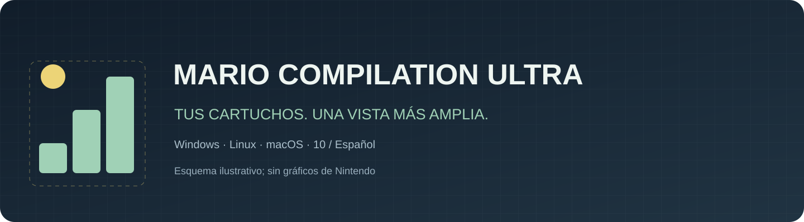
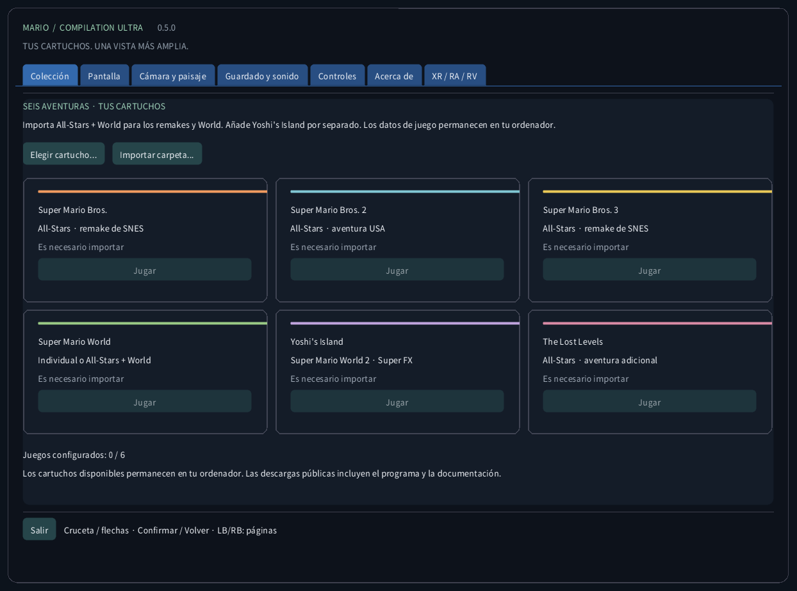
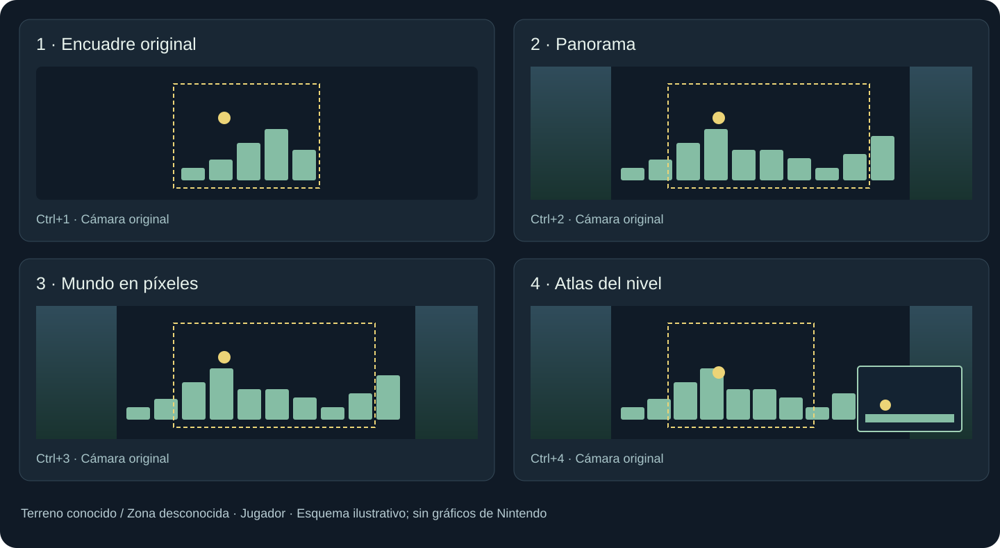
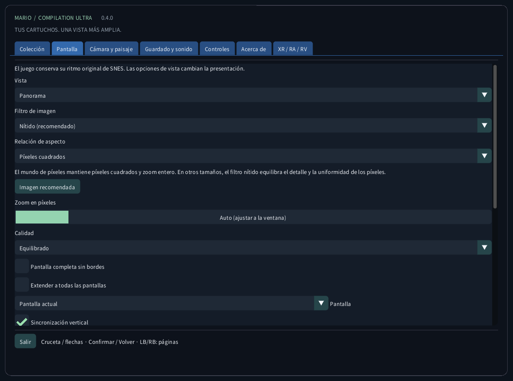
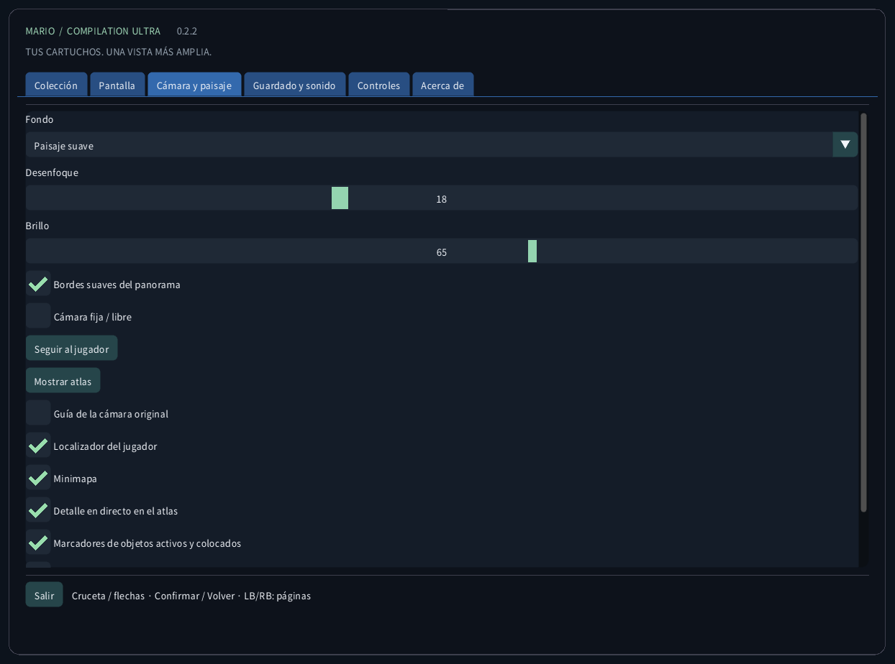
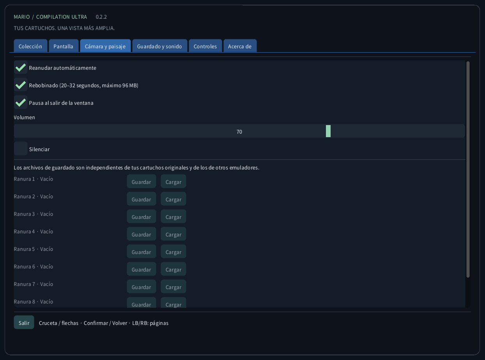
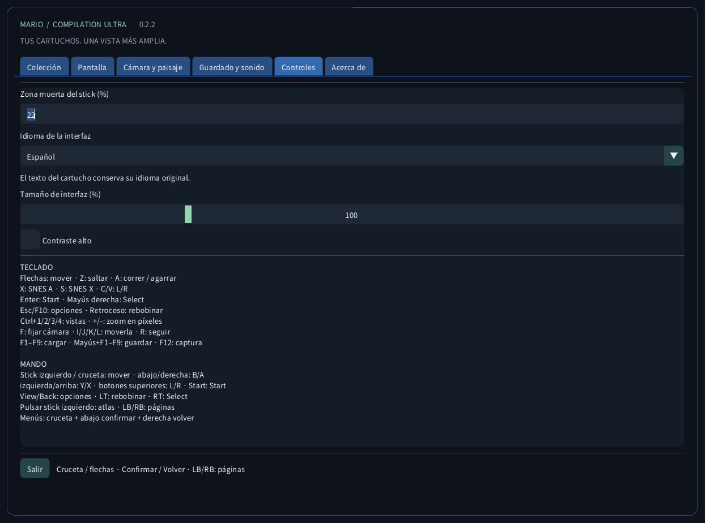
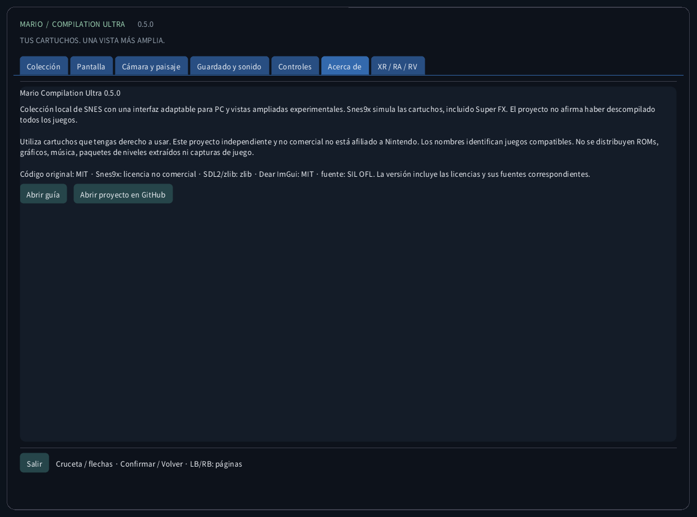

<!-- Generated by tools/guides.py; edit docs/guide-texts.json and assets/locales. -->


[English](../en/README.md) · [Français](../fr/README.md) · [Español](../es/README.md) · [日本語](../ja/README.md) · [Deutsch](../de/README.md) · [Italiano](../it/README.md) · [Português](../pt/README.md) · [Русский](../ru/README.md) · [简体中文](../zh/README.md) · [한국어](../ko/README.md)

# Mario Compilation Ultra 0.3.0

Colección local de SNES con una interfaz adaptable para PC y vistas ampliadas experimentales. Snes9x simula las cartuchos, incluido Super FX. El proyecto no afirma haber descompilado todos los juegos.

[Descarga e inicio desde el escritorio](https://github.com/vhaloo/MarioCompilationUltra/releases/tag/v0.3.0) · [HTML](guide.html) · [GitHub](https://github.com/vhaloo/MarioCompilationUltra)

## Descarga e inicio desde el escritorio

1. Descarga el paquete para tu ordenador y extrae todo el ZIP. Mantén juntos el ejecutable, SDL, los recursos y las guías. Windows: abre MarioCompilationUltra.exe. Linux: ejecuta Play.sh. Mac: abre la aplicación.
2. Importa tus archivos .sfc, .smc o ZIP de un solo cartucho con Elegir cartucho, Importar carpeta o arrastrar y soltar. El selector abre la carpeta de datos de la aplicación. Los cartuchos compatibles colocados allí se detectan al volver a iniciar.
3. All-Stars + Super Mario World incluye Mario Bros. 1, Mario Bros. 2 USA, Mario Bros. 3, World y The Lost Levels. Añade Yoshi’s Island por separado. Elige Jugar y pulsa Enter o Start en el título original; vuelve a pulsar si hay una demo.

Windows: ejecuta Install-Windows.ps1 para copiar el paquete completo a Programs de tu usuario y crear el acceso directo. Linux: ejecuta Install-Linux.sh para registrar esta carpeta en el menú y escritorio. Mac: mueve la app a Aplicaciones y crea un alias. Conserva la carpeta portátil elegida.

```powershell
# Windows
powershell -NoProfile -ExecutionPolicy Bypass -File .\Install-Windows.ps1
```

```sh
# Linux
sh ./Install-Linux.sh
```



*Las capturas provienen de la aplicación real sin cartucho. Los diagramas usan geometría original ilustrativa, no gráficos del juego. Las descargas públicas no contienen ROMs Nintendo, sprites, música, niveles extraídos ni capturas de partidas.*

## Paquetes y validación

- Windows x64: inicio local desde escritorio y ejecución de cartuchos comprobados; también hay pruebas automáticas.
- Linux x64: compilación y pruebas sin ROM automáticas. Juego en un escritorio Linux físico no probado.
- **macOS Intel x64 y Apple Silicon arm64: EXPERIMENTAL, NO PROBADO EN UN MAC FÍSICO. Las pruebas automáticas cubren compilación e interfaz sin ROM. Firma ad hoc, sin notarización; mando, sonido, gráficos y Gatekeeper siguen sin verificar en hardware real.**

## Modos de vista



Imagen recomendada: Panorama, zoom Auto, filtro Nítido, píxeles cuadrados, bordes suaves y fondo ambiental atenuado. Pantalla → Imagen recomendada aplica estos ajustes sin cambiar idioma, sonido ni partidas. También hay filtros Píxeles exactos y Suave y formato Televisión 4:3. Mundo de píxeles mantiene zoom entero y píxeles cuadrados. Las líneas siguen las filas del juego y se desactivan bajo 2× para evitar muaré.

Mapa completo (Ctrl+5) muestra todo el terreno del área cargada desde el primer fotograma jugable en los seis juegos, sin recorrerla. Las puertas y tuberías cambian de mapa; las salas separadas no se unen. Mario World incluye ambos planos de terreno. Una flecha señala al jugador y aparece una vista cercana si hay espacio. Se conservan las cuatro vistas anteriores; fuera de World, estas acumulan terreno observado. Personajes, plataformas móviles y efectos mantienen su simulación y alcance de activación originales. Las arenas especiales sin mapa de terreno conservan la vista nativa. Pulsa el stick izquierdo: Atlas → Mapa completo → Panorama.

Los perfiles de memoria ampliados y la selección automática All-Stars usan las ediciones estadounidenses indicadas. Una edición reconocida sin perfil verificado usa el encuadre original. La traducción de interfaz no traduce la historia ni los gráficos del cartucho comercial. No se afirma una nueva descompilación nativa de los cinco juegos.

| CRC32 | SNES |
|---|---|
| `f84305b1` | All-Stars + World (US) |
| `925637c7` | All-Stars (US) |
| `b19ed489` | Super Mario World (US) |
| `d138f224` | Yoshi’s Island 1.0 (US) |
| `cf98ddaa` | Yoshi’s Island 1.1 (US) |

## Controles

TECLADO<br>
Flechas: mover · Z: saltar · A: correr / agarrar<br>
X: SNES A · S: SNES X · C/V: L/R<br>
Enter: Start · Mayús derecha: Select<br>
Esc/F10: opciones · Retroceso: rebobinar<br>
Ctrl+1/2/3/4/5: vistas · +/-: zoom en píxeles<br>
F: fijar cámara · I/J/K/L: moverla · R: seguir<br>
F1–F9: cargar · Mayús+F1–F9: guardar · F12: captura<br>
<br>
MANDO<br>
Stick izquierdo / cruceta: mover · abajo/derecha: B/A<br>
izquierda/arriba: Y/X · botones superiores: L/R · Start: Start<br>
View/Back: opciones · LT: rebobinar · RT: Select<br>
Clic stick izquierdo: atlas / mapa completo / panorama · LB/RB: secciones<br>
Menús: cruceta + abajo confirmar + derecha volver

## Guardado y sonido

Cada juego tiene nueve ranuras, reanudación automática, SRAM y rebobinado limitado. Usa hasta 96 MiB para unos 20–32 segundos. F1–F9 cargan; Shift+F1–F9 guardan. Se comprueban CRC, versión del motor e integridad. Los guardados de otros emuladores quedan separados.

## Archivos locales

Esta carpeta contiene settings.ini, referencias a cartuchos, states/, saves/ y screenshots/. Importar no sube el cartucho ni modifica el original. Haz una copia antes de cambiar de ordenador. Los estados dependen del cartucho y motor exactos; SRAM es un archivo separado.

| OS | Carpeta local de cartuchos |
|---|---|
| Windows | `%APPDATA%/ValentinWittwe/MarioCompilationUltra/` |
| Linux | `$XDG_DATA_HOME/ValentinWittwe/MarioCompilationUltra/` or `~/.local/share/ValentinWittwe/MarioCompilationUltra/` |
| macOS | `~/Library/Application Support/ValentinWittwe/MarioCompilationUltra/` |

La opción --data-dir sustituye esta ruta. Al actualizar el acceso directo de Windows se conserva esa opción. Archivos locales muestra la carpeta utilizada.

## Si un juego aún pide importar

Vuelve a elegir el cartucho si moviste el archivo o desconectaste la unidad. El ZIP debe contener un solo .sfc o .smc sin cifrar y usar almacenamiento o DEFLATE. Comprueba la lista de ediciones y cabeceras. Si faltan fuente o SDL, extrae nuevamente el paquete completo.

## Galería de la interfaz real

### Colección


### Pantalla



### Cámara y paisaje



### Guardado y sonido



### Controles



### Acerca de



## Paquetes y validación · 0.3.0

Las pruebas públicas cubren 156 comprobaciones en cuatro suites, 179 mensajes por idioma, fuentes y 240 capturas reales. Las pruebas privadas abarcan seis juegos, mapas desde el primer fotograma, geometría horizontal y vertical, 105 áreas clásicas, 115 de Mario 2, 210 salas de Mario 3, 1.024 entradas World en dos ediciones y 222 entradas Yoshi. Son pruebas limitadas de carga, geometría, píxeles y funciones, no campañas completas. Botones físicos, audio audible y juego en Linux/Mac físicos siguen sin verificar. Consulta el informe.

[CTest / CI](https://github.com/vhaloo/MarioCompilationUltra/actions) · [Report](../TEST_REPORT.md) · [Build](../BUILD.md) · [Source / research](../RESEARCH.md)

Utiliza cartuchos que tengas derecho a usar. Este proyecto independiente y no comercial no está afiliado a Nintendo. Los nombres identifican juegos compatibles. No se distribuyen ROMs, gráficos, música, paquetes de niveles extraídos ni capturas de juego.

Código original: MIT · Snes9x: licencia no comercial · SDL2/zlib: zlib · Dear ImGui: MIT · fuente: SIL OFL. La versión incluye las licencias y sus fuentes correspondientes.

[Licence](../../LICENSE) · [Third-party notices](../../THIRD_PARTY_NOTICES.md)
