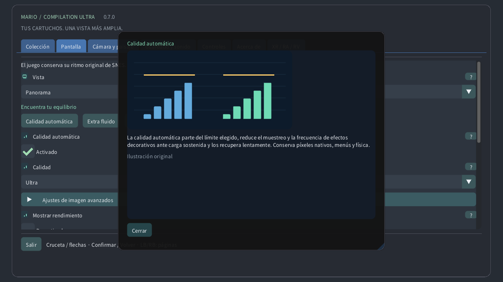

# Ajustes ilustrados

## Colección

Elige un cartucho local, inicia una partida o abre su guía. Las descargas públicas no incluyen juegos ni tus partidas guardadas.

## Vista

Original conserva la pantalla de la consola y Panorama la amplía. Atlas encuadra el terreno disponible; Mapa completo lee toda el área cargada cuando su formato es compatible, incluso sin explorar. Una puerta puede cambiar de área.

## Cámara y paisaje

Elige si la vista sigue la cámara original, al personaje o una posición fija. Cambia el encuadre sin mover al personaje ni activar enemigos lejanos.

## Zoom del reloj

El zoom cambia cuánto terreno cabe en pantalla. En el reloj, 0% muestra toda el área cargada y 100% llega a la cámara original. No cambia la velocidad del juego.

## Ojo de pez para pantalla redonda

En un reloj redondo, la lente convierte todo el rectángulo del juego en un círculo sin perder sus bordes. Los controles y textos siguen planos. Desactívala para ver un rectángulo sin deformación.

## Sensibilidad de la corona

La corona o bisel detectado controla el zoom al jugar y desplaza los menús. Sensibilidad ajusta el efecto de cada giro; Invertir cambia el sentido. El zoom táctil funciona sin corona.

## Filtro de imagen

Píxeles cercanos mantiene bordes duros. Nítido conserva la claridad a escalas no enteras. Suave suaviza la ampliación. No cambia la imagen fuente ni las colisiones.

## Relación de aspecto

Píxeles cuadrados conserva la forma original de cada píxel; TV 4:3 reproduce las proporciones de un televisor. Mundo píxel mantiene píxeles cuadrados y zoom entero.

## Calidad automática

La calidad automática parte del límite elegido, reduce el muestreo y la frecuencia de efectos decorativos ante carga sostenida y los recupera lentamente. Conserva píxeles nativos, menús y física.

## Reserva de rendimiento

La reserva deja tiempo libre para trabajo inesperado. Una reserva mayor favorece la fluidez. Extra fluido usa 40%; Quest reserva al menos 35%. La calidad se recupera cuando hay margen.

## Adaptar al calor del dispositivo

El estado térmico local de Android puede reducir detalles decorativos antes de que aumente el calor. No requiere permisos ni red. El sistema sigue controlando frecuencias reales y refresco.

## Sincronización vertical

La sincronización vertical sigue la pantalla para reducir cortes de imagen. El juego conserva su reloj. Quest usa la frecuencia elegida del visor; la reserva se calcula para esa frecuencia.

## Shader de RV

CRT eficiente conserva el aspecto retro con menos cálculo. Automático empieza eficiente y permite la referencia tras medir margen GPU sostenido. Referencia fuerza el cálculo más costoso.

## Pantalla

Elige ventana, pantalla o modo de pantalla completa. Cambia dónde aparece la imagen sin modificar el nivel cargado ni sus partidas guardadas.

## Fondo

El fondo llena el espacio alrededor del juego. Paisaje suave usa sus colores; Medianoche y Negro son más discretos. Desenfoque y brillo afectan a este entorno.

## Desenfoque

El desenfoque suaviza el paisaje exterior y el brillo ajusta su luz. Ninguno cambia la imagen nativa. La calidad automática puede actualizar esta decoración menos veces bajo carga.

## Bordes suaves del panorama

Los bordes suaves funden la escena ampliada con el fondo cerca de la cámara original. Desactívalos para una unión más marcada. El mapa completo conserva su encuadre.

## Localizador del jugador

El localizador señala al personaje; la guía marca la cámara original; el minimapa muestra dónde está. Un primer plano mantiene legible la pantalla nativa al alejar el mapa.

## Prever enemigos colocados

Las vistas previas usan posiciones verificadas o apariencias observadas localmente. Objetos atenuados y contornos son guías, no enemigos adicionales activos. Opacidad y etiquetas ajustan su visibilidad.

## Mostrar estado

Elige esquina, tamaño, opacidad y duración de los recordatorios. Un tiempo cero los mantiene visibles. Estas indicaciones no cambian el juego ni su cámara.

## Idioma

Ajusta idioma, tamaño y contraste de los menús. Las guías ilustradas funcionan sin conexión. El renderizado y el idioma del cartucho son independientes.

## Controles

Elige la asignación de botones y las zonas muertas. Una zona mayor ignora más movimientos pequeños. Los controles rápidos añaden atajos de cámara y conservan las acciones normales.

## Controles táctiles

Los botones táctiles admiten varios dedos. Automático los muestra cuando no hay mando. Posición, tamaño, opacidad y lateralidad cambian los controles, no la física.

## Retroceder

Mantén el control elegido para recorrer estados recientes exactos. La duración depende de la memoria y del cartucho. Sonido inverso e indicador son opcionales; los guardados en disco son independientes.

## Guardado y sonido

Un espacio guarda el estado actual de la máquina. Cargar vuelve a él; la reanudación automática usa su propio espacio. El progreso de batería es distinto. Reemplazar requiere confirmación.

## Volumen

Volumen y silencio controlan la reproducción local. No cambian la velocidad ni borran partidas. El sonido del rebobinado se ajusta por separado.

## Pausa al salir de la ventana

La pausa libera los controles mantenidos. El foco y el seguimiento deciden cuándo se pausa automáticamente. Reanudar conserva la partida; salir guarda el progreso de batería.

## Modo de presentación

Elige pantalla flotante, pared, atlas de suelo, mesa arcade, sala CRT o pantalla curva. La misma partida continúa; solo cambia su presentación espacial.

## Distancia de visión

Tamaño, distancia, altura, inclinación y separación colocan el objeto virtual en la sala. Usa las unidades indicadas. Recentrar lo devuelve a tu alcance sin reiniciar la partida.

## Anclaje de pantalla

La pared automática usa datos de escena autorizados cuando existen. Bloquear o guardar conserva la posición elegida. Perder seguimiento puede pausar; siempre queda la colocación manual.

## Usar mandos Quest Touch

El mando virtual, las manos y el toque directo manejan los mismos controles. Tamaño y pistas mejoran su uso. La fuerza háptica cambia la respuesta, no el momento de los botones.

## Monitor CRT nativo móvil

CRT añade líneas de barrido, máscara RGB, vidrio curvo y reflejos. Más intensidad es una elección visual, no detalle nuevo del juego. La calidad automática puede simplificar la decoración costosa.

## Entorno de RV

Passthrough muestra tu habitación real; el entorno virtual sirve de fondo cuando está desactivado. Transparencia, paisaje y brillo ajustan lo que rodea al juego.

## Detalle periférico adaptativo

El detalle del lienzo y el de los ojos limitan capas distintas. La calidad automática ajusta ambas. El menú independiente sigue nítido; la foveación periférica es opcional si está disponible.

## Ayuda ilustrada de ajustes

Usa el signo de interrogación para una explicación ilustrada. El cursor o foco del mando muestra una vista rápida; el toque abre la ficha. Las ilustraciones son originales, no capturas de cartuchos.

## Calidad manual

La calidad manual desactiva la adaptación y mantiene el detalle elegido. Calidad automática restaura la adaptación; Extra fluido deja una mayor reserva de rendimiento.

## Detalle periférico adaptativo

En Quest compatibles, la carga sostenida puede reducir el detalle periférico y conservar el centro. Los menús usan una capa nítida separada. Hay alternativa automática si no es compatible. La calidad en casco físico sigue sin probarse.

[Guide](README.md) · [Watch](WATCH.md)
