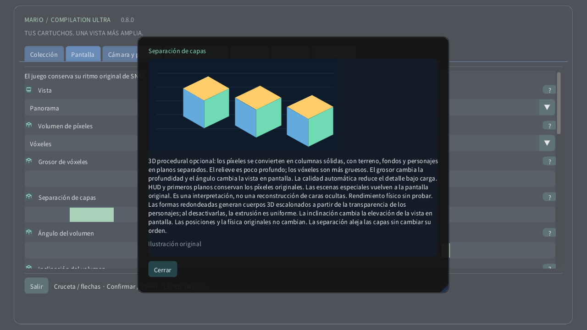

# Volumen de píxeles

[English](../en/VOXELS.md) · [Français](../fr/VOXELS.md) · [Español](../es/VOXELS.md) · [日本語](../ja/VOXELS.md) · [Deutsch](../de/VOXELS.md) · [Italiano](../it/VOXELS.md) · [Português](../pt/VOXELS.md) · [Русский](../ru/VOXELS.md) · [简体中文](../zh/VOXELS.md) · [한국어](../ko/VOXELS.md)

En un ordenador o dispositivo táctil, abre Pantalla → Volumen de píxeles. Prueba primero Relieve de píxeles para una profundidad sutil y después Vóxeles. El grosor cambia el cuerpo de cada píxel; la separación aleja las capas sin cambiar su orden. En Quest, usa la página Volumen del mando espacial. En un reloj, la corona acerca desde toda la zona hasta la pantalla original.

3D procedural opcional: los píxeles se convierten en columnas sólidas, con terreno, fondos y personajes en planos separados. El relieve es poco profundo; los vóxeles son más gruesos. El grosor cambia la profundidad y el ángulo cambia la vista en pantalla. La calidad automática reduce el detalle bajo carga. HUD y primeros planos conservan los píxeles originales. Las escenas especiales vuelven a la pantalla original. Es una interpretación, no una reconstrucción de caras ocultas. Rendimiento físico sin probar. Las formas redondeadas generan cuerpos 3D escalonados a partir de la transparencia de los personajes; al desactivarlas, la extrusión es uniforme. La inclinación cambia la elevación de la vista en pantalla. Las posiciones y la física originales no cambian. La separación aleja las capas sin cambiar su orden.

| Volumen de píxeles | |
|---|---|
| 0 | 2D original |
| 1 | Relieve de píxeles |
| 2 | Vóxeles |

- **Grosor de vóxeles**: 1–16 px
- **Separación de capas**: 1–12 px
- **Ángulo del volumen**: −30° … +30°
- **Inclinación del volumen**: −30° … +30°
- **Formas de vóxeles redondeadas**

[Colección](README.md) · [Ajustes ilustrados](SETTINGS.md) · [HTML](voxels.html) · [Technical research](../VOXEL_RESEARCH.md)
