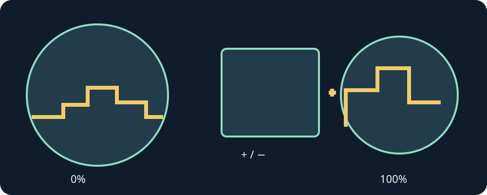
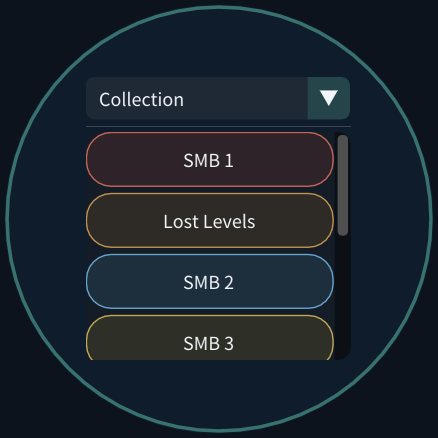

# Mario Compilation Ultra 0.12.2 · Vista del reloj

[English](../en/WATCH.md) · [Français](../fr/WATCH.md) · [Español](../es/WATCH.md) · [日本語](../ja/WATCH.md) · [Deutsch](../de/WATCH.md) · [Italiano](../it/WATCH.md) · [Português](../pt/WATCH.md) · [Русский](../ru/WATCH.md) · [简体中文](../zh/WATCH.md) · [한국어](../ko/WATCH.md)



Gira la corona o bisel para cambiar el zoom. En los menús desplaza el contenido; también funcionan + y - táctiles.

0%: toda el área cargada. 100%: cámara original. Puertas y tuberías pueden cargar otra área.

Gira la corona para acercar la imagen. Del 85 al 100 % se mantiene plana. Al alejarla, elige una curva suave, bordes curvos con el centro más plano u ojo de pez. El modo Plano conserva las líneas rectas con cualquier zoom.

En la mayoría de los juegos, B salta e Y corre o agarra. Usa dedos distintos para mantener dirección y acción.

Pausa con el icono de pausa o Atrás de Android. Reanudar conserva la partida. Salir está al final de Colección.

El paquete personal incluye tus cartuchos locales. Los paquetes públicos necesitan tus propios archivos compatibles.

Transfiere cartuchos a CartridgeInbox y elige Comprobar cartuchos transferidos o reinicia la app. Los archivos existentes se conservan.

Actualizar un APK firmado conserva los datos. Desinstalar o borrar datos elimina cartuchos y partidas locales.

Las pruebas usan eventos táctiles y de giro en un Galaxy Watch8 Classic. Aún falta evaluar la comodidad y el rendimiento en sesiones largas.



```text
/sdcard/Android/data/com.vhaloo.mariocompilationultra.wear/files/CartridgeInbox/

adb install -r MarioCompilationUltra-0.12.2-Wear-public.apk
adb push cartridge.sfc /sdcard/Android/data/com.vhaloo.mariocompilationultra.wear/files/CartridgeInbox/
```

[Wear APK](https://github.com/vhaloo/MarioCompilationUltra/releases/download/v0.12.2/MarioCompilationUltra-0.12.2-Wear-public.apk) · [HTML](watch.html) · [Ajustes ilustrados](SETTINGS.md) · [Guide](README.md)
