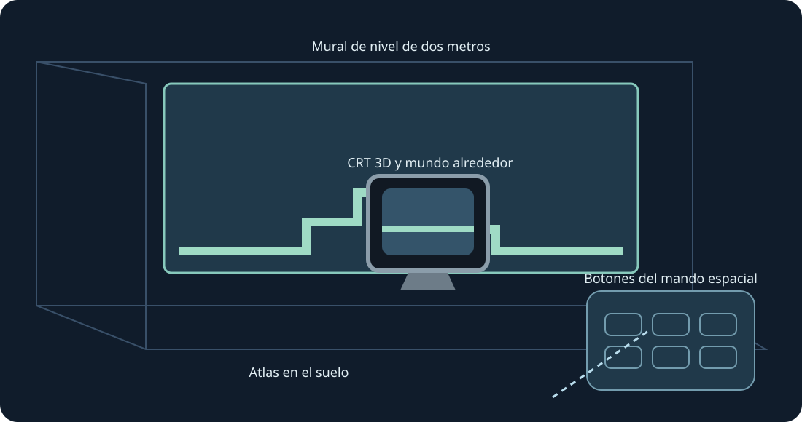

# Mario Compilation Ultra 0.5.0 · Quest VR / RA

[English](../en/XR.md) · [Français](../fr/XR.md) · [Español](../es/XR.md) · [日本語](../ja/XR.md) · [Deutsch](../de/XR.md) · [Italiano](../it/XR.md) · [Português](../pt/XR.md) · [Русский](../ru/XR.md) · [简体中文](../zh/XR.md) · [한국어](../ko/XR.md)

Muros del nivel, suelo, mesas arcade, CRT y galerías curvas. Vista XR experimental; usa ambas empuñaduras para cambiar tamaño.

Vista XR experimental. El usuario confirmó la colección 0.4 visible en Quest 3 tras instalarla; se registró el envío de fotogramas. La versión 0.5 se compila y verifica aparte. Seguimiento, comodidad, passthrough, colocación y juego prolongado necesitan pruebas físicas.

Para probar más tarde, activa el modo desarrollador e instala el APK ARM64 público con SideQuest o adb install -r. Abre Mario Compilation Ultra XR en Fuentes desconocidas, elige un cartucho o ZIP con el selector y pulsa Jugar. Importa All-Stars + World y Yoshi’s Island por separado. El APK público no contiene ROMs ni progreso.

Pantalla espacial | Ajustar a la pared | Mural de nivel de dos metros | Atlas en el suelo | Mesa de arcade | CRT 3D y mundo alrededor | Galería de nivel curva

Elige el nivel, CRT nativo, mando u opciones como objetivo. Una empuñadura mueve y gira; ambas cambian el tamaño aun con la posición bloqueada. El mando ofrece ajustes precisos y mitad/doble/restablecer. Recuperar acerca la interfaz. Y abre opciones; la página Jugar incluye todos los botones SNES.

Pellizca y arrastra la palanca; usa la otra mano para los botones. Pellizca con el dedo medio para agarrar. Si se pierde el seguimiento, se sueltan los controles.

Una instalación nueva solicita 90 Hz y un mural AR transparente de dos metros. Si no está disponible se usa otra frecuencia; la simulación conserva su ritmo. Permisos de escena/anclas y escaneo son opcionales para paredes automáticas. Hay colocación manual y calibración del suelo. El runtime compone passthrough; la app no solicita Internet, micrófono ni imágenes de cámara.

Las imágenes fantasma informan y no simulan objetos lejanos. Las posiciones verificadas pueden mostrarse al entrar; las imágenes aprendidas proceden de tu juego local.

La mesa arcade muestra el área cargada. Se conservan la física y la activación de objetos del cartucho.

Controles rápidos en PC: mantén pulsado el stick derecho; cruceta izquierda/derecha cambia zoom, arriba 1:1, abajo mapa completo, A fija, B cámara original, X captura, Y sigue al jugador. Al soltar vuelven los controles SNES. F1 o ayuda Y del menú abre la explicación ilustrada.

SNES: D-pad · A · B · X · Y · L · R · Start · Select

Touch: A → SNES B · B → SNES Y · X → SNES A · RT → SNES X · R3 → Start · LT → Rewind · Y → Mover opciones

[HTML](xr.html) · [Guide](README.md) · [Build](../BUILD.md) · [Parity](../PARITY.md) · [Validation](../TEST_REPORT.md)

[Meta developer mode](https://developers.meta.com/vr/documentation/android-apps/enable-developer-mode/) · [Meta refresh API](https://developers.meta.com/vr/documentation/native/android/mobile-display-refresh-rate/) · [Meta passthrough](https://developers.meta.com/vr/documentation/native/android/mobile-passthrough/)
