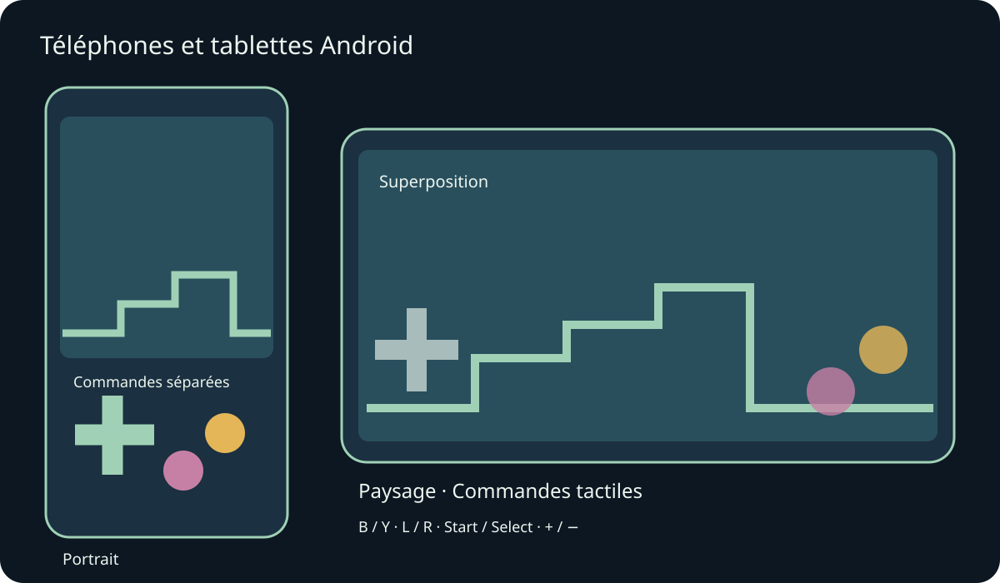
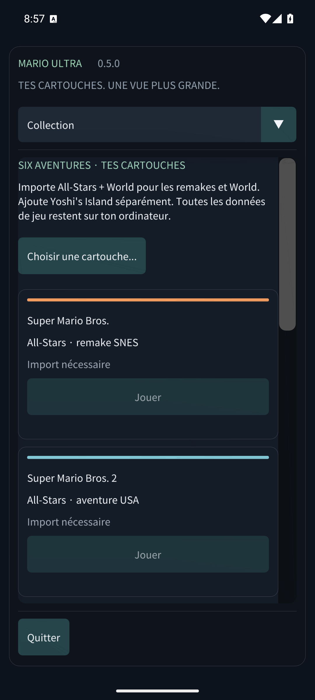

# Mario Compilation Ultra 0.5.0 · Téléphones et tablettes Android

[English](../en/MOBILE.md) · [Français](../fr/MOBILE.md) · [Español](../es/MOBILE.md) · [日本語](../ja/MOBILE.md) · [Deutsch](../de/MOBILE.md) · [Italiano](../it/MOBILE.md) · [Português](../pt/MOBILE.md) · [Русский](../ru/MOBILE.md) · [简体中文](../zh/MOBILE.md) · [한국어](../ko/MOBILE.md)

Installe l’APK pour téléphone/tablette Android, puis ouvre Mario Compilation Ultra dans les applications. L’APK public GitHub demande tes cartouches ; l’édition personnelle avec ROMs contient déjà les six jeux. L’APK Quest est une application distincte pour casque. Android 8 ou ultérieur et OpenGL ES 3 sont requis ; ARM64, ARMv7 et x86_64 sont inclus.

La rotation et le redimensionnement préservent la partie. Les marges protègent les encoches et la navigation système.

Utilise plusieurs doigts pour avancer, courir et sauter ensemble. Une manette connectée masque les commandes tactiles automatiques. Retour Android ouvre le menu.

Les lettres correspondent à la SNES : B pour sauter et Y pour courir dans la plupart des Mario. L, R, Start et Select restent disponibles. Vue parcourt les cinq modes ; moins/plus règlent le zoom pixel. Maintiens le retour arrière pour remonter le temps. Options met en pause immédiatement. Fais défiler les menus au doigt ; la liste supérieure change de rubrique sur un écran étroit.

- Orientation mobile
- Commandes tactiles
- Disposition tactile
- Taille des boutons tactiles
- Opacité des commandes tactiles
- Disposition pour gaucher
- Vibration tactile
- Garder l’écran allumé pendant le jeu

Les états, le retour arrière et les sauvegardes de cartouche utilisent le stockage privé de l’application. Le passage en arrière-plan écrit la sauvegarde de cartouche et, si activé, l’état de reprise 0. Une mise à jour avec le même APK signé conserve la progression. Désinstaller ou effacer les données supprime les cartouches et sauvegardes locales. Les emplacements sont dans Sauvegardes et son.

Les essais sur émulateur téléphone et tablette sont distingués du matériel physique. Performances, manettes, encoches et fenêtres peuvent varier selon l’appareil. Les versions macOS restent expérimentales, sans essai sur Mac physique. Le rapport de validation précise la couverture réelle.

[Android APK](https://github.com/vhaloo/MarioCompilationUltra/releases/download/v0.5.0/MarioCompilationUltra-0.5.0-Android-public.apk) · [HTML](mobile.html) · [Guide](README.md) · [Quest](XR.md) · [Validation](../TEST_REPORT.md)

[Adaptive Android apps](https://developer.android.com/develop/adaptive-apps/guides/support-different-display-sizes) · [16 KiB page sizes](https://developer.android.com/guide/practices/page-sizes)
