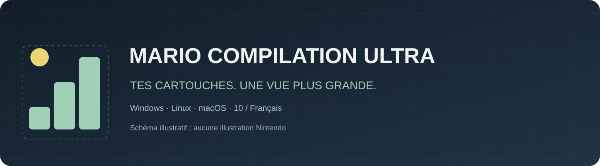
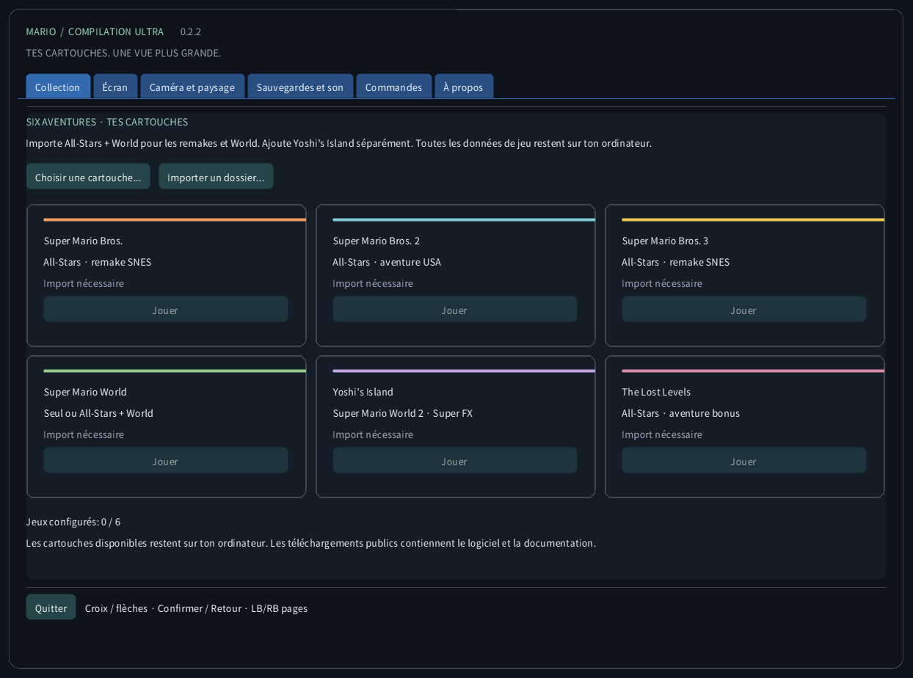
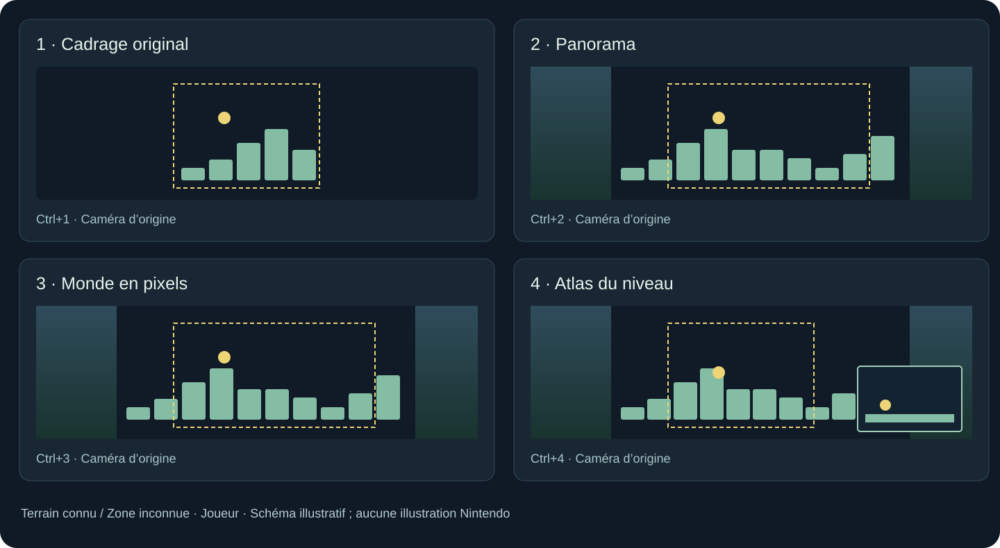
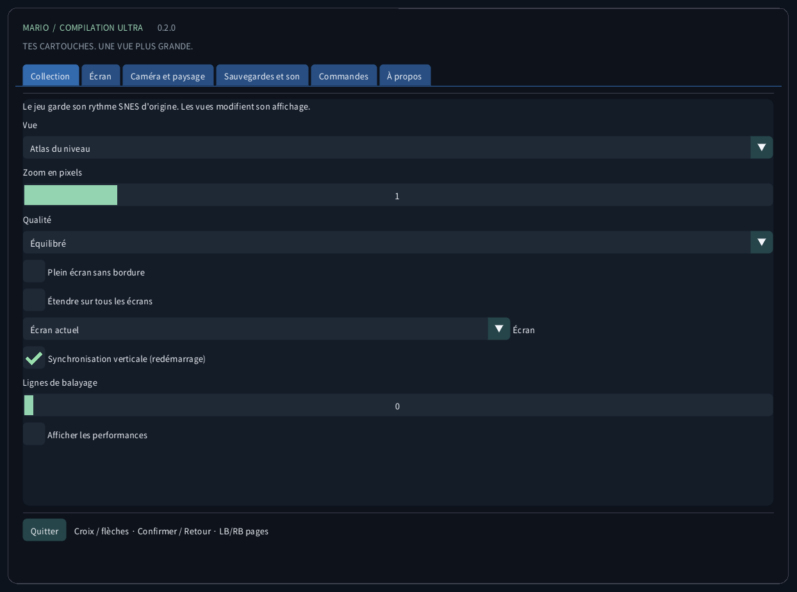
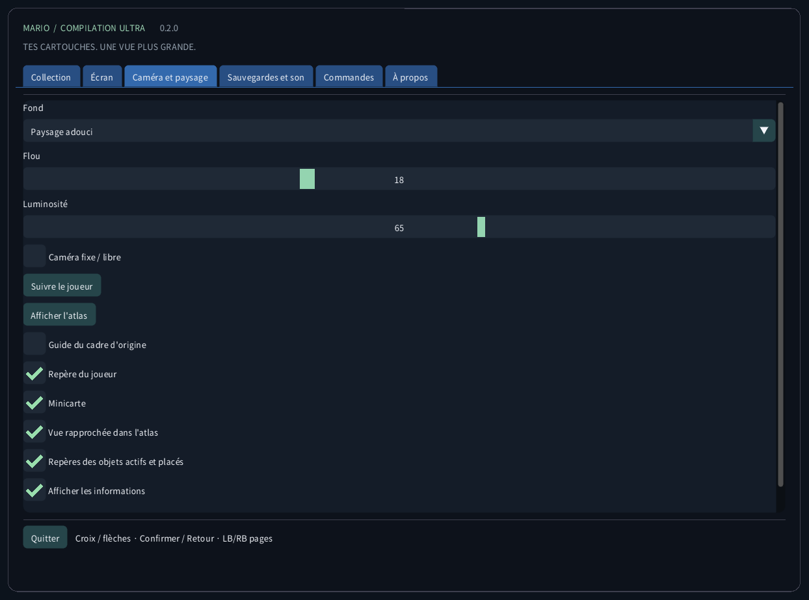
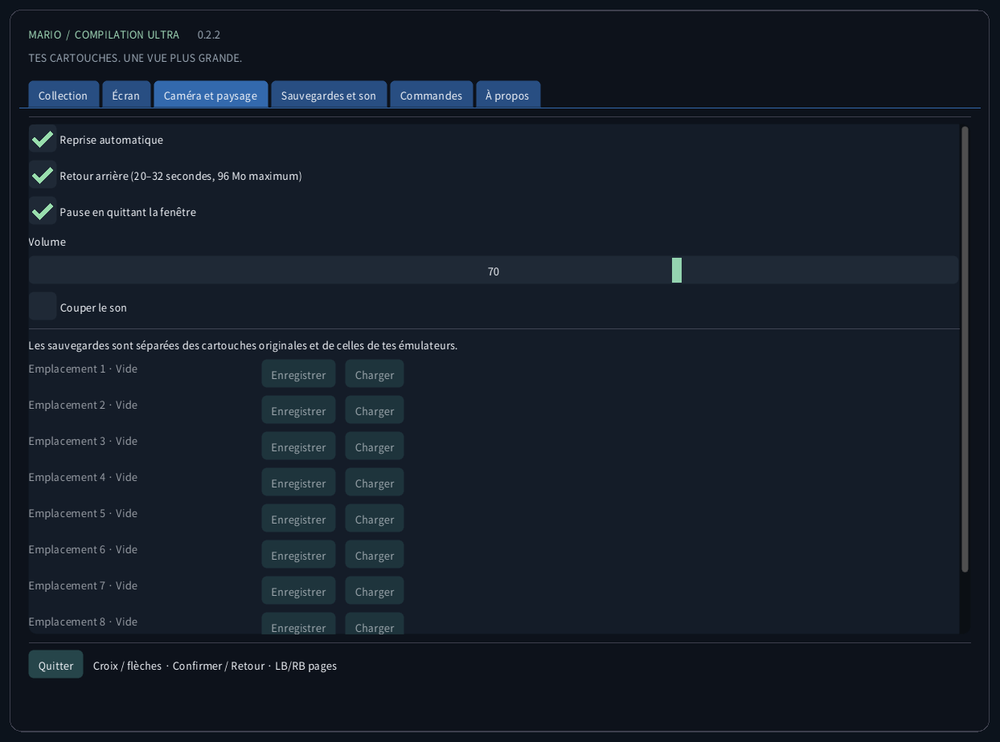
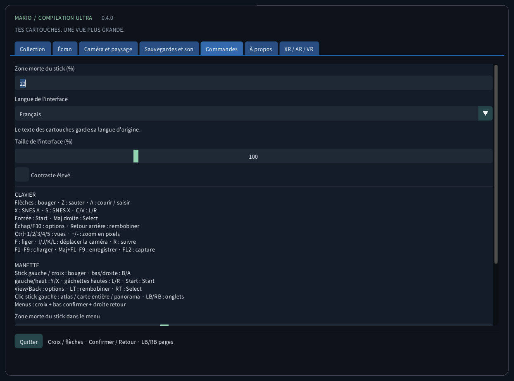
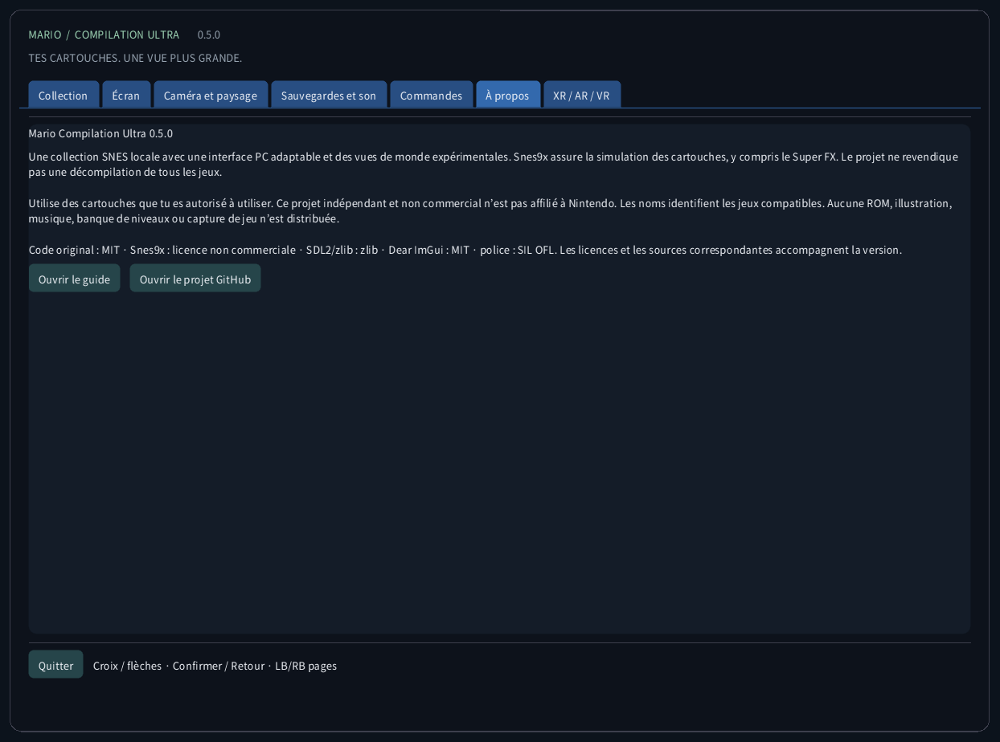

<!-- Generated by tools/guides.py; edit docs/guide-texts.json and assets/locales. -->


[English](../en/README.md) · [Français](../fr/README.md) · [Español](../es/README.md) · [日本語](../ja/README.md) · [Deutsch](../de/README.md) · [Italiano](../it/README.md) · [Português](../pt/README.md) · [Русский](../ru/README.md) · [简体中文](../zh/README.md) · [한국어](../ko/README.md)

# Mario Compilation Ultra 0.2.2

Une collection SNES locale avec une interface PC adaptable et des vues de monde expérimentales. Snes9x assure la simulation des cartouches, y compris le Super FX. Le projet ne revendique pas une décompilation de tous les jeux.

[Téléchargement et lancement sur le bureau](https://github.com/vhaloo/MarioCompilationUltra/releases/tag/v0.2.2) · [HTML](guide.html) · [GitHub](https://github.com/vhaloo/MarioCompilationUltra)

## Téléchargement et lancement sur le bureau

1. Télécharge le paquet pour ton ordinateur et extrais tout le ZIP. Garde ensemble l’exécutable, SDL, les ressources et les guides. Windows : ouvre MarioCompilationUltra.exe. Linux : lance Play.sh. Mac : ouvre l’application.
2. Importe tes fichiers .sfc, .smc ou ZIP contenant une seule cartouche avec Choisir une cartouche, Importer un dossier ou un glisser-déposer. Le sélecteur ouvre le dossier local de l’application. Les cartouches compatibles déposées directement dedans sont détectées au prochain lancement.
3. All-Stars + Super Mario World fournit Mario Bros. 1, Mario Bros. 2 USA, Mario Bros. 3, World et The Lost Levels. Ajoute Yoshi’s Island séparément. Choisis Jouer, puis Entrée ou Start sur l’écran titre d’origine ; appuie à nouveau si une démo est en cours.

Windows : lance Install-Windows.ps1 pour copier le paquet complet dans ton dossier Programs et créer le raccourci du bureau. Linux : lance Install-Linux.sh pour inscrire ce dossier portable dans le menu et sur le bureau. Mac : déplace l’application dans Applications et crée un alias sur le bureau. Conserve le dossier portable choisi.

```powershell
# Windows
powershell -NoProfile -ExecutionPolicy Bypass -File .\Install-Windows.ps1
```

```sh
# Linux
sh ./Install-Linux.sh
```



*Ces captures viennent de l’application réelle sans cartouche chargée. Les schémas utilisent une géométrie illustrative originale, pas des graphismes de jeu. Les téléchargements publics ne contiennent aucune ROM Nintendo, sprite, musique, niveau extrait ou capture de partie.*

## Paquets et validation

- Windows x64 : lancement réel sur le bureau et exécution de cartouches vérifiés ; tests automatiques également.
- Linux x64 : compilation et contrôles sans ROM automatisés. Jeu sur un poste Linux physique non testé.
- **macOS Intel x64 et Apple Silicon arm64 : EXPÉRIMENTAL, NON TESTÉ SUR UN MAC PHYSIQUE. Les contrôles automatiques couvrent la compilation et l’interface sans ROM. Signature ad hoc, sans notarisation ; manette, son, graphismes et Gatekeeper restent à vérifier sur un vrai Mac.**

## Modes de vue



Image recommandée : Panorama, zoom Auto, filtre Net, pixels carrés, raccords doux et fond ambiant atténué. Écran → Image recommandée applique ces choix sans toucher à la langue, au son ou aux sauvegardes. Les filtres Pixels nets et Doux ainsi que le format Télévision 4:3 restent disponibles. Le monde pixel garde un zoom entier et des pixels carrés. Les lignes de balayage suivent les lignes du jeu et s’effacent sous 2× pour éviter le moiré.

L’atlas de World couvre la zone actuellement chargée. Les autres scènes ordinaires étendues cartographient le terrain observé en avançant. Les régions inconnues laissent apparaître le fond ambiant. L’atlas montre le terrain décodé et une vue rapprochée agrandie permet de jouer. Hors du cadre d’origine, effets et sprites peuvent différer ; les objets hors caméra ne sont pas simulés. Les projections spéciales gardent le cadrage d’origine.

Les profils mémoire étendus et la sélection All-Stars automatique visent les éditions américaines listées. Une édition reconnue sans profil vérifié utilise le cadrage d’origine. Traduire l’interface ne traduit pas l’histoire ou les graphismes de la cartouche commerciale. Le projet ne revendique pas une nouvelle décompilation native des cinq jeux.

| CRC32 | SNES |
|---|---|
| `f84305b1` | All-Stars + World (US) |
| `925637c7` | All-Stars (US) |
| `b19ed489` | Super Mario World (US) |
| `d138f224` | Yoshi’s Island 1.0 (US) |
| `cf98ddaa` | Yoshi’s Island 1.1 (US) |

## Commandes

CLAVIER<br>
Flèches : bouger · Z : sauter · A : courir / saisir<br>
X : SNES A · S : SNES X · C/V : L/R<br>
Entrée : Start · Maj droite : Select<br>
Échap/F10 : options · Retour arrière : rembobiner<br>
Ctrl+1/2/3/4 : vues · +/- : zoom en pixels<br>
F : figer · I/J/K/L : déplacer la caméra · R : suivre<br>
F1–F9 : charger · Maj+F1–F9 : enregistrer · F12 : capture<br>
<br>
MANETTE<br>
Stick gauche / croix : bouger · bas/droite : B/A<br>
gauche/haut : Y/X · gâchettes hautes : L/R · Start : Start<br>
View/Back : options · LT : rembobiner · RT : Select<br>
Clic stick gauche : atlas · LB/RB : pages du menu<br>
Menus : croix + bas confirmer + droite retour

## Sauvegardes et son

Chaque jeu a neuf emplacements manuels, une reprise automatique, la SRAM et un retour arrière limité. Le retour arrière utilise au plus 96 Mio pour environ 20–32 secondes. F1–F9 chargent ; Maj+F1–F9 enregistrent. Les états sont vérifiés par CRC de cartouche, version du moteur et intégrité. Les sauvegardes de tes autres émulateurs restent séparées.

## Fichiers locaux

Ce dossier contient settings.ini, les références locales aux cartouches, states/, saves/ et screenshots/. L’importation n’envoie pas la cartouche et ne modifie pas le fichier original. Sauvegarde ce dossier avant de changer d’ordinateur. Les états dépendent de la cartouche exacte et du moteur ; la SRAM est un fichier séparé.

| OS | Dossier des cartouches locales |
|---|---|
| Windows | `%APPDATA%/ValentinWittwe/MarioCompilationUltra/` |
| Linux | `$XDG_DATA_HOME/ValentinWittwe/MarioCompilationUltra/` or `~/.local/share/ValentinWittwe/MarioCompilationUltra/` |
| macOS | `~/Library/Application Support/ValentinWittwe/MarioCompilationUltra/` |

Un dossier indiqué par --data-dir remplace ce chemin par défaut. La mise à jour du raccourci Windows conserve cette option. La page Fichiers locaux montre le dossier réellement utilisé.

## Si un jeu demande encore une importation

Choisis à nouveau la cartouche si son fichier a été déplacé ou si le disque est déconnecté. Le ZIP doit contenir un seul .sfc ou .smc, sans chiffrement, stocké ou compressé en DEFLATE. Vérifie les éditions et en-têtes pris en charge. Une police ou SDL manquante indique souvent que seul l’exécutable a été extrait ; extrais à nouveau tout le paquet.

## Galerie de l’interface réelle

### Collection


### Écran



### Caméra et paysage



### Sauvegardes et son



### Commandes



### À propos



## Paquets et validation · 0.2.2

Les contrôles publics couvrent 106 assertions dans trois suites, 176 messages dans dix catalogues, la police et 240 captures réelles de l’interface. Les tests privés Windows couvrent six jeux, 2 160 configurations de régression, 1 188 cas de rendu, les sauvegardes, la SRAM, la reprise et le rembobinage. Direct3D a été mesuré depuis le raccourci dans les quatre vues en 7680×1440. Ces scènes ne constituent pas des campagnes complètes ; les boutons physiques et le son audible restent non vérifiés. Consulte le rapport détaillé.

[CTest / CI](https://github.com/vhaloo/MarioCompilationUltra/actions) · [Report](../TEST_REPORT.md) · [Build](../BUILD.md) · [Source / research](../RESEARCH.md)

Utilise des cartouches que tu es autorisé à utiliser. Ce projet indépendant et non commercial n’est pas affilié à Nintendo. Les noms identifient les jeux compatibles. Aucune ROM, illustration, musique, banque de niveaux ou capture de jeu n’est distribuée.

Code original : MIT · Snes9x : licence non commerciale · SDL2/zlib : zlib · Dear ImGui : MIT · police : SIL OFL. Les licences et les sources correspondantes accompagnent la version.

[Licence](../../LICENSE) · [Third-party notices](../../THIRD_PARTY_NOTICES.md)
