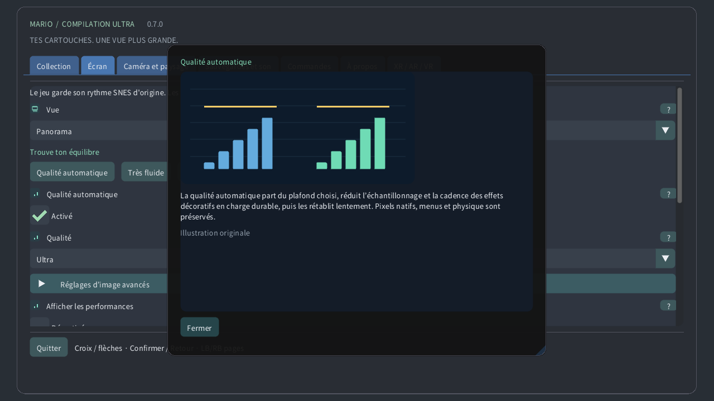

# Réglages illustrés

## Collection

Choisis une cartouche locale, lance un jeu ou ouvre son guide. Les téléchargements publics ne contiennent ni les jeux ni tes sauvegardes.

## Vue

Original garde l’écran de la console. Panorama l’étend. L’atlas cadre le terrain disponible ; Carte entière lit toute la zone chargée lorsque son décodage est pris en charge, même inexplorée. Une porte peut changer de zone.

## Caméra et paysage

Choisis ce que suit la vue : caméra originale, personnage ou position fixe. Le cadrage change sans déplacer le personnage ni activer les ennemis éloignés.

## Zoom de la montre

Le zoom change la portion visible. Sur montre, 0 % montre toute la carte chargée et 100 % rejoint la caméra originale. La vitesse du jeu reste identique.

## Fisheye pour écran rond

Sur une montre ronde, la lentille déforme tout le rectangle du jeu en cercle. Les bords restent visibles. Commandes et textes restent plats ; désactive-la pour un rectangle sans déformation.

## Sensibilité de la couronne

La couronne ou lunette détectée règle le zoom en partie et fait défiler les menus. La sensibilité règle l’amplitude ; Inverser échange les sens. Le zoom tactile fonctionne sans couronne.

## Filtre d’image

Pixels proches conserve les contours bruts. Net les garde précis aux tailles non entières. Doux adoucit l’agrandissement. L’image source et les collisions restent identiques.

## Proportions

Pixels carrés respecte la forme des pixels source ; TV 4:3 donne les proportions d’un téléviseur. Monde pixel conserve des pixels carrés et un zoom entier.

## Qualité automatique

La qualité automatique part du plafond choisi, réduit l’échantillonnage et la cadence des effets décoratifs en charge durable, puis les rétablit lentement. Pixels natifs, menus et physique sont préservés.

## Réserve de performance

La réserve garde une part du temps de chaque image pour les imprévus. Une réserve plus grande favorise la fluidité. Très fluide utilise 40 % ; Quest garde au moins 35 %. La qualité remonte quand la marge le permet.

## Tenir compte de la chauffe

L’état thermique local d’Android peut réduire les détails décoratifs avant que la chauffe augmente. Aucune permission ni connexion n’est nécessaire. Le système contrôle toujours les fréquences réelles.

## Synchronisation verticale

La synchronisation suit l’écran pour limiter les déchirures. Le jeu garde son horloge originale. Quest utilise la fréquence choisie du casque ; la réserve est calculée à cette fréquence.

## Shader VR

CRT léger garde l’aspect rétro avec moins de calculs. Automatique commence léger et autorise la référence après une marge GPU mesurée durable. Référence impose le calcul plus coûteux.

## Écran

Choisis la fenêtre, l’écran ou le plein écran. Ces options changent l’emplacement de l’image, sans modifier le niveau chargé ni ses sauvegardes.

## Fond

Le fond remplit l’espace autour du jeu. Paysage doux reprend ses couleurs ; Minuit et Noir donnent un cadre plus sobre. Flou et luminosité agissent sur ce fond.

## Flou

Le flou adoucit le paysage autour du jeu ; la luminosité règle sa clarté. L’image native reste intacte. En charge, la qualité automatique peut rafraîchir ce décor moins souvent.

## Raccords doux du panorama

Les raccords doux fondent l’extension dans le fond près de la caméra originale. Désactive-les pour une limite franche. La carte entière conserve son cadrage complet.

## Repère du joueur

Le repère indique le personnage ; le guide encadre la caméra originale ; la minicarte situe cette caméra. La vue rapprochée garde l’écran natif lisible quand la carte est éloignée.

## Anticiper les ennemis placés

Les aperçus montrent des placements vérifiés ou des apparences observées localement. Objets estompés et contours sont des guides, pas des ennemis actifs supplémentaires. Opacité et étiquettes règlent leur visibilité.

## Afficher les informations

Choisis le coin, la taille, l’opacité et la durée des rappels. Un délai nul garde le rappel visible. Ces indications ne changent ni le jeu ni sa caméra.

## Langue

Règle la langue, la taille ou le contraste des menus pour lire confortablement. Les guides illustrés sont disponibles hors ligne. Le rendu et la langue de la cartouche sont indépendants.

## Commandes

Choisis la correspondance des boutons et les zones mortes. Une zone plus grande ignore davantage de petits mouvements. Les commandes rapides ajoutent des raccourcis caméra ; les actions normales restent disponibles.

## Commandes tactiles

Les boutons tactiles acceptent plusieurs doigts simultanés. Automatique les montre sans manette. Disposition, taille, opacité et côté changent les commandes, pas la physique du jeu.

## Retour

Maintiens la commande choisie pour remonter les états récents exacts. La durée dépend de la mémoire et de la cartouche. Son inversé et indicateur sont facultatifs ; les sauvegardes disque sont séparées.

## Sauvegardes et son

Un emplacement conserve l’état actuel de la machine. Charger y revient ; la reprise automatique utilise son propre emplacement. La progression de cartouche est distincte. Remplacer un emplacement demande confirmation.

## Volume

Volume et silence règlent la lecture locale. Ils ne changent pas la vitesse du jeu et n’effacent aucune sauvegarde. Le son du retour arrière se règle séparément.

## Pause en quittant la fenêtre

La pause relâche les commandes maintenues. Les options de focus et de suivi règlent les pauses automatiques. Reprendre garde la partie ; quitter enregistre la progression de cartouche.

## Mode de présentation

Choisis écran flottant, mur, atlas au sol, table arcade, pièce CRT ou écran courbe. La même partie continue ; seul son affichage dans l’espace change.

## Distance de visionnement

Taille, distance, hauteur, inclinaison et écart placent l’objet virtuel dans la pièce. Les valeurs utilisent les unités affichées. Recentrer le remet à portée sans relancer le jeu.

## Ancrage de l’écran

Le placement automatique utilise les données de scène autorisées si disponibles. Un placement verrouillé ou enregistré garde le lieu choisi. Une perte de suivi peut mettre en pause ; le placement manuel reste accessible.

## Utiliser les contrôleurs Quest Touch

Télécommande virtuelle, mains et toucher direct commandent le même jeu. Taille et rappels règlent leur confort. L’intensité haptique change le retour, sans modifier le moment des actions.

## Écran CRT natif déplaçable

Les réglages CRT ajoutent balayage, masque RVB, verre courbe et reflets. Plus d’intensité est un choix visuel, pas du détail de jeu supplémentaire. La qualité automatique peut simplifier ce décor coûteux.

## Environnement VR

La transparence AR montre ta pièce réelle ; l’environnement virtuel sert de décor sinon. Transparence, paysage périphérique et luminosité règlent ce qui entoure le jeu.

## Détail périphérique adaptatif

Les détails du canevas et des yeux règlent les plafonds de couches distinctes. La qualité automatique les ajuste si nécessaire. Le menu indépendant reste net ; la fovéation périphérique est facultative si prise en charge.

## Aide illustrée des réglages

Utilise le point d’interrogation pour une explication illustrée. Survol et focus manette donnent un aperçu ; le toucher ouvre la fiche. Les illustrations sont des exemples originaux, pas des captures de cartouche.

## Qualité manuelle

La qualité manuelle désactive l’adaptation et conserve le niveau de détail choisi. Qualité automatique rétablit l’adaptation ; Très fluide garde davantage de réserve de performance.

## Détail périphérique adaptatif

Sur un Quest compatible, une charge durable peut réduire les détails périphériques tout en préservant le centre. Les menus gardent une couche nette distincte. Le rendu ordinaire prend automatiquement le relais si nécessaire. La qualité en casque reste à tester.

[Guide](README.md) · [Watch](WATCH.md)
