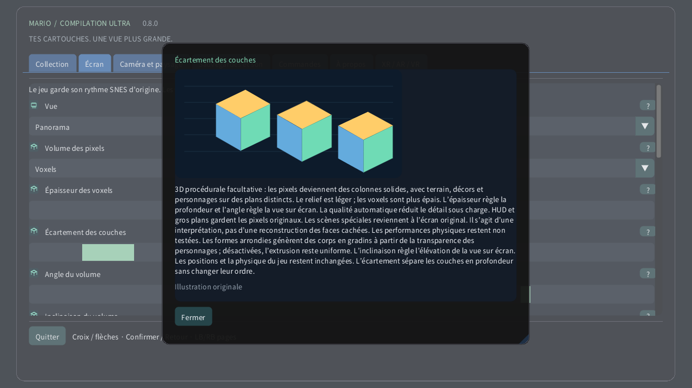

# Volume des pixels

[English](../en/VOXELS.md) · [Français](../fr/VOXELS.md) · [Español](../es/VOXELS.md) · [日本語](../ja/VOXELS.md) · [Deutsch](../de/VOXELS.md) · [Italiano](../it/VOXELS.md) · [Português](../pt/VOXELS.md) · [Русский](../ru/VOXELS.md) · [简体中文](../zh/VOXELS.md) · [한국어](../ko/VOXELS.md)

Sur ordinateur ou appareil tactile, ouvre Écran → Volume des pixels. Essaie d’abord le Relief des pixels pour une profondeur discrète, puis les Voxels. L’épaisseur modifie le corps de chaque pixel ; l’écartement éloigne les couches sans changer leur ordre. Sur Quest, utilise la page Volume de la télécommande spatiale. Sur montre, la couronne zoome de la zone entière jusqu’à l’écran d’origine en fin de course.

3D procédurale facultative : les pixels deviennent des colonnes solides, avec terrain, décors et personnages sur des plans distincts. Le relief est léger ; les voxels sont plus épais. L’épaisseur règle la profondeur et l’angle règle la vue sur écran. La qualité automatique réduit le détail sous charge. HUD et gros plans gardent les pixels originaux. Les scènes spéciales reviennent à l’écran original. Il s’agit d’une interprétation, pas d’une reconstruction des faces cachées. Les performances physiques restent non testées. Les formes arrondies génèrent des corps en gradins à partir de la transparence des personnages ; désactivées, l’extrusion reste uniforme. L’inclinaison règle l’élévation de la vue sur écran. Les positions et la physique du jeu restent inchangées. L’écartement sépare les couches en profondeur sans changer leur ordre.

| Volume des pixels | |
|---|---|
| 0 | 2D originale |
| 1 | Relief des pixels |
| 2 | Voxels |

- **Épaisseur des voxels**: 1–16 px
- **Écartement des couches**: 1–12 px
- **Angle du volume**: −30° … +30°
- **Inclinaison du volume**: −30° … +30°
- **Formes de voxels arrondies**

[Collection](README.md) · [Réglages illustrés](SETTINGS.md) · [HTML](voxels.html) · [Technical research](../VOXEL_RESEARCH.md)
