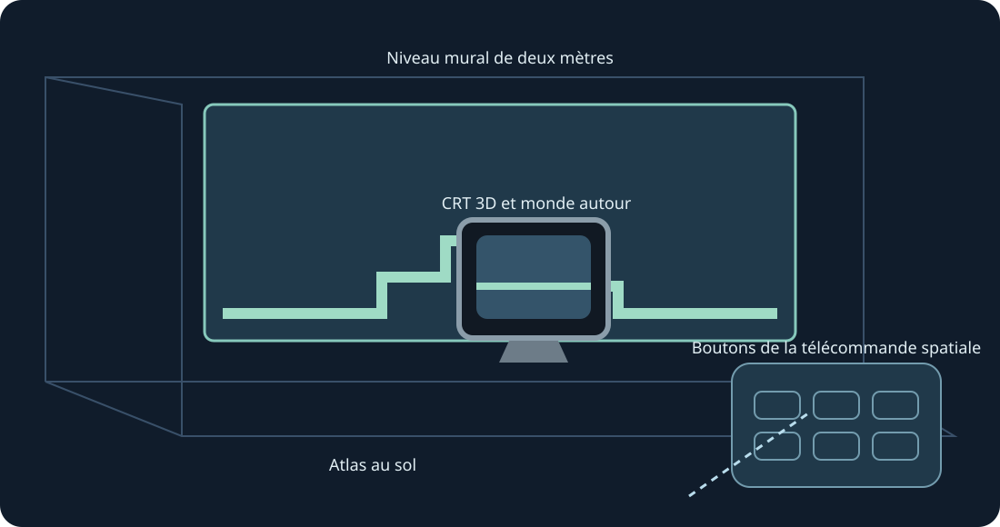

# Mario Compilation Ultra 0.5.0 · Quest VR / AR

[English](../en/XR.md) · [Français](../fr/XR.md) · [Español](../es/XR.md) · [日本語](../ja/XR.md) · [Deutsch](../de/XR.md) · [Italiano](../it/XR.md) · [Português](../pt/XR.md) · [Русский](../ru/XR.md) · [简体中文](../zh/XR.md) · [한국어](../ko/XR.md)

Murs de niveau entier, sol, table arcade, CRT et galerie incurvée. Aperçu XR expérimental ; deux poignées pour redimensionner.

Aperçu XR expérimental. L’utilisateur a confirmé la collection 0.4 visible dans son Quest 3 après installation ; la soumission des images a été enregistrée. La version 0.5 est compilée et contrôlée séparément. Suivi, confort, passthrough, placement dans la pièce et jeu prolongé demandent encore des essais physiques.

Pour ton essai ultérieur, active le mode développeur et installe l’APK ARM64 public avec SideQuest ou adb install -r. Ouvre Mario Compilation Ultra XR dans Sources inconnues, choisis une cartouche ou un ZIP avec le sélecteur système, puis Jouer. Importe All-Stars + World et Yoshi’s Island séparément. L’APK public ne contient ni ROM ni progression.

Écran spatial | Ajuster au mur scanné | Niveau mural de deux mètres | Atlas au sol | Table de jeu d'arcade | CRT 3D et monde autour | Galerie de niveau incurvée

Choisis le niveau, le CRT natif, la télécommande ou les options comme cible. Une poignée le déplace et l’oriente ; deux poignées redimensionnent le niveau même si sa position est verrouillée. La télécommande propose aussi déplacement précis et moitié/double/réinitialiser. Récupérer ramène l’interface à proximité. Y ouvre les options ; la page Jouer comporte toutes les touches SNES.

Pince et déplace le stick ; l’autre main actionne les boutons. Pince avec le majeur pour saisir une poignée. Une perte de suivi relâche les commandes.

Une nouvelle installation demande 90 Hz et une fresque AR transparente de deux mètres. La fréquence utilise un repli si nécessaire ; la simulation garde sa cadence native. Les permissions de scène/ancrage et le scan de pièce sont facultatifs pour les murs automatiques. Placement manuel et calibration du sol restent accessibles. Le runtime fournit le passthrough ; l’application ne demande ni Internet, ni micro, ni images caméra.

Les images fantômes sont informatives et ne simulent pas les objets éloignés. Les placements vérifiés peuvent être montrés dès le début ; les images apprises viennent uniquement de ton jeu local.

La table arcade affiche la zone chargée. La physique et l’activation des objets restent celles de la cartouche.

Commandes rapides sur ordinateur : maintiens le clic du stick droit, puis croix gauche/droite pour le zoom, haut pour 1:1, bas pour la carte entière, A pour figer, B pour la caméra originale, X pour une capture, Y pour suivre le joueur. Relâcher rend les commandes SNES normales. F1 ou l’aide Y du menu ouvre une explication illustrée.

SNES: D-pad · A · B · X · Y · L · R · Start · Select

Touch: A → SNES B · B → SNES Y · X → SNES A · RT → SNES X · R3 → Start · LT → Rewind · Y → Déplacer les options

[HTML](xr.html) · [Guide](README.md) · [Build](../BUILD.md) · [Parity](../PARITY.md) · [Validation](../TEST_REPORT.md)

[Meta developer mode](https://developers.meta.com/vr/documentation/android-apps/enable-developer-mode/) · [Meta refresh API](https://developers.meta.com/vr/documentation/native/android/mobile-display-refresh-rate/) · [Meta passthrough](https://developers.meta.com/vr/documentation/native/android/mobile-passthrough/)
