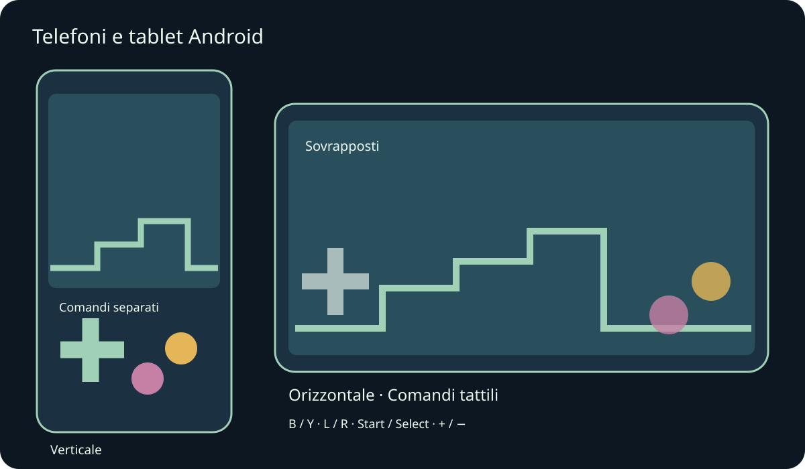
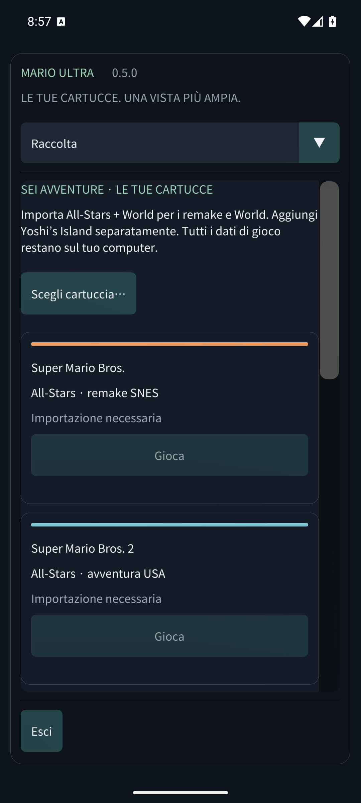

# Mario Compilation Ultra 0.5.0 · Telefoni e tablet Android

[English](../en/MOBILE.md) · [Français](../fr/MOBILE.md) · [Español](../es/MOBILE.md) · [日本語](../ja/MOBILE.md) · [Deutsch](../de/MOBILE.md) · [Italiano](../it/MOBILE.md) · [Português](../pt/MOBILE.md) · [Русский](../ru/MOBILE.md) · [简体中文](../zh/MOBILE.md) · [한국어](../ko/MOBILE.md)

Installa l’APK Android per telefono/tablet e apri Mario Compilation Ultra. L’APK pubblico GitHub richiede le tue cartucce; l’edizione personale con ROM include già i sei giochi. L’APK Quest è un’app separata per il visore. Richiede Android 8 o successivo e OpenGL ES 3; include ARM64, ARMv7 e x86_64.

Rotazione e ridimensionamento conservano la partita. I margini proteggono ritagli e navigazione di sistema.

Usa più dita per muoverti, correre e saltare insieme. Un gamepad collegato nasconde i comandi tattili automatici. Indietro Android apre il menu.

Le lettere corrispondono al SNES: B salta e Y corre nella maggior parte dei Mario. L, R, Start e Select restano disponibili. Vista alterna cinque modalità; meno/più regola lo zoom. Tieni premuto riavvolgi per tornare indietro. Opzioni mette subito in pausa. Scorri i menu con un dito e scegli la sezione nell’elenco superiore sugli schermi stretti.

- Orientamento mobile
- Comandi tattili
- Disposizione tattile
- Dimensione pulsanti tattili
- Opacità dei comandi tattili
- Comandi per mancini
- Vibrazione al tocco
- Mantieni lo schermo acceso durante il gioco

Stati, riavvolgimento e salvataggi usano l’archivio privato dell’app. In background vengono scritti i salvataggi della cartuccia e, se attivo, lo stato di ripresa 0. Gli aggiornamenti con la stessa firma conservano i progressi. Disinstallare o cancellare i dati elimina cartucce e salvataggi locali. Gli stati sono in Salvataggi e audio.

I test su emulatori di telefono e tablet sono distinti dall’hardware fisico. Prestazioni, gamepad, ritagli e finestre possono variare per dispositivo. macOS resta sperimentale e non è stato testato su un Mac fisico. Il rapporto indica la copertura esatta.

[Android APK](https://github.com/vhaloo/MarioCompilationUltra/releases/download/v0.5.0/MarioCompilationUltra-0.5.0-Android-public.apk) · [HTML](mobile.html) · [Guide](README.md) · [Quest](XR.md) · [Validation](../TEST_REPORT.md)

[Adaptive Android apps](https://developer.android.com/develop/adaptive-apps/guides/support-different-display-sizes) · [16 KiB page sizes](https://developer.android.com/guide/practices/page-sizes)
