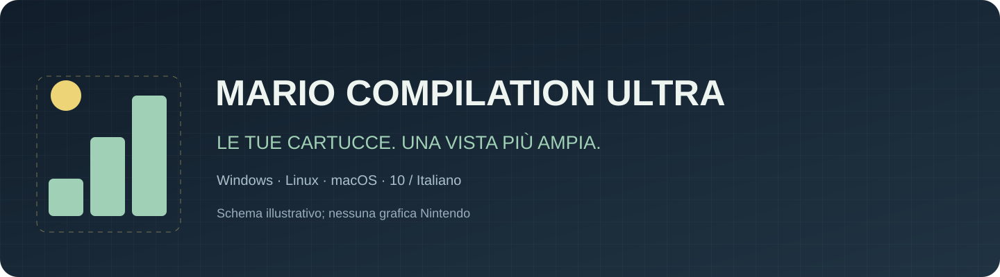
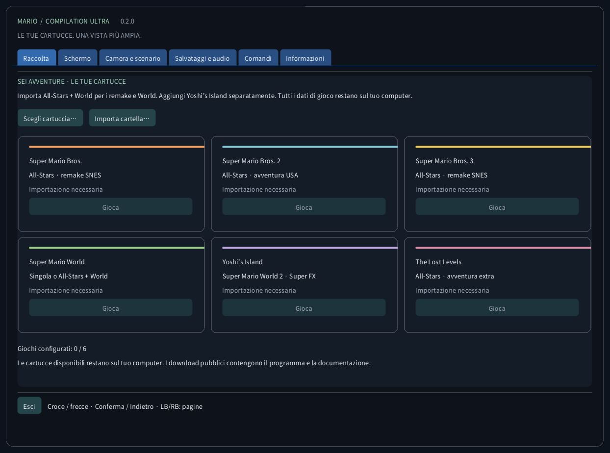
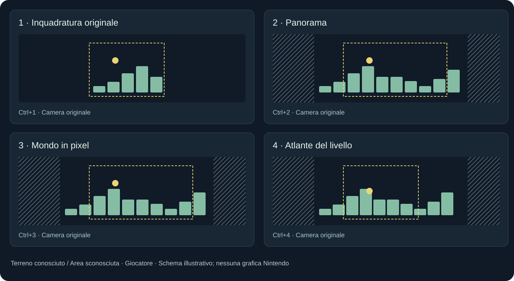
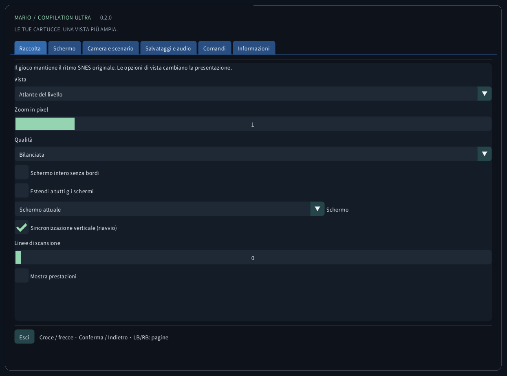
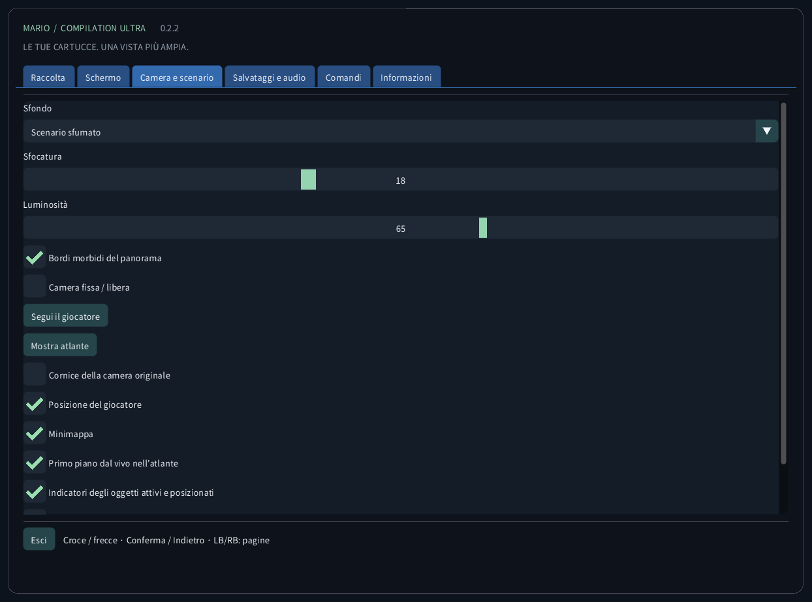
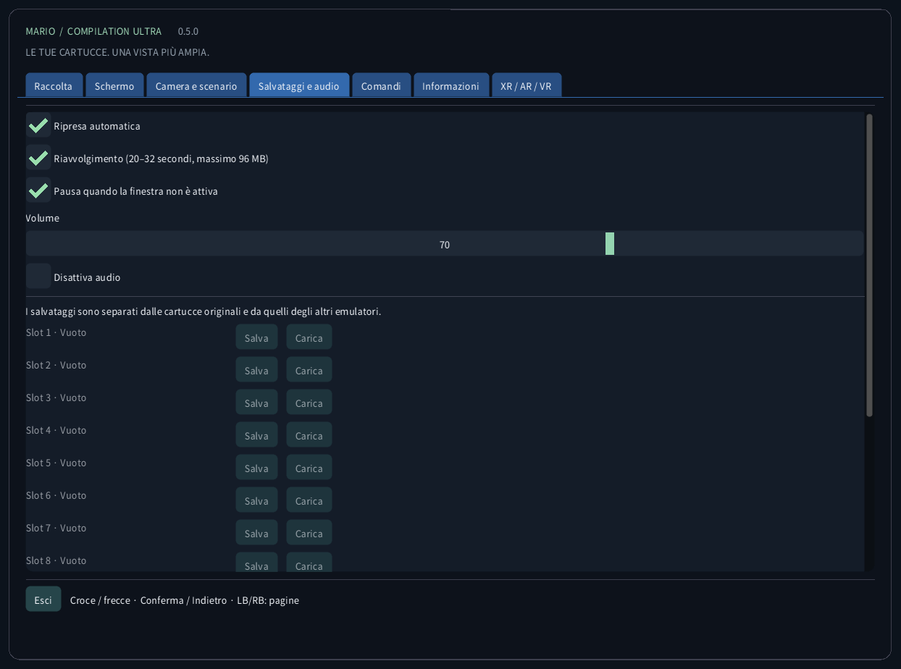
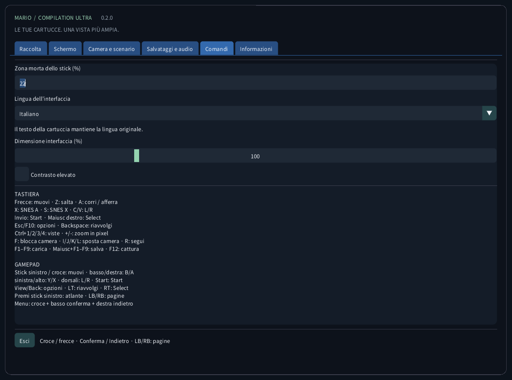
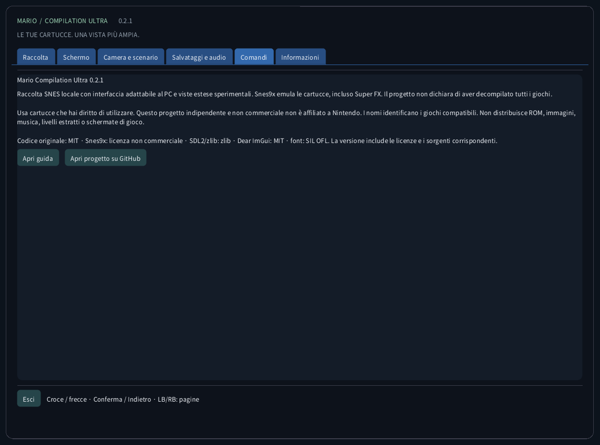

<!-- Generated by tools/guides.py; edit docs/guide-texts.json and assets/locales. -->


[English](../en/README.md) · [Français](../fr/README.md) · [Español](../es/README.md) · [日本語](../ja/README.md) · [Deutsch](../de/README.md) · [Italiano](../it/README.md) · [Português](../pt/README.md) · [Русский](../ru/README.md) · [简体中文](../zh/README.md) · [한국어](../ko/README.md)

# Mario Compilation Ultra 0.2.0

Raccolta SNES locale con interfaccia adattabile al PC e viste estese sperimentali. Snes9x emula le cartucce, incluso Super FX. Il progetto non dichiara di aver decompilato tutti i giochi.

[Download e avvio dal desktop](https://github.com/vhaloo/MarioCompilationUltra/releases/tag/v0.2.0) · [HTML](guide.html) · [GitHub](https://github.com/vhaloo/MarioCompilationUltra)

## Download e avvio dal desktop

1. Scarica il pacchetto per il tuo computer ed estrai tutto lo ZIP. Mantieni insieme eseguibile, SDL, risorse e guide. Windows: apri MarioCompilationUltra.exe. Linux: avvia Play.sh. Mac: apri l’app.
2. Importa i tuoi file .sfc, .smc o ZIP con una sola cartuccia tramite Scegli cartuccia, Importa cartella o trascinamento. Il selettore apre la cartella dati dell’app. Le cartucce compatibili inserite direttamente lì vengono rilevate al prossimo avvio.
3. All-Stars + Super Mario World include Mario Bros. 1, Mario Bros. 2 USA, Mario Bros. 3, World e The Lost Levels. Aggiungi Yoshi’s Island separatamente. Scegli Gioca, poi Invio o Start nel titolo originale; premi di nuovo se è in corso una demo.

Windows: esegui Install-Windows.ps1 per copiare il pacchetto completo in Programs dell’utente e creare il collegamento. Linux: esegui Install-Linux.sh per registrare questa cartella nel menu e sul desktop. Mac: sposta l’app in Applicazioni e crea un alias. Non spostare la cartella portatile scelta.

```powershell
# Windows
powershell -NoProfile -ExecutionPolicy Bypass -File .\Install-Windows.ps1
```

```sh
# Linux
sh ./Install-Linux.sh
```



*Le schermate provengono dall’app reale senza cartuccia caricata. I diagrammi usano geometria illustrativa originale, non grafica dei giochi. I download pubblici non includono ROM Nintendo, sprite, musica, livelli estratti o schermate di gioco.*

## Pacchetti e verifica

- Windows x64: avvio locale dal desktop ed esecuzione cartucce verificati; anche test automatici.
- Linux x64: build e controlli senza ROM automatici. Gioco su un desktop Linux fisico non testato.
- **macOS Intel x64 e Apple Silicon arm64: SPERIMENTALE, NON TESTATO SU UN MAC FISICO. I controlli automatici coprono build e interfaccia senza ROM. Firma ad hoc, senza notarizzazione; controller, audio, grafica e Gatekeeper non verificati su hardware reale.**

## Modalità di vista



L’atlante di World copre l’area caricata, non tutte le aree insieme. Mario 1, Lost Levels, Mario 2, Mario 3 e le scene normali di Yoshi accumulano il terreno osservato durante il movimento. Le aree sconosciute sono tratteggiate. Fuori dalla camera originale effetti e sprite possono differire. Le proiezioni speciali usano l’immagine originale.

I profili di memoria e la selezione automatica All-Stars riguardano le edizioni USA elencate. Un’edizione riconosciuta senza profilo verificato usa l’inquadratura originale. Tradurre l’interfaccia non traduce storia o grafica della cartuccia commerciale. Non si dichiara una nuova decompilazione nativa dei cinque giochi.

| CRC32 | SNES |
|---|---|
| `f84305b1` | All-Stars + World (US) |
| `925637c7` | All-Stars (US) |
| `b19ed489` | Super Mario World (US) |
| `d138f224` | Yoshi’s Island 1.0 (US) |
| `cf98ddaa` | Yoshi’s Island 1.1 (US) |

## Comandi

TASTIERA<br>
Frecce: muovi · Z: salta · A: corri / afferra<br>
X: SNES A · S: SNES X · C/V: L/R<br>
Invio: Start · Maiusc destro: Select<br>
Esc/F10: opzioni · Backspace: riavvolgi<br>
Ctrl+1/2/3/4: viste · +/-: zoom in pixel<br>
F: blocca camera · I/J/K/L: sposta camera · R: segui<br>
F1–F9: carica · Maiusc+F1–F9: salva · F12: cattura<br>
<br>
GAMEPAD<br>
Stick sinistro / croce: muovi · basso/destra: B/A<br>
sinistra/alto: Y/X · dorsali: L/R · Start: Start<br>
View/Back: opzioni · LT: riavvolgi · RT: Select<br>
Premi stick sinistro: atlante · LB/RB: pagine<br>
Menu: croce + basso conferma + destra indietro

## Salvataggi e audio

Ogni gioco dispone di nove slot, ripresa automatica, SRAM e riavvolgimento limitato. Usa fino a 96 MiB per circa 20–32 secondi. F1–F9 caricano; Shift+F1–F9 salvano. Si verificano CRC, versione del motore e integrità. I salvataggi degli altri emulatori restano separati.

## File locali

Questa cartella contiene settings.ini, riferimenti alle cartucce, states/, saves/ e screenshots/. L’importazione non carica online la cartuccia né modifica l’originale. Fai un backup prima di cambiare computer. Gli stati dipendono da cartuccia e motore esatti; SRAM è separata.

| OS | Cartella locale delle cartucce |
|---|---|
| Windows | `%APPDATA%/ValentinWittwe/MarioCompilationUltra/` |
| Linux | `$XDG_DATA_HOME/ValentinWittwe/MarioCompilationUltra/` or `~/.local/share/ValentinWittwe/MarioCompilationUltra/` |
| macOS | `~/Library/Application Support/ValentinWittwe/MarioCompilationUltra/` |

## Se un gioco richiede ancora l’importazione

Scegli di nuovo la cartuccia se il file è stato spostato o l’unità scollegata. Lo ZIP deve contenere un solo .sfc o .smc, senza cifratura, memorizzato o DEFLATE. Controlla edizioni e intestazioni supportate. Se mancano font o SDL, estrai nuovamente il pacchetto completo.

## Galleria dell’interfaccia reale

### Raccolta


### Schermo



### Camera e scenario



### Salvataggi e audio



### Comandi



### Informazioni



## Pacchetti e verifica · 0.2.0

I controlli automatici coprono 63 verifiche di motore/controller, 165 messaggi in dieci cataloghi, glifi e 240 schermate reali in quattro dimensioni. Brevi prove private non equivalgono al completamento dei giochi. Rapporto e workflow distinguono il verificato dall’hardware non testato.

[CTest / CI](https://github.com/vhaloo/MarioCompilationUltra/actions) · [Report](../TEST_REPORT.md) · [Build](../BUILD.md) · [Source / research](../RESEARCH.md)

Usa cartucce che hai diritto di utilizzare. Questo progetto indipendente e non commerciale non è affiliato a Nintendo. I nomi identificano i giochi compatibili. Non distribuisce ROM, immagini, musica, livelli estratti o schermate di gioco.

Codice originale: MIT · Snes9x: licenza non commerciale · SDL2/zlib: zlib · Dear ImGui: MIT · font: SIL OFL. La versione include le licenze e i sorgenti corrispondenti.

[Licence](../../LICENSE) · [Third-party notices](../../THIRD_PARTY_NOTICES.md)
