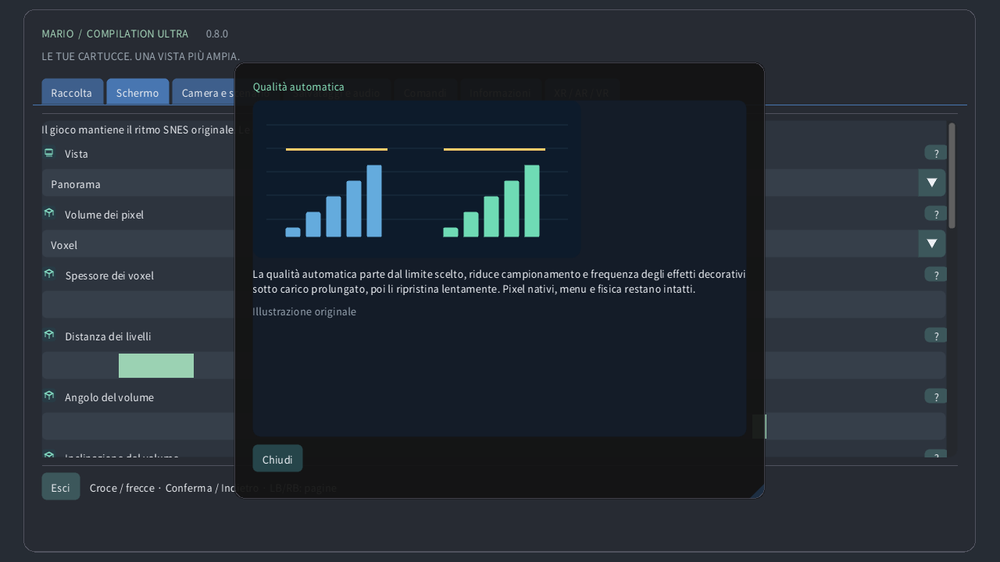

# Impostazioni illustrate

## Raccolta

Scegli una cartuccia locale, avvia un gioco o apri la guida. I download pubblici non includono giochi né salvataggi personali.

## Vista

Originale mantiene lo schermo della console e Panorama lo estende. Atlante mostra il terreno disponibile; Mappa completa legge tutta l’area caricata quando il formato è supportato, anche inesplorata. Una porta può cambiare area.

## Camera e scenario

Scegli se seguire la telecamera originale, il personaggio o una posizione fissa. Cambia l’inquadratura senza muovere il personaggio né attivare nemici lontani.

## Zoom orologio

Lo zoom regola quanto terreno è visibile. Sull’orologio, 0% mostra tutta l’area caricata e 100% raggiunge la telecamera originale. La velocità del gioco resta invariata.

## Fisheye per schermo rotondo

Su un orologio rotondo, la lente piega l’intero rettangolo del gioco in un cerchio, mantenendo i bordi. Comandi e testo restano piani. Disattivala per un rettangolo senza deformazioni.

## Sensibilità corona

La corona o ghiera rilevata controlla lo zoom in gioco e scorre i menu. Sensibilità regola l’effetto di ogni rotazione; Inverti cambia il verso. Lo zoom tattile funziona anche senza corona.

## Filtro immagine

Pixel vicini mantiene i bordi netti. Nitido conserva la chiarezza a dimensioni non intere. Morbido attenua l’ingrandimento. Immagine originale e collisioni restano invariate.

## Proporzioni

Pixel quadrati conserva la forma dei pixel originali; TV 4:3 riproduce le proporzioni di un televisore. Mondo pixel usa pixel quadrati e zoom intero.

## Qualità automatica

La qualità automatica parte dal limite scelto, riduce campionamento e frequenza degli effetti decorativi sotto carico prolungato, poi li ripristina lentamente. Pixel nativi, menu e fisica restano intatti.

## Riserva di prestazioni

La riserva lascia tempo per il lavoro imprevisto. Una riserva maggiore favorisce la fluidità. Molto fluido usa il 40%; Quest almeno il 35%. La qualità risale quando c’è margine.

## Adatta al calore del dispositivo

Lo stato termico locale di Android può ridurre i dettagli decorativi prima che il calore aumenti. Non richiede permessi né rete. Il sistema controlla comunque frequenze reali e aggiornamento.

## Sincronizzazione verticale

La sincronizzazione segue lo schermo per ridurre le immagini spezzate. Il gioco conserva il proprio ritmo. Quest usa la frequenza scelta del visore; la riserva è calcolata su quella frequenza.

## Shader VR

CRT efficiente conserva l’aspetto rétro con meno calcoli. Automatico parte leggero e consente il riferimento dopo un margine GPU misurato duraturo. Riferimento forza il calcolo più costoso.

## Schermo

Scegli finestra, schermo e comportamento a schermo intero. Cambia dove appare l’immagine, senza modificare il livello caricato o i salvataggi.

## Sfondo

Lo sfondo riempie lo spazio attorno al gioco. Paesaggio morbido riprende i suoi colori; Mezzanotte e Nero sono più sobri. Sfocatura e luminosità agiscono su questo contorno.

## Sfocatura

La sfocatura ammorbidisce il paesaggio circostante e la luminosità ne regola la luce. L’immagine nativa non cambia. Sotto carico, l’automatismo può aggiornare meno spesso questa decorazione.

## Bordi morbidi del panorama

I bordi morbidi fondono l’estensione con lo sfondo vicino alla telecamera originale. Disattivali per un raccordo netto. Le mappe complete conservano la propria inquadratura.

## Posizione del giocatore

L’indicatore mostra il personaggio, la guida delimita la telecamera e la minimappa ne mostra la posizione. Il primo piano mantiene leggibile lo schermo originale quando la mappa è lontana.

## Anteprima nemici posizionati

Le anteprime mostrano posizioni verificate o aspetti osservati localmente. Oggetti sbiaditi e contorni sono guide, non nemici attivi aggiuntivi. Opacità ed etichette ne regolano la visibilità.

## Mostra stato

Scegli angolo, dimensione, opacità e durata dei promemoria. Un tempo pari a zero li mantiene visibili. Queste indicazioni non cambiano gioco o telecamera.

## Lingua

Regola lingua, dimensione e contrasto dei menu per leggere comodamente. Le guide illustrate funzionano offline. Grafica e lingua della cartuccia sono indipendenti.

## Comandi

Scegli assegnazione dei pulsanti e zone morte. Una zona maggiore ignora più piccoli movimenti. I comandi rapidi aggiungono scorciatoie della telecamera, mantenendo le azioni normali.

## Comandi tattili

I pulsanti tattili accettano più dita contemporaneamente. Automatico li mostra senza gamepad. Posizione, dimensione, opacità e mano preferita cambiano i comandi, non la fisica.

## Riavvolgi

Tieni premuto il comando scelto per tornare attraverso stati recenti esatti. La durata dipende da memoria e cartuccia. Audio inverso e indicatore sono facoltativi; i salvataggi restano separati.

## Salvataggi e audio

Uno slot conserva lo stato corrente della macchina. Caricare vi ritorna; la ripresa automatica usa uno slot proprio. Il progresso della cartuccia è separato. La sostituzione richiede conferma.

## Volume

Volume e silenzio regolano la riproduzione locale. Non cambiano velocità né cancellano salvataggi. L’audio del riavvolgimento si imposta separatamente.

## Pausa quando la finestra non è attiva

La pausa rilascia i comandi mantenuti. Focus e tracciamento regolano le pause automatiche. Riprendere conserva la partita; uscire salva il progresso della cartuccia.

## Modalità di presentazione

Scegli schermo sospeso, parete, atlante a terra, tavolo arcade, stanza CRT o schermo curvo. La stessa partita continua; cambia solo la presentazione nello spazio.

## Distanza di visione

Dimensione, distanza, altezza, inclinazione e spazio posizionano l’oggetto virtuale nella stanza. Usa le unità indicate. Ricentra lo riporta a portata senza riavviare il gioco.

## Ancoraggio schermo

La parete automatica usa i dati della scena autorizzati, se disponibili. Bloccare o salvare mantiene il luogo scelto. La perdita del tracciamento può mettere in pausa; il posizionamento manuale resta disponibile.

## Usa controller Quest Touch

Telecomando virtuale, mani e tocco diretto usano gli stessi comandi. Dimensione e suggerimenti migliorano l’uso. La forza aptica cambia il feedback, non il momento degli input.

## Monitor CRT nativo spostabile

CRT aggiunge linee di scansione, maschera RGB, vetro curvo e riflessi. Più intensità è una scelta visiva, non nuovo dettaglio del gioco. La qualità automatica può semplificare la decorazione costosa.

## Ambiente VR

Passthrough mostra la stanza reale; quando è spento, l’ambiente virtuale fornisce lo sfondo. Trasparenza, paesaggio circostante e luminosità regolano ciò che circonda il gioco.

## Dettaglio periferico adattivo

Dettaglio del quadro e degli occhi limitano strati distinti. L’automatismo adatta entrambi. Il menu indipendente resta nitido; la foveazione periferica è facoltativa, se supportata.

## Guida illustrata impostazioni

Il punto interrogativo apre una spiegazione illustrata. Puntatore e focus del gamepad mostrano un’anteprima; il tocco apre la scheda. Le illustrazioni sono esempi originali, non immagini della cartuccia.

## Qualità manuale

La qualità manuale disattiva l’adattamento e mantiene il dettaglio scelto. Qualità automatica ripristina l’adattamento; Molto fluido lascia più riserva di prestazioni.

## Dettaglio periferico adattivo

Sui Quest compatibili, il carico prolungato può ridurre il dettaglio periferico mantenendo il centro. I menu hanno un livello nitido separato. I dispositivi non compatibili usano il rendering normale. La qualità nel visore fisico resta da verificare.

## Volume dei pixel

3D procedurale facoltativo: i pixel diventano colonne solide, con terreno, sfondi e personaggi su piani separati. Il rilievo è sottile; i voxel sono più spessi. Lo spessore cambia la profondità, l’angolo cambia la vista sullo schermo. La qualità automatica riduce i dettagli sotto carico. HUD e primi piani mantengono i pixel originali. Le scene speciali tornano allo schermo originale. È un’interpretazione, non una ricostruzione dei lati nascosti. Prestazioni fisiche non testate.

[Guide](README.md) · [Watch](WATCH.md)
