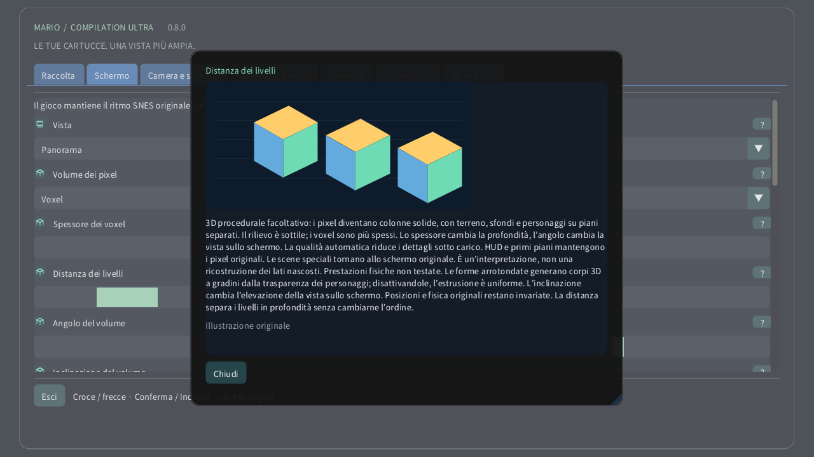

# Volume dei pixel

[English](../en/VOXELS.md) · [Français](../fr/VOXELS.md) · [Español](../es/VOXELS.md) · [日本語](../ja/VOXELS.md) · [Deutsch](../de/VOXELS.md) · [Italiano](../it/VOXELS.md) · [Português](../pt/VOXELS.md) · [Русский](../ru/VOXELS.md) · [简体中文](../zh/VOXELS.md) · [한국어](../ko/VOXELS.md)

Su computer o dispositivo tattile, apri Schermo → Volume dei pixel. Prova prima Rilievo dei pixel per una profondità leggera, poi Voxel. Lo spessore cambia il corpo di ciascun pixel; la distanza separa i livelli senza cambiarne l’ordine. Su Quest usa la pagina Volume del telecomando spaziale. Sull’orologio la corona ingrandisce dall’area intera fino allo schermo originale.

3D procedurale facoltativo: i pixel diventano colonne solide, con terreno, sfondi e personaggi su piani separati. Il rilievo è sottile; i voxel sono più spessi. Lo spessore cambia la profondità, l’angolo cambia la vista sullo schermo. La qualità automatica riduce i dettagli sotto carico. HUD e primi piani mantengono i pixel originali. Le scene speciali tornano allo schermo originale. È un’interpretazione, non una ricostruzione dei lati nascosti. Prestazioni fisiche non testate. Le forme arrotondate generano corpi 3D a gradini dalla trasparenza dei personaggi; disattivandole, l’estrusione è uniforme. L’inclinazione cambia l’elevazione della vista sullo schermo. Posizioni e fisica originali restano invariate. La distanza separa i livelli in profondità senza cambiarne l’ordine.

| Volume dei pixel | |
|---|---|
| 0 | 2D originale |
| 1 | Rilievo dei pixel |
| 2 | Voxel |

- **Spessore dei voxel**: 1–16 px
- **Distanza dei livelli**: 1–12 px
- **Angolo del volume**: −30° … +30°
- **Inclinazione del volume**: −30° … +30°
- **Forme voxel arrotondate**

[Raccolta](README.md) · [Impostazioni illustrate](SETTINGS.md) · [HTML](voxels.html) · [Technical research](../VOXEL_RESEARCH.md)
