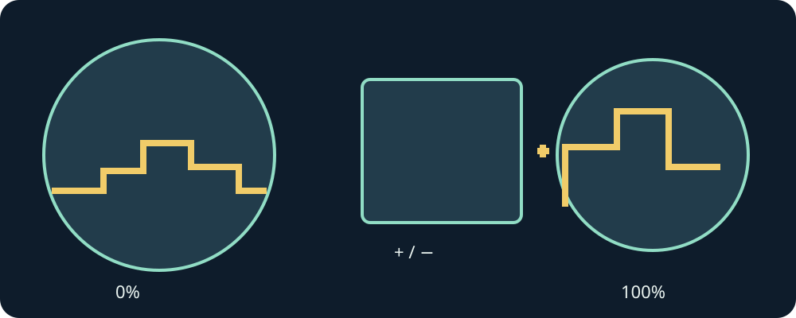

# Mario Compilation Ultra 0.8.0 · Vista orologio

[English](../en/WATCH.md) · [Français](../fr/WATCH.md) · [Español](../es/WATCH.md) · [日本語](../ja/WATCH.md) · [Deutsch](../de/WATCH.md) · [Italiano](../it/WATCH.md) · [Português](../pt/WATCH.md) · [Русский](../ru/WATCH.md) · [简体中文](../zh/WATCH.md) · [한국어](../ko/WATCH.md)



Ruota la corona o ghiera per lo zoom. Nei menu scorre il contenuto; funzionano anche + e - tattili.

0%: tutta l’area caricata. 100%: telecamera originale. Porte e tubi possono caricare un’altra area.

Nella maggior parte dei giochi, B salta e Y corre o afferra. Tieni direzione e azione con dita diverse.

Metti in pausa con l’icona pausa o Indietro di Android. Riprendi conserva la partita. Esci si trova in fondo a Raccolta.

Un pacchetto personale include le tue cartucce locali. I pacchetti pubblici richiedono i tuoi file compatibili.

Trasferisci le cartucce in CartridgeInbox, poi scegli Controlla cartucce trasferite o riavvia l’app. I file esistenti sono preservati.

I comandi fisici dell’orologio e le prestazioni prolungate restano da verificare. Questa edizione è sperimentale.

I comandi fisici dell’orologio e le prestazioni prolungate restano da verificare. Questa edizione è sperimentale.

Aggiornare un APK firmato conserva i dati. Disinstallare o cancellare i dati elimina cartucce e salvataggi locali.

```text
/sdcard/Android/data/com.vhaloo.mariocompilationultra.wear/files/CartridgeInbox/

adb install -r MarioCompilationUltra-0.8.0-Wear-public.apk
adb push cartridge.sfc /sdcard/Android/data/com.vhaloo.mariocompilationultra.wear/files/CartridgeInbox/
```

[Wear APK](https://github.com/vhaloo/MarioCompilationUltra/releases/download/v0.8.0/MarioCompilationUltra-0.8.0-Wear-public.apk) · [HTML](watch.html) · [Impostazioni illustrate](SETTINGS.md) · [Guide](README.md)
