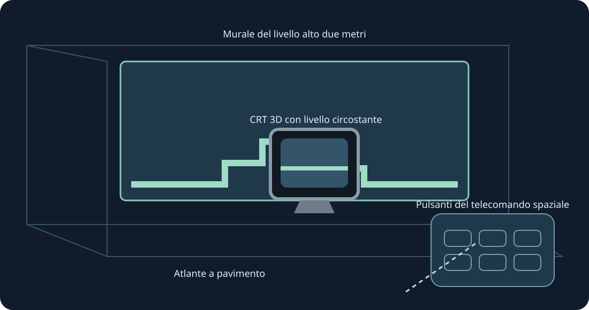

# Mario Compilation Ultra 0.5.0 · Quest VR / AR

[English](../en/XR.md) · [Français](../fr/XR.md) · [Español](../es/XR.md) · [日本語](../ja/XR.md) · [Deutsch](../de/XR.md) · [Italiano](../it/XR.md) · [Português](../pt/XR.md) · [Русский](../ru/XR.md) · [简体中文](../zh/XR.md) · [한국어](../ko/XR.md)

Pareti, pavimento, tavolo arcade, CRT e galleria curva. Anteprima XR sperimentale. Usa entrambe le prese per scalare.

Anteprima XR sperimentale. L’utente ha confermato la raccolta 0.4 visibile su Quest 3 dopo l’installazione; l’invio dei fotogrammi è stato registrato. La 0.5 viene compilata e verificata separatamente. Tracciamento, comfort, passthrough, posizione e gioco prolungato richiedono prove fisiche.

Per il test futuro, attiva la modalità sviluppatore e installa l’APK ARM64 pubblico con SideQuest o adb install -r. Apri Mario Compilation Ultra XR da Origini sconosciute, scegli una cartuccia o ZIP e premi Gioca. Importa All-Stars + World e Yoshi’s Island separatamente. L’APK pubblico non contiene ROM né progressi.

Schermo spaziale | Adatta alla parete acquisita | Murale del livello alto due metri | Atlante a pavimento | Tavolo arcade | CRT 3D con livello circostante | Galleria curva del livello

Seleziona livello, CRT nativo, telecomando o opzioni. Una presa sposta e ruota; due ridimensionano il livello anche con posizione bloccata. Sono disponibili regolazioni fini e metà/doppio/ripristina. Recupera riporta l’interfaccia vicino. Y apre le opzioni; la pagina Gioca contiene tutti i pulsanti SNES.

Pizzica e trascina lo stick; usa l’altra mano per i pulsanti. Il pizzico col medio afferra le maniglie. La perdita del tracciamento rilascia i comandi.

Una nuova installazione richiede 90 Hz e un murale AR trasparente alto due metri. Se necessario si usa una frequenza supportata; la simulazione resta originale. Scansione stanza e permessi scena/ancore sono facoltativi per le pareti automatiche. Restano posizione manuale e calibrazione del pavimento. Il runtime fornisce passthrough, senza permessi Internet, microfono o immagini della fotocamera.

Le immagini fantasma sono informative, senza simulare oggetti lontani. Le posizioni verificate appaiono subito; le immagini apprese provengono solo dal gioco locale.

Il tavolo arcade mostra l’area caricata. Fisica e attivazione degli oggetti restano originali.

Comandi rapidi PC: tieni premuto lo stick destro; croce sinistra/destra zoom, su 1:1, giù mappa intera, A blocca, B camera originale, X schermata, Y segue il giocatore. Rilascia per tornare ai comandi SNES. F1 o aiuto Y nel menu apre la spiegazione illustrata.

SNES: D-pad · A · B · X · Y · L · R · Start · Select

Touch: A → SNES B · B → SNES Y · X → SNES A · RT → SNES X · R3 → Start · LT → Rewind · Y → Sposta opzioni

[HTML](xr.html) · [Guide](README.md) · [Build](../BUILD.md) · [Parity](../PARITY.md) · [Validation](../TEST_REPORT.md)

[Meta developer mode](https://developers.meta.com/vr/documentation/android-apps/enable-developer-mode/) · [Meta refresh API](https://developers.meta.com/vr/documentation/native/android/mobile-display-refresh-rate/) · [Meta passthrough](https://developers.meta.com/vr/documentation/native/android/mobile-passthrough/)
