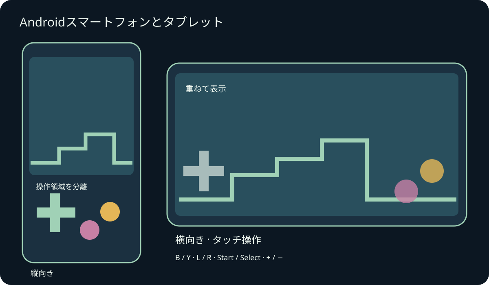
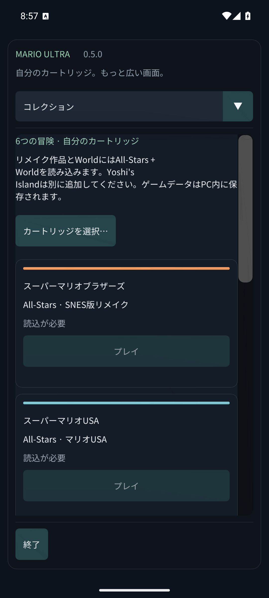

# Mario Compilation Ultra 0.5.0 · Androidスマートフォンとタブレット

[English](../en/MOBILE.md) · [Français](../fr/MOBILE.md) · [Español](../es/MOBILE.md) · [日本語](../ja/MOBILE.md) · [Deutsch](../de/MOBILE.md) · [Italiano](../it/MOBILE.md) · [Português](../pt/MOBILE.md) · [Русский](../ru/MOBILE.md) · [简体中文](../zh/MOBILE.md) · [한국어](../ko/MOBILE.md)

スマートフォン・タブレット用APKをインストールし、アプリ一覧からMario Compilation Ultraを開きます。GitHubの公開APKでは自分のカートリッジを選択します。個人用ROM版では6作品をすぐに選べます。Quest APKは別のヘッドセット用アプリです。Android 8以降とOpenGL ES 3が必要で、ARM64・ARMv7・x86_64を含みます。

回転やウィンドウサイズの変更でもゲームは続きます。画面の切り欠きやシステム操作領域を避けて表示します。

複数の指で移動・ダッシュ・ジャンプを同時に操作できます。ゲームパッド接続時は自動タッチ表示が隠れます。Androidの戻るでメニューを開きます。

ボタン名はSNESと同じです。多くのマリオ作品ではBでジャンプ、Yでダッシュします。L・R・Start・Selectも使えます。表示ボタンで5つのモード、−と＋でピクセル倍率を切り替えます。巻き戻しは押している間だけ動作します。設定ボタンですぐに一時停止します。メニューは指でスクロールし、狭い画面では上の一覧から項目を選びます。

- 画面の向き
- タッチ操作
- タッチ配置
- タッチボタンの大きさ
- タッチボタンの不透明度
- 左利き用配置
- タッチ振動
- プレイ中は画面を点灯

ステート・巻き戻し・バッテリーセーブはアプリ専用領域に保存します。バックグラウンド移行時にバッテリーを保存し、有効なら再開用スロット0も保存します。同じ署名のAPKで更新すれば進行を保持します。アンインストールやデータ消去でカートリッジとセーブは削除されます。保存操作はセーブ・サウンド項目にあります。

スマートフォン・タブレットのエミュレーター検証と実機検証は区別しています。性能、ゲームパッド、切り欠き、ウィンドウ動作は機種により異なります。macOS版は実機Macでは未検証の実験版です。詳しい範囲は検証レポートを確認してください。

[Android APK](https://github.com/vhaloo/MarioCompilationUltra/releases/download/v0.5.0/MarioCompilationUltra-0.5.0-Android-public.apk) · [HTML](mobile.html) · [Guide](README.md) · [Quest](XR.md) · [Validation](../TEST_REPORT.md)

[Adaptive Android apps](https://developer.android.com/develop/adaptive-apps/guides/support-different-display-sizes) · [16 KiB page sizes](https://developer.android.com/guide/practices/page-sizes)
