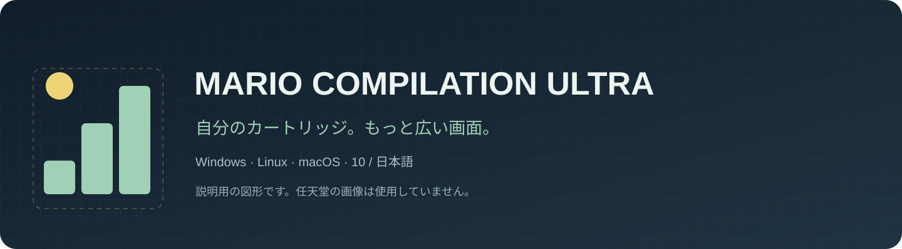
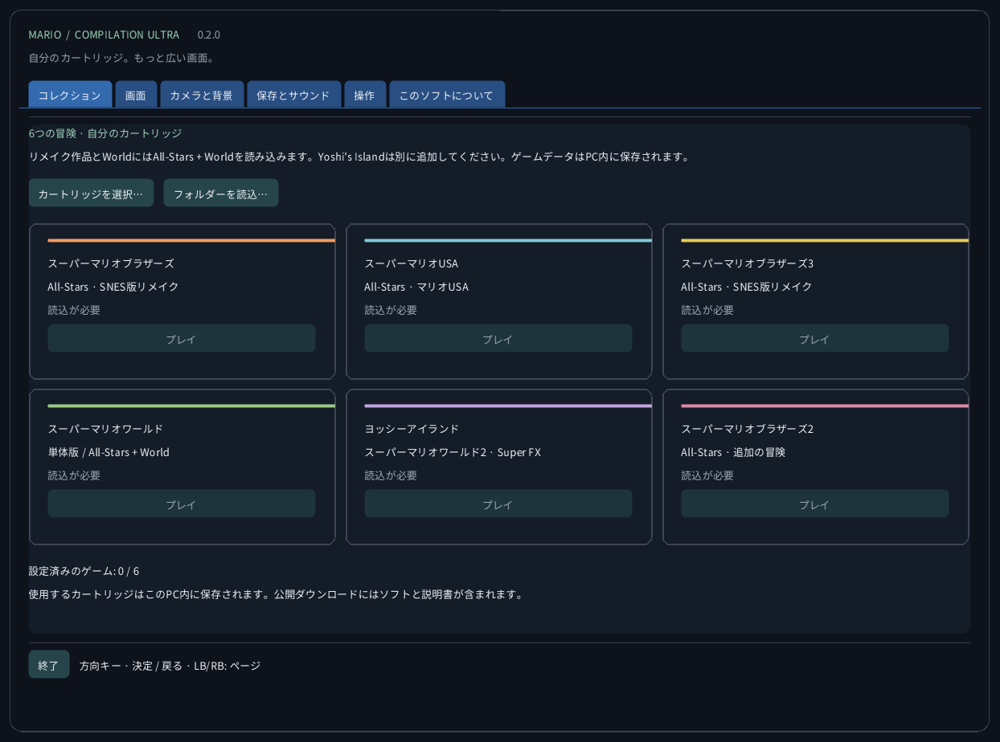
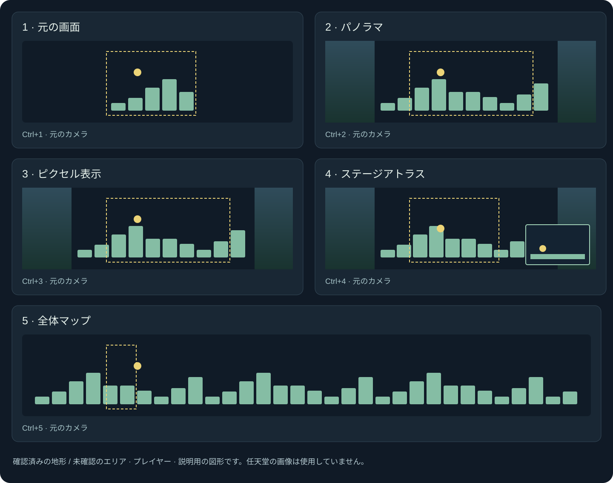
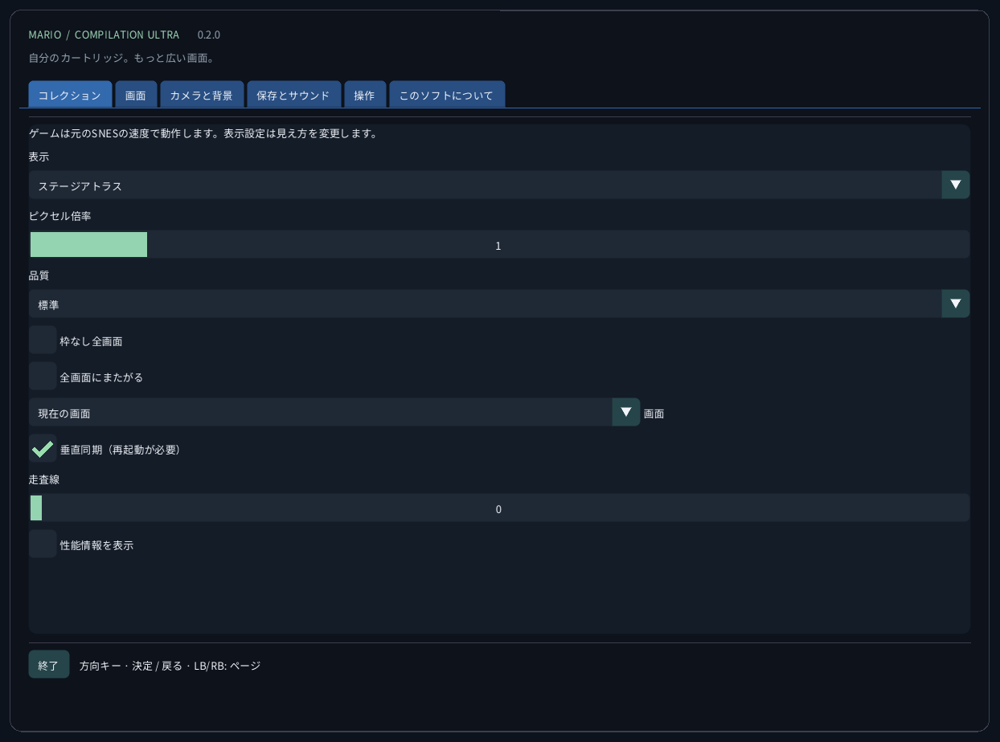
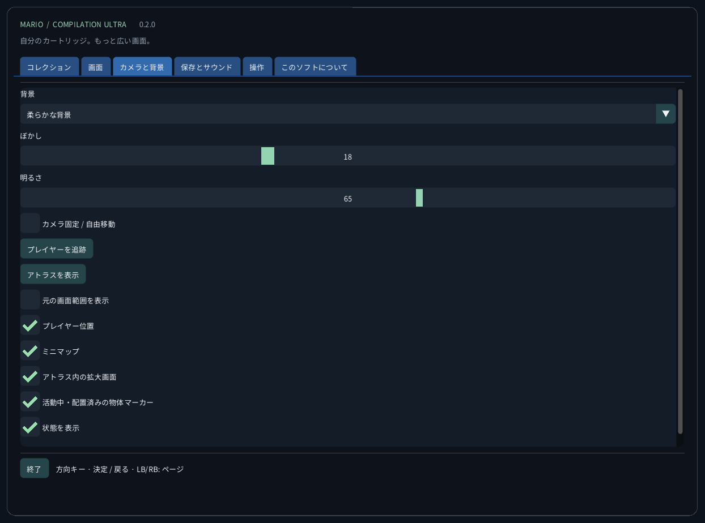
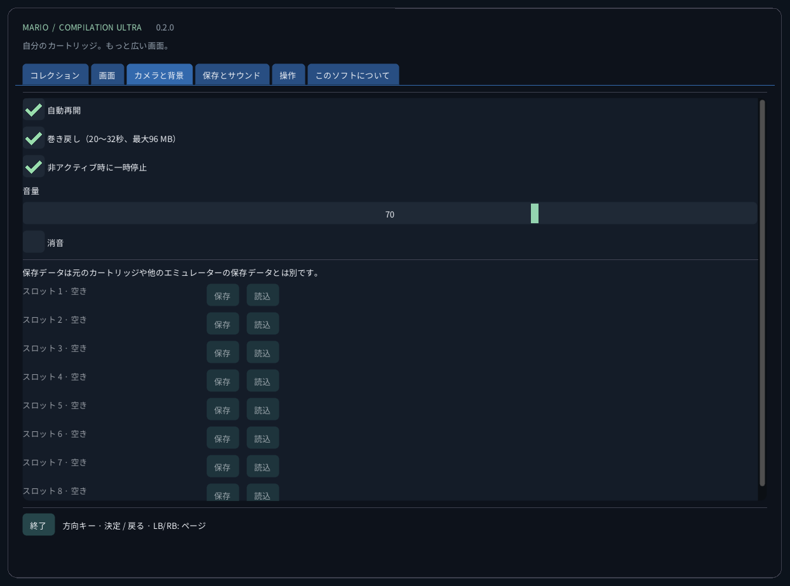
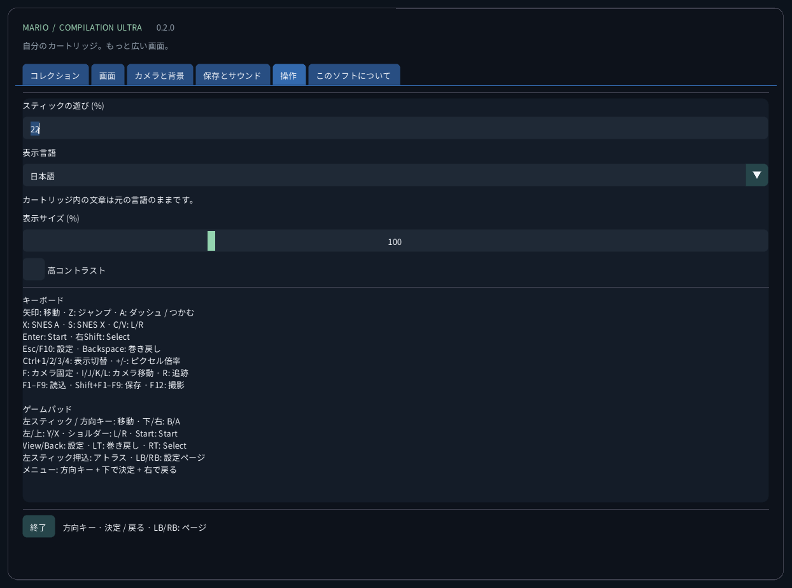
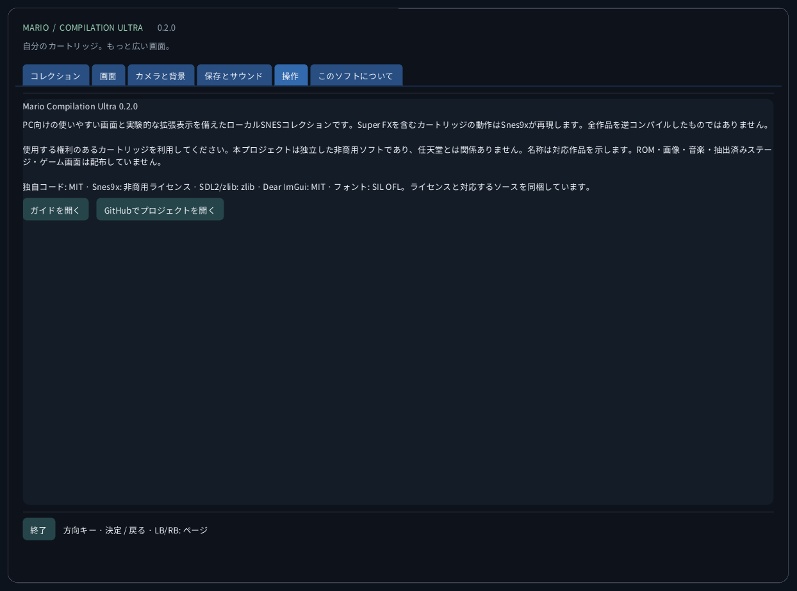

<!-- Generated by tools/guides.py; edit docs/guide-texts.json and assets/locales. -->


[English](../en/README.md) · [Français](../fr/README.md) · [Español](../es/README.md) · [日本語](../ja/README.md) · [Deutsch](../de/README.md) · [Italiano](../it/README.md) · [Português](../pt/README.md) · [Русский](../ru/README.md) · [简体中文](../zh/README.md) · [한국어](../ko/README.md)

# Mario Compilation Ultra 0.2.0

PC向けの使いやすい画面と実験的な拡張表示を備えたローカルSNESコレクションです。Super FXを含むカートリッジの動作はSnes9xが再現します。全作品を逆コンパイルしたものではありません。

[ダウンロードとデスクトップからの起動](https://github.com/vhaloo/MarioCompilationUltra/releases/tag/v0.2.0) · [HTML](guide.html) · [GitHub](https://github.com/vhaloo/MarioCompilationUltra)

## ダウンロードとデスクトップからの起動

1. お使いのパソコン用のZIPをすべて展開してください。実行ファイル、SDL、素材、ガイドを同じフォルダーに保ちます。WindowsはMarioCompilationUltra.exe、LinuxはPlay.sh、Macはアプリを開きます。
2. 自分の.sfc、.smc、またはカートリッジ1本入りのZIPを、選択ボタン、フォルダーの読み込み、ドラッグ＆ドロップで読み込みます。選択画面はアプリのデータフォルダーから開きます。対応ファイルをそこに直接置くと、次回起動時に認識されます。
3. All-Stars + Super Mario Worldにはマリオ1、Super Mario USA、マリオ3、World、The Lost Levelsが含まれます。ヨッシーアイランドは別に追加します。プレイを選び、元のタイトル画面でEnterまたはStartを押します。デモ中ならもう一度押してください。

WindowsはInstall-Windows.ps1でパッケージ全体をユーザーのProgramsにコピーし、デスクトップにショートカットを作成します。LinuxはInstall-Linux.shでこのフォルダーをメニューとデスクトップに登録します。MacはApplicationsにアプリを移動し、デスクトップにエイリアスを作ります。選んだフォルダーは移動しないでください。

```powershell
# Windows
powershell -NoProfile -ExecutionPolicy Bypass -File .\Install-Windows.ps1
```

```sh
# Linux
sh ./Install-Linux.sh
```



*スクリーンショットはカートリッジを読み込まずに実際のアプリから撮影しています。図はゲーム素材ではなく、独自の説明用図形です。公開配布にはNintendoのROM、スプライト、音楽、抽出レベル、ゲーム画面は含まれません。*

## 配布パッケージと検証

- Windows x64：ローカルのデスクトップ起動とカートリッジ実行を確認。自動テストも実施。
- Linux x64：自動ビルドとROMなしの検査。実際のLinuxデスクトップでのゲーム動作は未検証です。
- **macOS Intel x64とApple Silicon arm64：実験版、実機Macでは未検証。自動環境ではビルドとROMなしの画面を検査します。アドホック署名のみで公証はありません。実機でのコントローラー、音声、描画、Gatekeeperは未確認です。**

## 表示モード



Worldのアトラスは現在読み込まれたエリアを表示し、ゲーム全体を一度に表示するものではありません。マリオ1、Lost Levels、マリオ2、マリオ3と通常のヨッシー場面は移動中に見えた地形を蓄積します。未観測部分は斜線表示です。元のカメラの外では効果やスプライトが異なることがあります。特殊な投影は元の画面で表示します。

拡張メモリプロファイルとAll-Starsの自動選択は一覧の米国版向けです。認識できても検証済みプロファイルのない版は元の表示を使います。画面メニューの翻訳は市販カートリッジの物語や画像を翻訳しません。5作品すべての新しいネイティブ逆コンパイルを実現したとは主張しません。

| CRC32 | SNES |
|---|---|
| `f84305b1` | All-Stars + World (US) |
| `925637c7` | All-Stars (US) |
| `b19ed489` | Super Mario World (US) |
| `d138f224` | Yoshi’s Island 1.0 (US) |
| `cf98ddaa` | Yoshi’s Island 1.1 (US) |

## 操作

キーボード<br>
矢印: 移動 · Z: ジャンプ · A: ダッシュ / つかむ<br>
X: SNES A · S: SNES X · C/V: L/R<br>
Enter: Start · 右Shift: Select<br>
Esc/F10: 設定 · Backspace: 巻き戻し<br>
Ctrl+1/2/3/4: 表示切替 · +/-: ピクセル倍率<br>
F: カメラ固定 · I/J/K/L: カメラ移動 · R: 追跡<br>
F1–F9: 読込 · Shift+F1–F9: 保存 · F12: 撮影<br>
<br>
ゲームパッド<br>
左スティック / 方向キー: 移動 · 下/右: B/A<br>
左/上: Y/X · ショルダー: L/R · Start: Start<br>
View/Back: 設定 · LT: 巻き戻し · RT: Select<br>
左スティック押込: アトラス · LB/RB: 設定ページ<br>
メニュー: 方向キー + 下で決定 + 右で戻る

## 保存とサウンド

各ゲームに手動9スロット、自動再開、バッテリーSRAM、制限付き巻き戻しがあります。巻き戻しは最大96 MiBで約20～32秒です。F1～F9で読み込み、Shift+F1～F9で保存します。状態はカートリッジCRC、エンジン版、整合性を確認します。他のエミュレーターの保存とは別に管理します。

## ローカルファイル

このフォルダーにはsettings.ini、カートリッジへの参照、states/、sram/、screenshots/があります。読み込みでカートリッジを送信したり元のファイルを変更したりしません。パソコンを変える前にバックアップしてください。状態は同じカートリッジとエンジンに依存し、SRAMは別ファイルです。

| OS | ローカルカートリッジフォルダー |
|---|---|
| Windows | `%APPDATA%/ValentinWittwe/MarioCompilationUltra/` |
| Linux | `$XDG_DATA_HOME/ValentinWittwe/MarioCompilationUltra/` or `~/.local/share/ValentinWittwe/MarioCompilationUltra/` |
| macOS | `~/Library/Application Support/ValentinWittwe/MarioCompilationUltra/` |

## 読み込みが必要と表示される場合

ファイルを移動した、またはドライブを外した場合はカートリッジを再選択してください。ZIPは.sfcか.smcを1本だけ含み、暗号化なしの無圧縮またはDEFLATEである必要があります。対応版とヘッダーを確認します。フォントやSDLがない場合は、ZIP全体を再展開してください。

## 実際の画面ギャラリー

### コレクション


### 画面



### カメラと背景



### 保存とサウンド



### 操作



### このソフトについて



## 配布パッケージと検証 · 0.2.0

自動検査は実行・コントローラーの63項目、10カタログ各165メッセージ、フォント、4サイズ計240画面を対象とします。短い非公開テストは全ゲームのクリアを意味しません。詳細報告と各版のワークフローで確認済みの動作と未検証の機器を区別します。

[CTest / CI](https://github.com/vhaloo/MarioCompilationUltra/actions) · [Report](../TEST_REPORT.md) · [Build](../BUILD.md) · [Source / research](../RESEARCH.md)

使用する権利のあるカートリッジを利用してください。本プロジェクトは独立した非商用ソフトであり、任天堂とは関係ありません。名称は対応作品を示します。ROM・画像・音楽・抽出済みステージ・ゲーム画面は配布していません。

独自コード: MIT · Snes9x: 非商用ライセンス · SDL2/zlib: zlib · Dear ImGui: MIT · フォント: SIL OFL。ライセンスと対応するソースを同梱しています。

[Licence](../../LICENSE) · [Third-party notices](../../THIRD_PARTY_NOTICES.md)
