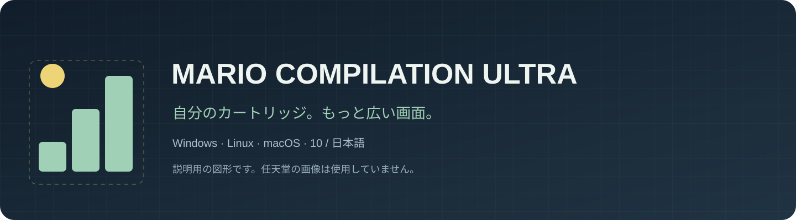
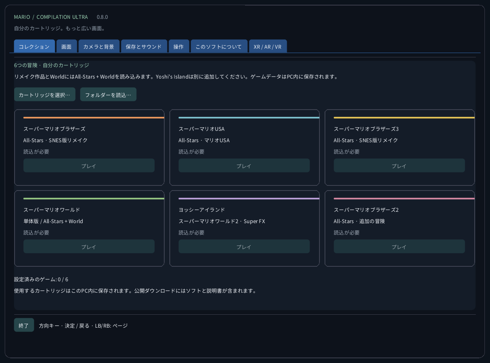
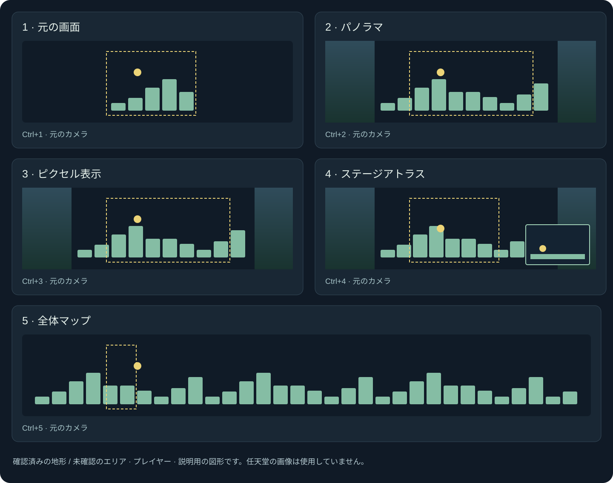
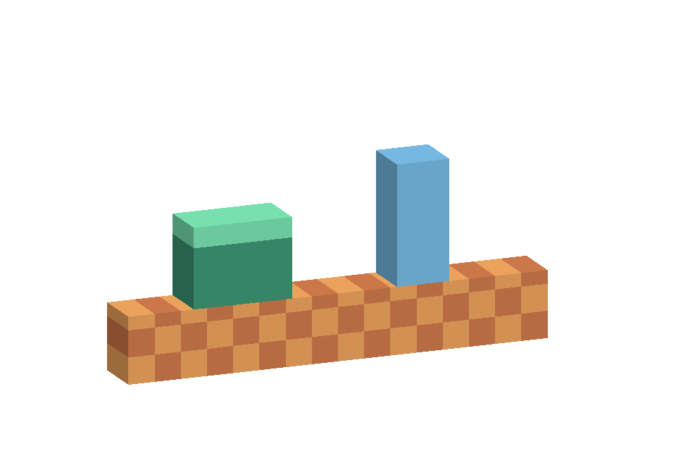
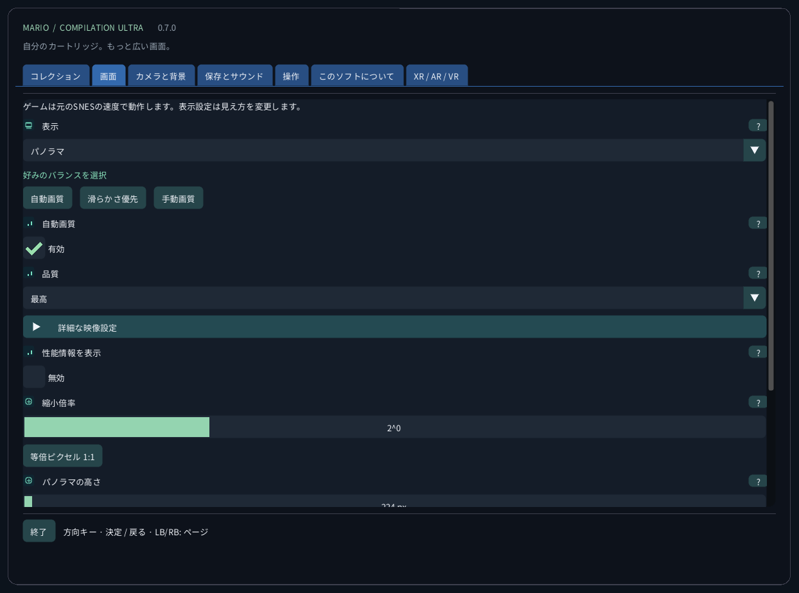
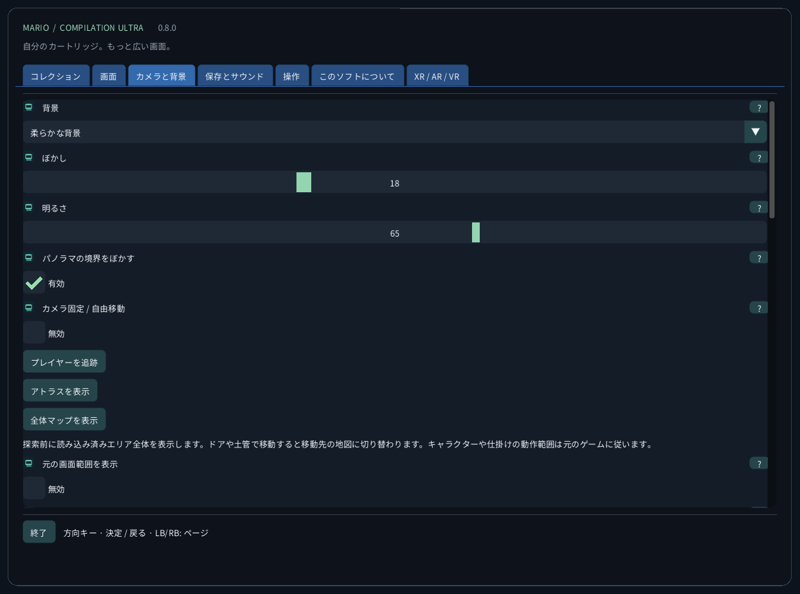
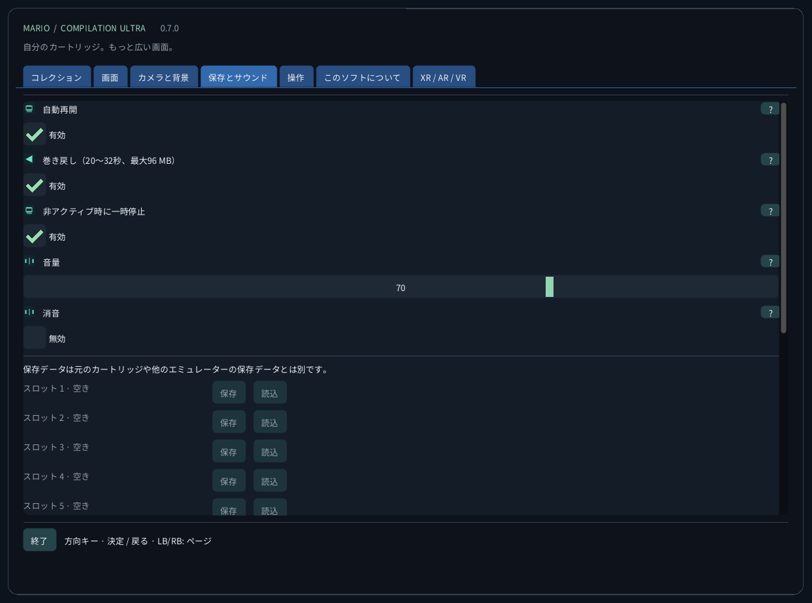
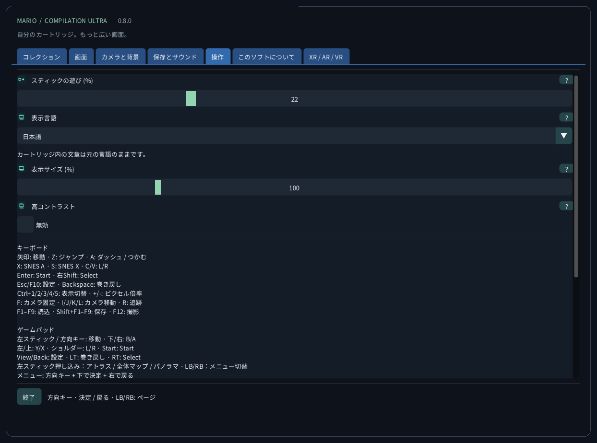
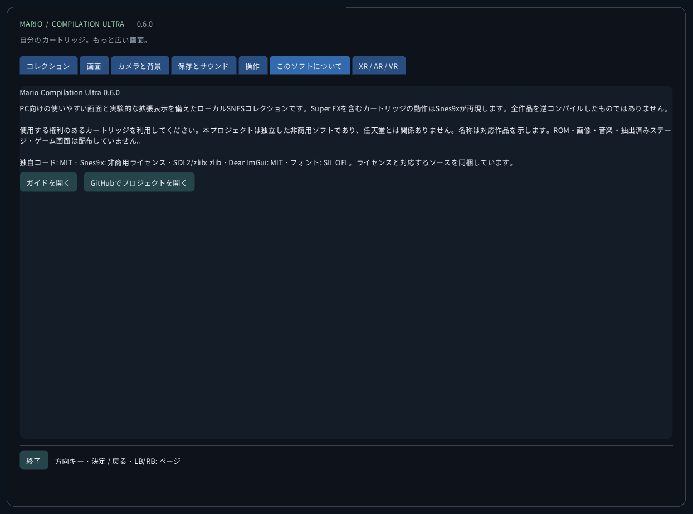
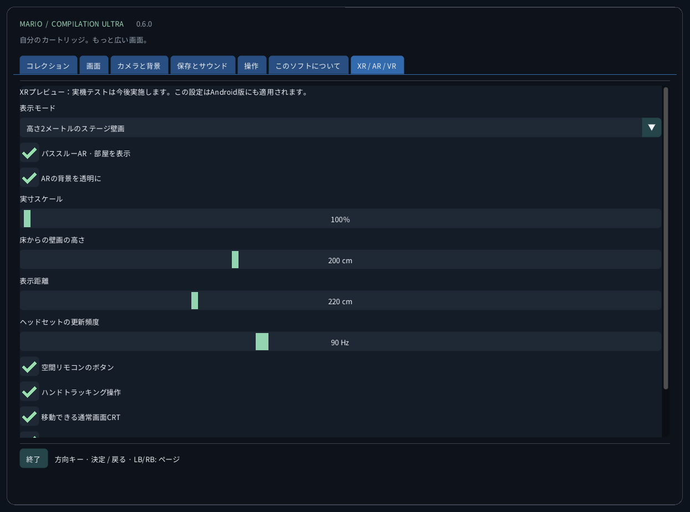

<!-- Generated by tools/guides.py; edit docs/guide-texts.json and assets/locales. -->


[English](../en/README.md) · [Français](../fr/README.md) · [Español](../es/README.md) · [日本語](../ja/README.md) · [Deutsch](../de/README.md) · [Italiano](../it/README.md) · [Português](../pt/README.md) · [Русский](../ru/README.md) · [简体中文](../zh/README.md) · [한국어](../ko/README.md)

# Mario Compilation Ultra 0.9.0

PC向けの使いやすい画面と実験的な拡張表示を備えたローカルSNESコレクションです。Super FXを含むカートリッジの動作はSnes9xが再現します。全作品を逆コンパイルしたものではありません。

[ダウンロードとデスクトップからの起動](https://github.com/vhaloo/MarioCompilationUltra/releases/tag/v0.9.0) · [HTML](guide.html) · [GitHub](https://github.com/vhaloo/MarioCompilationUltra)

## ダウンロードとデスクトップからの起動

1. お使いのパソコン用のZIPをすべて展開してください。実行ファイル、SDL、素材、ガイドを同じフォルダーに保ちます。WindowsはMarioCompilationUltra.exe、LinuxはPlay.sh、Macはアプリを開きます。
2. 自分の.sfc、.smc、またはカートリッジ1本入りのZIPを、選択ボタン、フォルダーの読み込み、ドラッグ＆ドロップで読み込みます。選択画面はアプリのデータフォルダーから開きます。対応ファイルをそこに直接置くと、次回起動時に認識されます。
3. All-Stars + Super Mario Worldにはマリオ1、Super Mario USA、マリオ3、World、The Lost Levelsが含まれます。ヨッシーアイランドは別に追加します。プレイを選び、元のタイトル画面でEnterまたはStartを押します。デモ中ならもう一度押してください。

WindowsはInstall-Windows.ps1でパッケージ全体をユーザーのProgramsにコピーし、デスクトップにショートカットを作成します。LinuxはInstall-Linux.shでこのフォルダーをメニューとデスクトップに登録します。MacはApplicationsにアプリを移動し、デスクトップにエイリアスを作ります。選んだフォルダーは移動しないでください。

```powershell
# Windows
powershell -NoProfile -ExecutionPolicy Bypass -File .\Install-Windows.ps1
```

```sh
# Linux
sh ./Install-Linux.sh
```



*スクリーンショットはカートリッジを読み込まずに実際のアプリから撮影しています。図はゲーム素材ではなく、独自の説明用図形です。公開配布にはNintendoのROM、スプライト、音楽、抽出レベル、ゲーム画面は含まれません。*

## 配布パッケージと検証

- Windows x64：ローカルのデスクトップ起動とカートリッジ実行を確認。自動テストも実施。
- Linux x64：自動ビルドとROMなしの検査。実際のLinuxデスクトップでのゲーム動作は未検証です。
- **macOS Intel x64とApple Silicon arm64：実験版、実機Macでは未検証。自動環境ではビルドとROMなしの画面を検査します。アドホック署名のみで公証はありません。実機でのコントローラー、音声、描画、Gatekeeperは未確認です。**

## 表示モード



推奨画質：パノラマ、自動倍率、くっきりフィルター、正方形ピクセル、なめらかな境界、暗めの周囲背景。画面設定の「推奨画質に戻す」で言語・音声・保存データを変えずに適用できます。最近傍・なめらかフィルターとテレビ4:3も選択できます。ピクセルワールドは常に整数倍率と正方形ピクセルを維持します。走査線はゲームの行に合わせ、モアレ防止のため2倍未満では表示しません。

全体マップ（Ctrl+5）は6ゲームすべてで、プレイ開始時から読み込み済みエリアの地形全体を表示します。下見は不要です。ドアや土管で別の部屋へ進むと地図が切り替わり、離れた部屋は結合しません。Mario Worldでは存在する2つの地形面を表示します。矢印がプレイヤーを示し、余白があれば拡大画面も表示します。従来の4表示は残り、World以外では観測済み地形を蓄積します。キャラクター、動く足場、特殊効果の動作範囲は元のゲームと同じです。地形マップのない特殊な部屋は元の表示になります。左スティック押し込みでアトラス→全体マップ→パノラマを切り替えます。

拡張メモリプロファイルとAll-Starsの自動選択は一覧の米国版向けです。認識できても検証済みプロファイルのない版は元の表示を使います。画面メニューの翻訳は市販カートリッジの物語や画像を翻訳しません。5作品すべての新しいネイティブ逆コンパイルを実現したとは主張しません。

## 実際のゲーム画面

画面設定の「実際のゲーム画面」で、同じ場面の表示を比較できます。プレイ中にメニューを開き、「現在のシーンを撮影」を選ぶと端末に保存されます。

コレクション画面ですべての設定を初期化できます。設定ページごとの初期化もできます。カートリッジとセーブデータは保持されます。新規プロファイルはオリジナルの2D表示で開きます。

## 詳細設定を開く

外観を選ぶと、現在の画面とカメラの設定が置き換わります。

**設定プロファイル** · 外観を適用する前に、現在の設定をここに保存できます。

## ピクセルの立体化



任意のプロシージャル3D表示です。ピクセルを柱に変換し、地形、背景、キャラクターを別々の奥行きに配置します。浮き彫りは薄く、ボクセルは厚くなります。厚さは奥行き、角度は画面上の視点を変更します。自動画質は負荷に応じて細部を減らします。HUDと元のカメラの拡大表示は元のピクセルを保持します。特殊な場面は元の画面に戻ります。見えない裏面を復元するものではありません。実機での性能は未検証です。 丸みのある形状は、キャラクターの透明部分から段階的な3D形状を生成します。無効にすると厚さが均一になります。傾きは画面上の視点の高さを変更します。元の位置とゲームの物理は変わりません。 レイヤー間隔は重なり順を保ったまま奥行きの間隔を変えます。

[ピクセルの立体化](VOXELS.md) · [HTML](voxels.html)

## 自動解像度

0.8は背景解像度、ボクセル格子、装飾更新頻度、VRシェーダーを利用できる性能に合わせて調整します。拡大画面では元のゲーム画像を確認でき、メニューも鮮明です。Questはフレーム時間の35%以上の余裕を目標にします。これは自動調整の目標であり、実機での結果を保証しません。

[Performance / GPU](../PERFORMANCE.md)

| CRC32 | SNES |
|---|---|
| `f84305b1` | All-Stars + World (US) |
| `925637c7` | All-Stars (US) |
| `b19ed489` | Super Mario World (US) |
| `d138f224` | Yoshi’s Island 1.0 (US) |
| `cf98ddaa` | Yoshi’s Island 1.1 (US) |

## Androidスマートフォンとタブレット

[Androidスマートフォンとタブレット](MOBILE.md) · [HTML](mobile.html) · [Android APK](https://github.com/vhaloo/MarioCompilationUltra/releases/download/v0.9.0/MarioCompilationUltra-0.9.0-Android-public.apk)

## 時計の表示

[時計の表示](WATCH.md) · [Wear OS APK](https://github.com/vhaloo/MarioCompilationUltra/releases/download/v0.9.0/MarioCompilationUltra-0.9.0-Wear-public.apk) · [図解設定ガイド](SETTINGS.md)

## Quest VR / AR

[Quest ARM64 APK](https://github.com/vhaloo/MarioCompilationUltra/releases/download/v0.9.0/MarioCompilationUltra-0.9.0-Quest-public.apk) · [Quest VR / AR](XR.md) · [HTML](xr.html) · [Parity](../PARITY.md)

## 操作

キーボード<br>
矢印: 移動 · Z: ジャンプ · A: ダッシュ / つかむ<br>
X: SNES A · S: SNES X · C/V: L/R<br>
Enter: Start · 右Shift: Select<br>
Esc/F10: 設定 · Backspace: 巻き戻し<br>
Ctrl+1/2/3/4/5: 表示切替 · +/-: ピクセル倍率<br>
F: カメラ固定 · I/J/K/L: カメラ移動 · R: 追跡<br>
F1–F9: 読込 · Shift+F1–F9: 保存 · F12: 撮影<br>
<br>
ゲームパッド<br>
左スティック / 方向キー: 移動 · 下/右: B/A<br>
左/上: Y/X · ショルダー: L/R · Start: Start<br>
View/Back: 設定 · LT: 巻き戻し · RT: Select<br>
左スティック押し込み：アトラス / 全体マップ / パノラマ · LB/RB：メニュー切替<br>
メニュー: 方向キー + 下で決定 + 右で戻る

右スティックで視点を回転。押し込みながら倒すと視点を移動します。

## 保存とサウンド

各ゲームに手動9スロット、自動再開、バッテリーSRAM、制限付き巻き戻しがあります。巻き戻しは最大96 MiBで約20～32秒です。F1～F9で読み込み、Shift+F1～F9で保存します。状態はカートリッジCRC、エンジン版、整合性を確認します。他のエミュレーターの保存とは別に管理します。

## ローカルファイル

このフォルダーにはsettings.ini、カートリッジへの参照、states/、saves/、screenshots/があります。読み込みでカートリッジを送信したり元のファイルを変更したりしません。パソコンを変える前にバックアップしてください。状態は同じカートリッジとエンジンに依存し、SRAMは別ファイルです。

| OS | ローカルカートリッジフォルダー |
|---|---|
| Windows | `%APPDATA%/ValentinWittwe/MarioCompilationUltra/` |
| Linux | `$XDG_DATA_HOME/ValentinWittwe/MarioCompilationUltra/` or `~/.local/share/ValentinWittwe/MarioCompilationUltra/` |
| macOS | `~/Library/Application Support/ValentinWittwe/MarioCompilationUltra/` |

--data-dirで指定したフォルダーは既定の保存先より優先されます。Windowsショートカットの更新時も維持されます。ローカルファイル画面で実際の保存先を確認できます。

## 読み込みが必要と表示される場合

ファイルを移動した、またはドライブを外した場合はカートリッジを再選択してください。ZIPは.sfcか.smcを1本だけ含み、暗号化なしの無圧縮またはDEFLATEである必要があります。対応版とヘッダーを確認します。フォントやSDLがない場合は、ZIP全体を再展開してください。

## 実際の画面ギャラリー

### コレクション


### 画面



### カメラと背景



### 保存とサウンド



### 操作



### このソフトについて



### Quest VR / AR



## 配布パッケージと検証 · 0.9.0

0.8は手続き型のレリーフとボクセルを追加します。9つの公開テストが独自の形状、奥行き、透明度、設定、既存機能を検証します。ローカルの6ゲームは別に検査し、画像は非公開です。スマートフォン、タブレット、Wear OSはエミュレーターを使います。Mac、Android、時計、Quest実機のゲーム動作は実験的です。最新レポートを参照してください。

[CTest / CI](https://github.com/vhaloo/MarioCompilationUltra/actions) · [Report](../TEST_REPORT.md) · [Build](../BUILD.md) · [Source / research](../RESEARCH.md)

使用する権利のあるカートリッジを利用してください。本プロジェクトは独立した非商用ソフトであり、任天堂とは関係ありません。名称は対応作品を示します。ROM・画像・音楽・抽出済みステージ・ゲーム画面は配布していません。

独自コード: MIT · Snes9x: 非商用ライセンス · SDL2/zlib: zlib · Dear ImGui: MIT · フォント: SIL OFL。ライセンスと対応するソースを同梱しています。

[Licence](../../LICENSE) · [Third-party notices](../../THIRD_PARTY_NOTICES.md)
