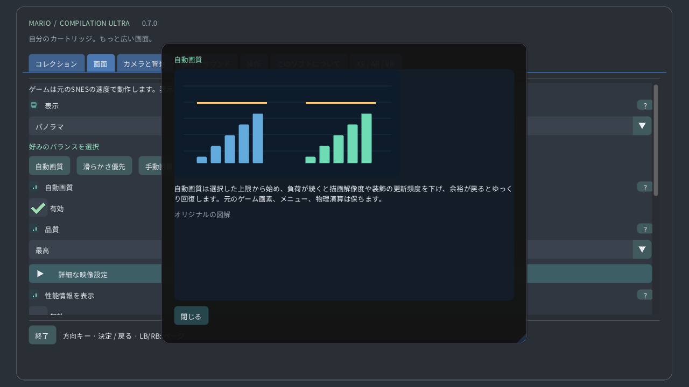

# 図解設定ガイド

## コレクション

ローカルのカートリッジを選び、ゲームを起動したりガイドを開いたりします。公開ダウンロードにゲームや個人のセーブデータは含まれません。

## 表示

オリジナルは元の画面、パノラマは拡張表示です。アトラスは利用できる地形、全体マップは対応する形式の読み込み済みエリア全体を未探索部分も含めて表示します。扉で別エリアに移る場合があります。

## カメラと背景

元のカメラ、プレイヤー、固定位置から追従方法を選びます。表示範囲だけを変え、キャラクターを移動させたり遠くの敵を起動したりはしません。

## 時計のズーム

ズームで表示範囲を変えます。時計では0%で読み込み済みマップ全体、100%で元のカメラ画面になります。ゲーム速度は変わりません。

## 丸画面の魚眼表示

丸い時計ではゲーム画面全体を円形に曲げ、元画像の端も残します。操作ボタンと文字は変形しません。無効にすると歪みのない長方形で表示します。

## リューズの感度

検出したリューズや回転ベゼルで、プレイ中はズーム、メニューではスクロールできます。感度で回転量の効果、反転で方向を変えます。タッチでもズームできます。

## 画像フィルター

最近傍はピクセルの輪郭を保ち、くっきりは整数倍以外でも鮮明に表示します。なめらかは拡大を柔らかくします。元画像や当たり判定は変わりません。

## 画面比率

正方形ピクセルは元のピクセル形状、TV 4:3はテレビの比率です。ピクセルワールドでは正方形ピクセルと整数倍ズームを使います。

## 自動画質

自動画質は選択した上限から始め、負荷が続くと描画解像度や装飾の更新頻度を下げ、余裕が戻るとゆっくり回復します。元のゲーム画素、メニュー、物理演算は保ちます。

## 処理時間の余裕

予備時間は各フレームに余裕を残します。大きいほど滑らかさを優先します。滑らかさ優先は40%、Questは最低35%を目標にします。余裕が続けば画質を戻します。

## 端末の発熱に対応

Androidの端末内の発熱状態に応じて装飾を軽くします。温度の権限や通信は不要です。実際の動作クロックや画面更新頻度はOSが管理します。

## 垂直同期

垂直同期は画面に合わせてティアリングを減らします。ゲームは元の時計で動きます。Questでは選択したヘッドセットの更新頻度を使い、それに対して余裕を確保します。

## VRシェーダー

軽量CRTは計算を減らしてレトロな外観を保ちます。自動は軽量から始め、GPUの余裕を長く確認してから基準版を許可します。基準版は重い計算を固定します。

## 画面

ウィンドウ、使用画面、全画面表示を選びます。表示場所だけが変わり、読み込み済みステージやセーブデータは変わりません。

## 背景

背景はゲームの周囲の空間を埋めます。柔らかい風景はゲームの色を使い、ミッドナイトと黒は落ち着いた表示です。ぼかしと明るさは周囲にだけ作用します。

## ぼかし

ぼかしは周囲の風景を柔らかくし、明るさはその光量を変えます。元のゲーム画像は変わりません。高負荷時は装飾の更新頻度を下げることがあります。

## パノラマの境界をぼかす

柔らかい境界は元のカメラ付近で拡張風景を背景になじませます。無効にすると境界が明確になります。全体マップの表示範囲は保たれます。

## プレイヤー位置

マーカーはプレイヤー、ガイド枠は元のカメラ、ミニマップはエリア内の位置を示します。クローズアップはマップを引いたときも元の画面を読みやすくします。

## 配置された敵を予告

プレビューは確認済み配置や端末内で観察した外観を示します。薄い物体や輪郭は案内であり、追加の敵を起動しません。不透明度やラベルで見やすさを調整します。

## 状態を表示

操作ヒントの位置、サイズ、不透明度、表示時間を選びます。時間を0にすると常に表示します。ゲームやカメラ自体は変わりません。

## 言語

メニューの言語、サイズ、コントラストを調整します。図解ガイドはオフラインで読めます。ゲームの描画やカートリッジの言語とは別の設定です。

## 操作

ボタン配置とスティックのデッドゾーンを選びます。大きくすると小さな揺れを無視します。クイック操作はカメラのショートカットを追加し、通常のゲーム操作も保ちます。

## タッチ操作

タッチボタンは複数の指に対応します。自動ではゲームパッド未接続時に表示します。配置、サイズ、不透明度、左右設定は操作表示だけを変え、物理演算は変えません。

## 巻き戻し

指定した操作を押し続けると直近の正確な状態を巻き戻します。長さはメモリとゲームによって変わります。逆再生音と表示は任意で、保存スロットは別です。

## 保存とサウンド

スロットは現在のマシン状態を保存します。ロードでその時点に戻り、自動再開は専用スロットを使います。カートリッジの進行状況とは別で、上書きには確認があります。

## 音量

音量とミュートは端末の再生音を変えます。ゲーム速度やセーブデータには影響しません。巻き戻し音は別に設定します。

## 非アクティブ時に一時停止

一時停止で押し続けた入力を解除します。フォーカスと追跡の設定で自動停止を選べます。再開は現在のゲームを続け、終了時はカートリッジの進行状況を保存します。

## 表示モード

浮遊画面、壁、床のマップ、アーケード台、CRTルーム、曲面画面を選びます。同じゲームを続けたまま、空間内での見せ方だけが変わります。

## 表示距離

サイズ、距離、高さ、傾き、間隔で仮想物体を配置します。表示された単位で調整してください。リセンターはゲームを再起動せずに手の届く位置へ戻します。

## スクリーンの固定

自動の壁配置は許可されたシーン情報を使います。固定や保存で選んだ場所を維持します。追跡を失うと一時停止でき、手動配置も使えます。

## Quest Touchコントローラーを使用

仮想リモコン、手、直接タッチで同じゲーム操作を行えます。サイズやヒントで使いやすさを調整します。振動の強さは触覚だけを変え、入力タイミングは変えません。

## 移動できる通常画面CRT

CRTは走査線、RGBマスク、曲面ガラス、反射を追加します。強くしてもゲームの情報は増えません。自動画質は負荷が高いと重い装飾を簡略化できます。

## VRの環境

パススルーは実際の部屋を表示し、無効時は仮想環境が背景になります。透明度、周囲の風景、明るさでゲームを囲む表示を調整します。

## 周辺描画の自動最適化

キャンバスと両眼画像の詳細度は別の上限です。自動画質は必要に応じて両方を調整します。独立したメニューは鮮明に保ち、対応時は周辺のフォビエーションも選べます。

## 設定の図解ヘルプ

疑問符で図解説明を開きます。マウスのホバーやゲームパッドのフォーカスで短い説明、タッチで詳細カードを表示します。図はオリジナルの例で、ゲーム画像ではありません。

## 手動画質

手動画質では自動調整を止め、選んだ詳細度を維持します。自動画質で調整を再開でき、滑らかさ優先では処理時間の余裕を増やします。

## 周辺描画の自動最適化

対応するQuestでは負荷が続くと周辺部の詳細度を下げ、中央を保ちます。メニューは別の鮮明なレイヤーです。未対応時は通常描画に戻ります。実機ヘッドセットでの画質は未検証です。

[Guide](README.md) · [Watch](WATCH.md)
