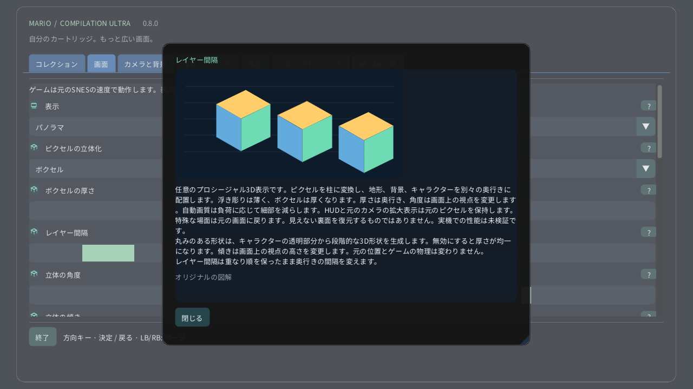

# ピクセルの立体化

[English](../en/VOXELS.md) · [Français](../fr/VOXELS.md) · [Español](../es/VOXELS.md) · [日本語](../ja/VOXELS.md) · [Deutsch](../de/VOXELS.md) · [Italiano](../it/VOXELS.md) · [Português](../pt/VOXELS.md) · [Русский](../ru/VOXELS.md) · [简体中文](../zh/VOXELS.md) · [한국어](../ko/VOXELS.md)

パソコンや携帯端末では画面 → ピクセルの立体化を開きます。まずピクセルの浮き彫りで控えめな奥行きを試し、次にボクセルに切り替えます。厚みは各ピクセルの立体の厚さ、間隔は重なり順を保ったままレイヤー間の距離を変えます。Questでは空間リモコンの立体ページを使います。時計のリューズはエリア全体から元の画面まで拡大できます。

任意のプロシージャル3D表示です。ピクセルを柱に変換し、地形、背景、キャラクターを別々の奥行きに配置します。浮き彫りは薄く、ボクセルは厚くなります。厚さは奥行き、角度は画面上の視点を変更します。自動画質は負荷に応じて細部を減らします。HUDと元のカメラの拡大表示は元のピクセルを保持します。特殊な場面は元の画面に戻ります。見えない裏面を復元するものではありません。実機での性能は未検証です。 丸みのある形状は、キャラクターの透明部分から段階的な3D形状を生成します。無効にすると厚さが均一になります。傾きは画面上の視点の高さを変更します。元の位置とゲームの物理は変わりません。 レイヤー間隔は重なり順を保ったまま奥行きの間隔を変えます。

| ピクセルの立体化 | |
|---|---|
| 0 | 元の2D |
| 1 | ピクセルの浮き彫り |
| 2 | ボクセル |

- **ボクセルの厚さ**: 1–16 px
- **レイヤー間隔**: 1–12 px
- **立体の角度**: −30° … +30°
- **立体の傾き**: −30° … +30°
- **丸みのあるボクセル形状**

[コレクション](README.md) · [図解設定ガイド](SETTINGS.md) · [HTML](voxels.html) · [Technical research](../VOXEL_RESEARCH.md)
