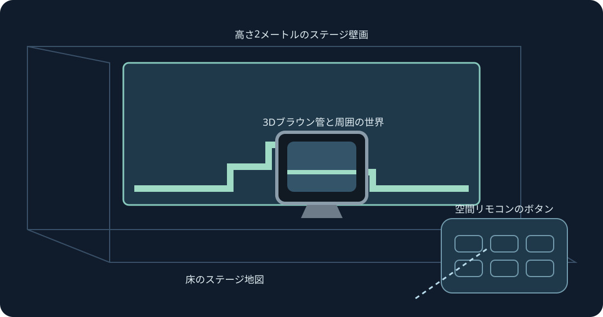

# Mario Compilation Ultra 0.5.0 · Quest VR / AR

[English](../en/XR.md) · [Français](../fr/XR.md) · [Español](../es/XR.md) · [日本語](../ja/XR.md) · [Deutsch](../de/XR.md) · [Italiano](../it/XR.md) · [Português](../pt/XR.md) · [Русский](../ru/XR.md) · [简体中文](../zh/XR.md) · [한국어](../ko/XR.md)

全体マップの壁、床、アーケードテーブル、CRT、曲面ギャラリー。実験的なXRプレビューです。両グリップで拡大縮小します。

実験的XR版です。インストール後にQuest 3で0.4のコレクションが見えることを利用者が確認し、フレーム送信を記録しました。0.5は別途ビルド・検査します。追跡、快適さ、パススルー、室内配置、継続プレイは実機検証が必要です。

後日テストする際は開発者モードを有効にし、SideQuestまたはadb install -rで公開ARM64 APKをインストールしてください。提供元不明からMario Compilation Ultra XRを開き、システム選択画面でカートリッジまたはZIPを選んでプレイします。All-Stars + WorldとYoshi’s Islandは別々に読み込みます。公開APKにROMや進行データはありません。

空間スクリーン | 壁の範囲に合わせる | 高さ2メートルのステージ壁画 | 床のステージ地図 | アーケードテーブル | 3Dブラウン管と周囲の世界 | 湾曲ステージギャラリー

レベル、ネイティブCRT、リモコン、設定を配置対象にします。片手のグリップで移動と回転、両グリップで位置ロック中もレベルを拡大縮小できます。リモコンには微調整、半分、2倍、リセットもあります。復帰操作でUIを近くに戻せます。Yで設定、プレイページには全SNESボタンがあります。

ピンチしてスティックを動かし、もう片方の手でボタンを押します。中指のピンチでハンドルをつかみます。追跡が失われると入力を解除します。

新規インストールは90 Hzと高さ2 mの透明AR壁画を既定にします。非対応の場合は別の表示周波数を選び、ゲーム本来の速度は変えません。壁の自動配置には任意のシーン・アンカー権限と室内スキャンを使います。手動配置と床調整も可能です。パススルーはランタイムが提供し、ネット、マイク、カメラ画像の権限は要求しません。

半透明の予告は情報表示であり、遠くの物体を動かしません。確認済み配置は開始時から表示でき、学習画像はローカルのゲームから取得します。

アーケードテーブルは読み込まれたエリアを表示します。物理挙動やオブジェクトの起動条件は元のままです。

PCのクイック操作：右スティック押し込み中、十字左右でズーム、上で1:1、下で全体マップ、Aで固定、Bで元カメラ、Xで撮影、Yでプレイヤー追従。離すと通常のSNES操作に戻ります。F1またはメニューのYヘルプで図解を開きます。

SNES: D-pad · A · B · X · Y · L · R · Start · Select

Touch: A → SNES B · B → SNES Y · X → SNES A · RT → SNES X · R3 → Start · LT → Rewind · Y → 設定画面を移動

[HTML](xr.html) · [Guide](README.md) · [Build](../BUILD.md) · [Parity](../PARITY.md) · [Validation](../TEST_REPORT.md)

[Meta developer mode](https://developers.meta.com/vr/documentation/android-apps/enable-developer-mode/) · [Meta refresh API](https://developers.meta.com/vr/documentation/native/android/mobile-display-refresh-rate/) · [Meta passthrough](https://developers.meta.com/vr/documentation/native/android/mobile-passthrough/)
