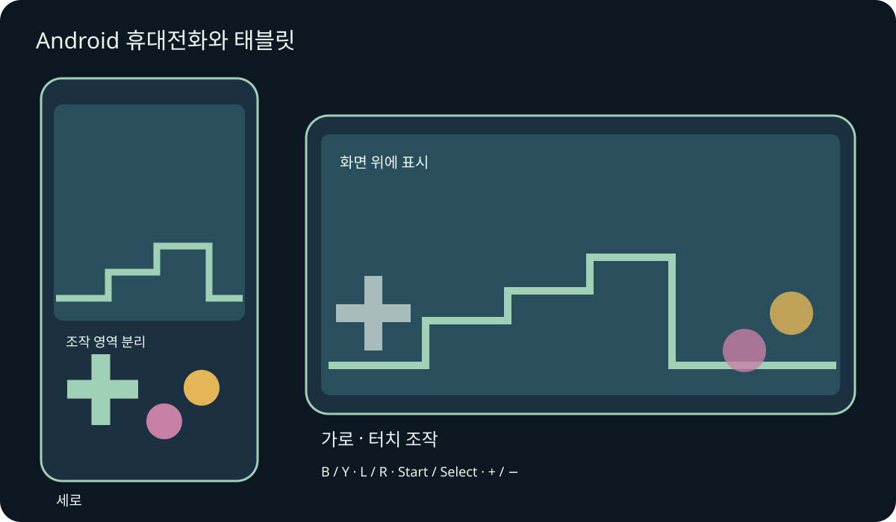
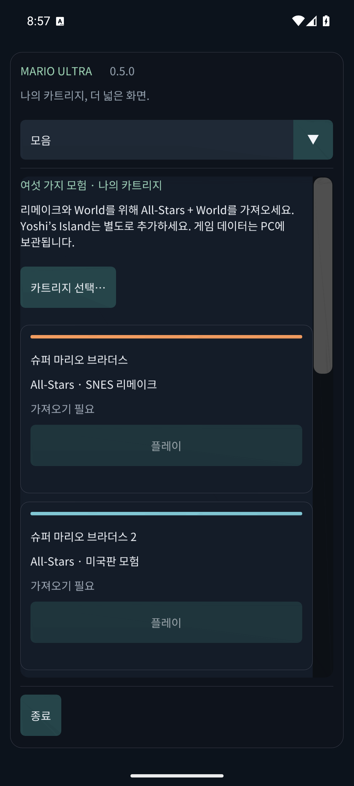

# Mario Compilation Ultra 0.5.0 · Android 휴대전화와 태블릿

[English](../en/MOBILE.md) · [Français](../fr/MOBILE.md) · [Español](../es/MOBILE.md) · [日本語](../ja/MOBILE.md) · [Deutsch](../de/MOBILE.md) · [Italiano](../it/MOBILE.md) · [Português](../pt/MOBILE.md) · [Русский](../ru/MOBILE.md) · [简体中文](../zh/MOBILE.md) · [한국어](../ko/MOBILE.md)

Android 휴대전화/태블릿 APK를 설치하고 앱 목록에서 Mario Compilation Ultra를 여세요. GitHub 공개 APK는 본인의 카트리지를 선택해야 하며, ROM이 포함된 개인판에는 여섯 게임이 준비되어 있습니다. Quest APK는 별도의 헤드셋 앱입니다. Android 8 이상과 OpenGL ES 3이 필요하며 ARM64, ARMv7, x86_64가 포함됩니다.

회전과 창 크기 변경 시에도 게임이 유지됩니다. 안전 여백이 화면 홈과 시스템 탐색 영역을 보호합니다.

여러 손가락으로 이동, 달리기, 점프를 함께 조작하세요. 게임패드 연결 시 자동 터치 버튼이 숨겨집니다. Android 뒤로 가기로 메뉴를 엽니다.

버튼 이름은 SNES와 같습니다. 대부분의 마리오에서 B는 점프, Y는 달리기입니다. L, R, Start, Select도 사용할 수 있습니다. 보기로 다섯 모드를 전환하고 −/＋로 픽셀 배율을 조절합니다. 되감기를 누른 동안 시간을 되돌립니다. 옵션은 즉시 일시정지합니다. 메뉴는 손가락으로 스크롤하며 좁은 화면에서는 위 목록으로 섹션을 고릅니다.

- 모바일 화면 방향
- 터치 조작
- 터치 배치
- 터치 버튼 크기
- 터치 불투명도
- 왼손잡이 배치
- 터치 진동
- 플레이 중 화면 켜기

저장 슬롯, 되감기, 배터리 저장은 앱 전용 저장소를 사용합니다. 백그라운드로 가면 배터리 저장과 활성화된 경우 재개 슬롯 0을 저장합니다. 같은 서명의 APK로 업데이트하면 진행이 유지됩니다. 앱 삭제나 데이터 지우기는 로컬 카트리지와 저장을 삭제합니다. 저장 슬롯은 저장 및 소리 항목에 있습니다.

휴대전화 및 태블릿 에뮬레이터 검증은 실물 하드웨어와 구분합니다. 성능, 게임패드, 화면 홈, 제조사 창 동작은 기기에 따라 다를 수 있습니다. macOS 빌드는 실제 Mac에서 테스트하지 않은 실험판입니다. 정확한 범위는 검증 보고서를 보세요.

[Android APK](https://github.com/vhaloo/MarioCompilationUltra/releases/download/v0.5.0/MarioCompilationUltra-0.5.0-Android-public.apk) · [HTML](mobile.html) · [Guide](README.md) · [Quest](XR.md) · [Validation](../TEST_REPORT.md)

[Adaptive Android apps](https://developer.android.com/develop/adaptive-apps/guides/support-different-display-sizes) · [16 KiB page sizes](https://developer.android.com/guide/practices/page-sizes)
