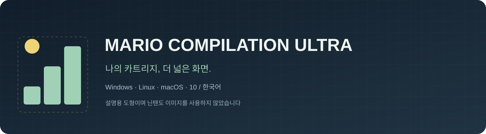
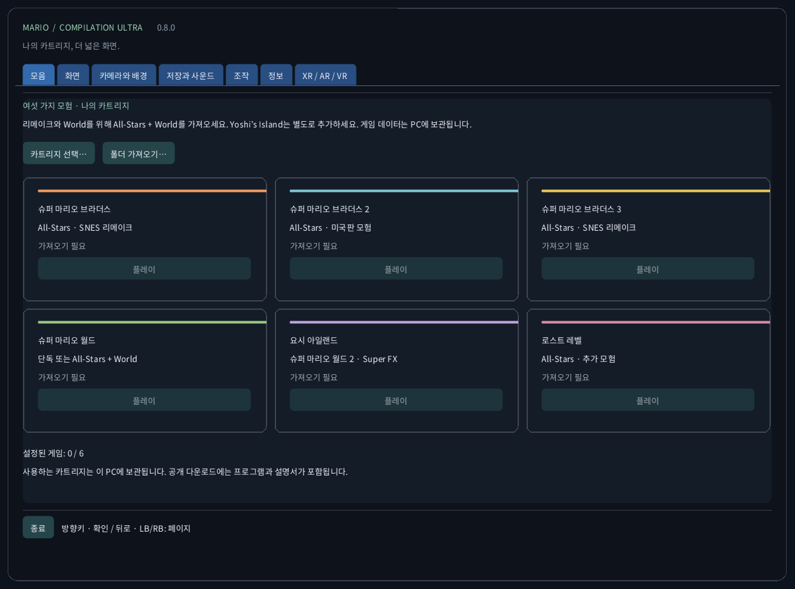
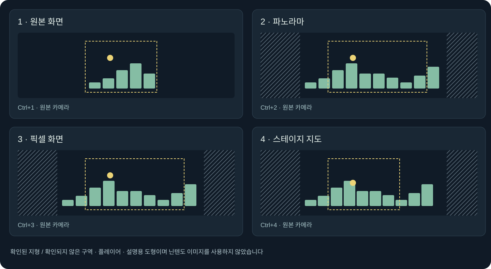
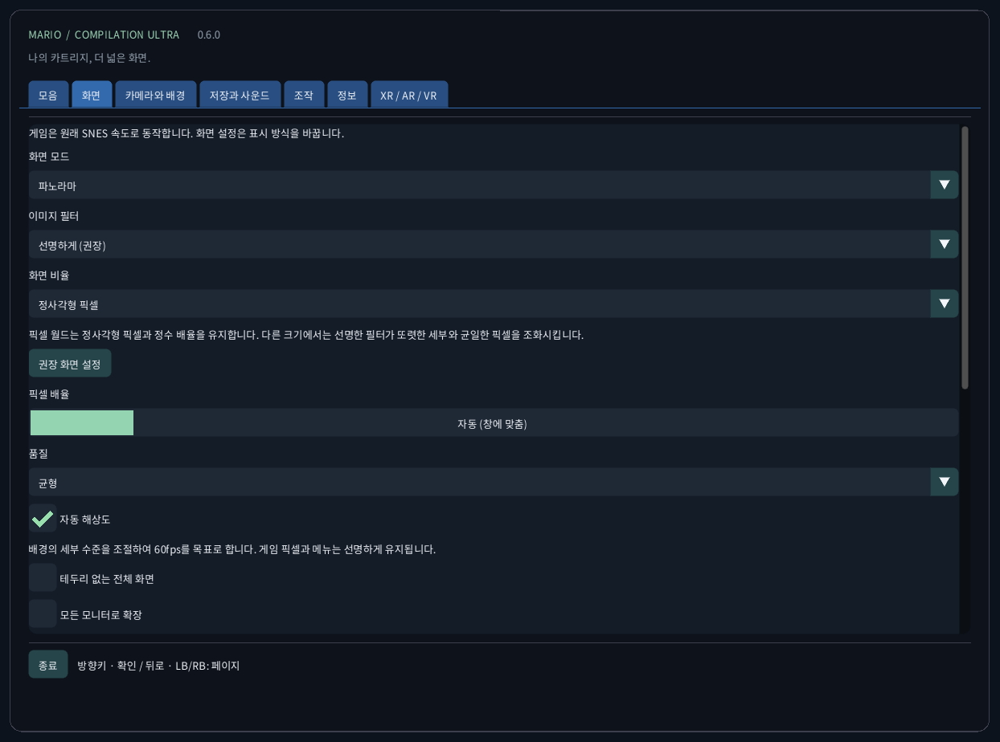
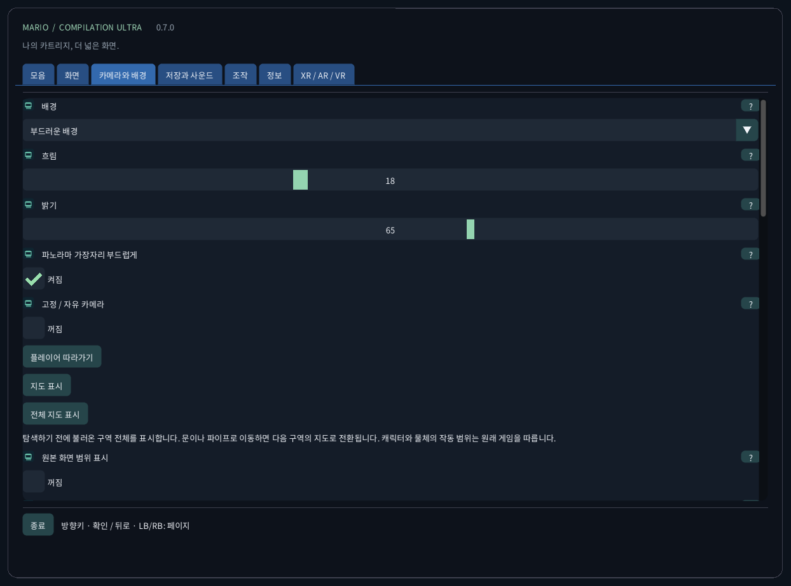
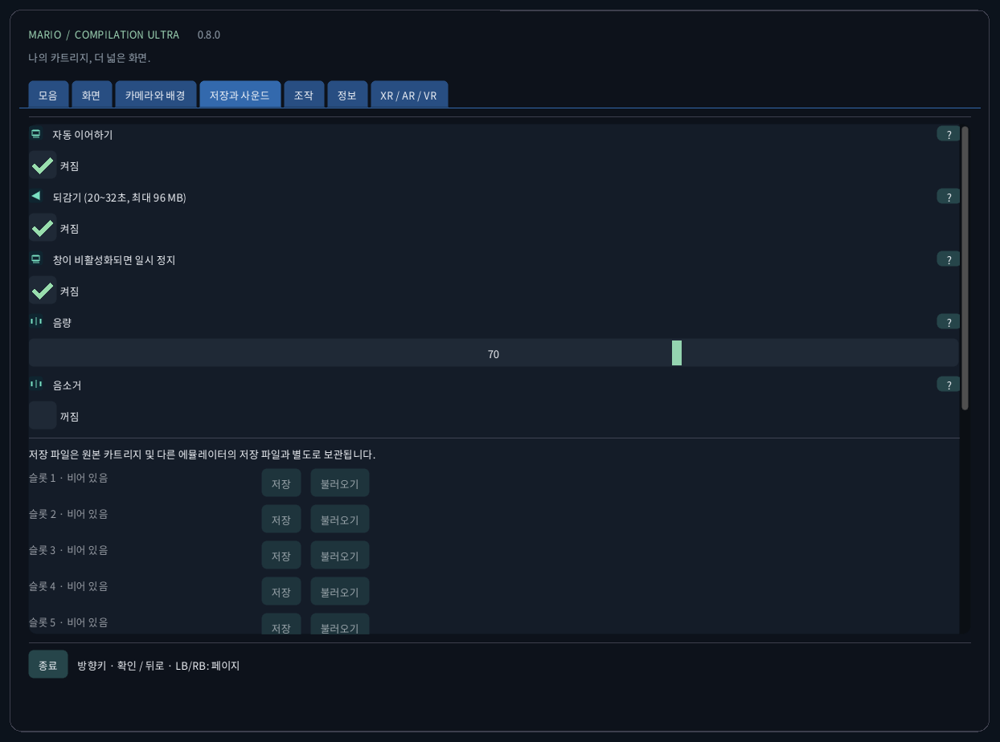
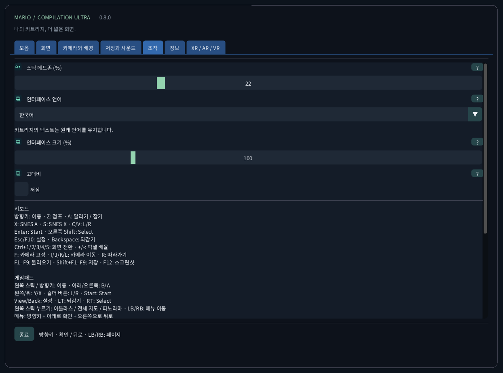
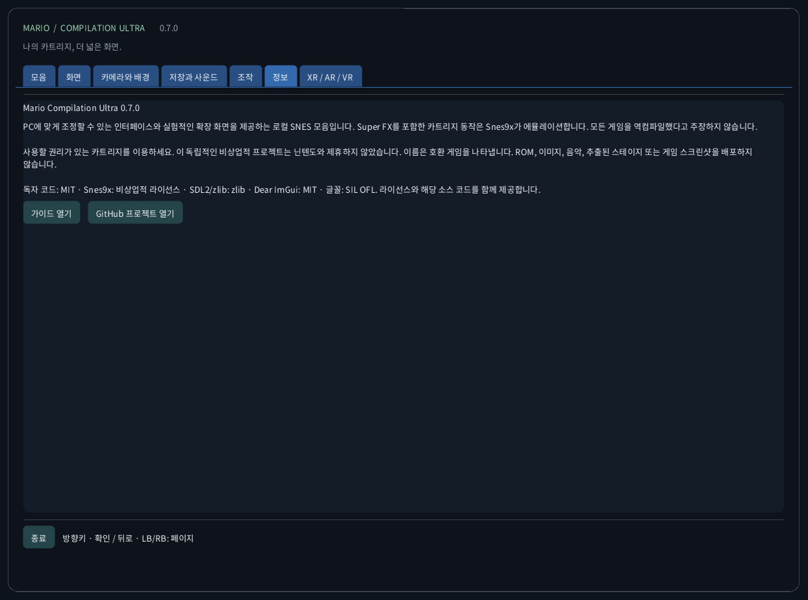
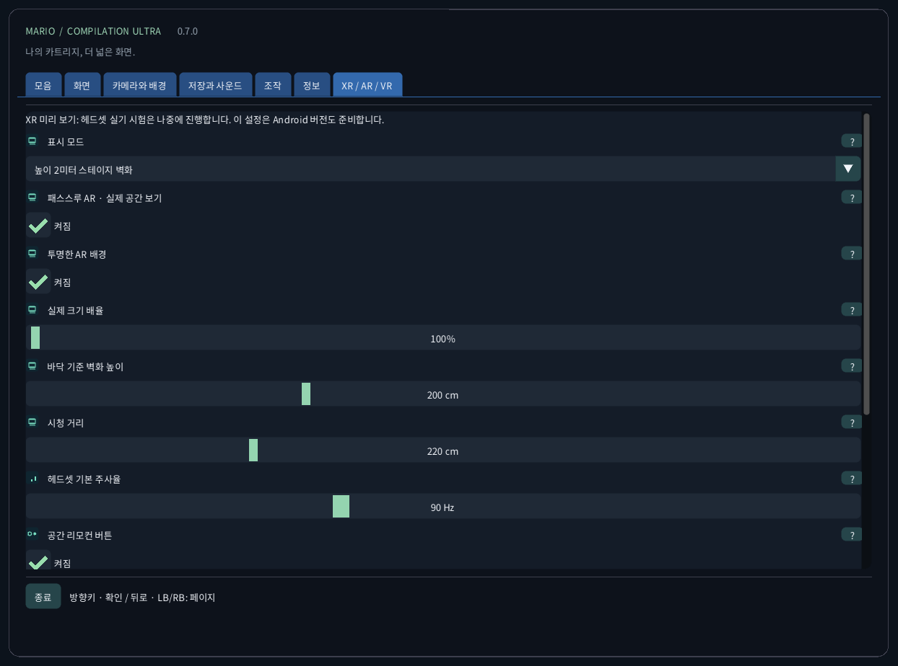

<!-- Generated by tools/guides.py; edit docs/guide-texts.json and assets/locales. -->


[English](../en/README.md) · [Français](../fr/README.md) · [Español](../es/README.md) · [日本語](../ja/README.md) · [Deutsch](../de/README.md) · [Italiano](../it/README.md) · [Português](../pt/README.md) · [Русский](../ru/README.md) · [简体中文](../zh/README.md) · [한국어](../ko/README.md)

# Mario Compilation Ultra 0.9.2

PC에 맞게 조정할 수 있는 인터페이스와 실험적인 확장 화면을 제공하는 로컬 SNES 모음입니다. Super FX를 포함한 카트리지 동작은 Snes9x가 에뮬레이션합니다. 모든 게임을 역컴파일했다고 주장하지 않습니다.

[다운로드와 바탕 화면에서 실행](https://github.com/vhaloo/MarioCompilationUltra/releases/tag/v0.9.2) · [HTML](guide.html) · [GitHub](https://github.com/vhaloo/MarioCompilationUltra)

## 다운로드와 바탕 화면에서 실행

1. 컴퓨터에 맞는 ZIP을 모두 풀어 주세요. 실행 파일, SDL, 리소스와 가이드는 함께 보관합니다. Windows는 MarioCompilationUltra.exe, Linux는 Play.sh, Mac은 앱을 실행합니다.
2. 카트리지 선택, 폴더 가져오기 또는 끌어놓기로 자신의 .sfc, .smc, 카트리지 하나가 든 ZIP을 가져옵니다. 선택 창은 앱의 데이터 폴더에서 열립니다. 호환 카트리지를 이 폴더에 직접 넣으면 다음 실행 때 자동으로 인식됩니다.
3. All-Stars + Super Mario World에는 마리오1, 미국판 마리오2, 마리오3, World와 The Lost Levels가 들어 있습니다. Yoshi’s Island는 별도로 추가합니다. 플레이를 선택하고 원래 제목 화면에서 Enter 또는 Start를 누르세요. 데모 중이면 한 번 더 누릅니다.

Windows에서는 Install-Windows.ps1로 전체 패키지를 사용자 Programs 폴더에 복사하고 바로 가기를 만듭니다. Linux에서는 Install-Linux.sh로 이 폴더를 메뉴와 바탕 화면에 등록합니다. Mac에서는 앱을 Applications로 옮기고 별칭을 만듭니다. 선택한 휴대용 폴더는 그대로 유지하세요.

```powershell
# Windows
powershell -NoProfile -ExecutionPolicy Bypass -File .\Install-Windows.ps1
```

```sh
# Linux
sh ./Install-Linux.sh
```



*스크린샷은 카트리지를 불러오지 않은 실제 앱에서 촬영했습니다. 도표는 게임 그림 대신 독창적인 설명용 도형을 사용합니다. 공개 다운로드에는 Nintendo ROM, 스프라이트, 음악, 추출한 레벨 또는 게임 화면이 없습니다.*

## 패키지와 검증

- Windows x64: 로컬 바탕 화면 실행과 카트리지 구동 확인. 자동 테스트도 실행합니다.
- Linux x64: 자동 빌드 및 ROM 없는 검사. 실제 Linux 데스크톱에서 게임은 테스트하지 않았습니다.
- **macOS Intel x64 및 Apple Silicon arm64: 실험용, 실제 Mac에서 테스트하지 않았습니다. 자동 환경에서 빌드와 ROM 없는 화면을 검사합니다. 임시 서명이며 공증되지 않았습니다. 실제 기기의 컨트롤러, 소리, 그래픽과 Gatekeeper는 확인하지 않았습니다.**

## 화면 모드



권장 화면: 파노라마, 자동 확대, 선명한 필터, 정사각형 픽셀, 부드러운 가장자리와 어두운 주변 배경. 화면 → 권장 화면 설정은 언어, 소리, 저장 데이터를 바꾸지 않습니다. 최근접 픽셀, 부드러운 필터와 TV 4:3도 선택할 수 있습니다. 픽셀 월드는 정수 배율과 정사각형 픽셀을 유지합니다. 주사선은 게임의 행을 따르며 모아레를 막기 위해 2배 미만에서는 꺼집니다.

전체 지도(Ctrl+5)는 6개 게임 모두에서 첫 플레이 화면부터 불러온 구역의 지형 전체를 표시합니다. 미리 돌아볼 필요가 없습니다. 문이나 파이프로 이동하면 지도가 바뀌며 분리된 방은 이어 붙이지 않습니다. Mario World는 존재하는 두 지형 레이어를 표시합니다. 화살표가 플레이어를 가리키고 공간이 남으면 실시간 확대 화면도 표시합니다. 기존 4개 보기는 유지되며 World 이외에는 관찰한 지형을 쌓습니다. 캐릭터, 움직이는 발판과 효과는 원래 시뮬레이션과 작동 범위를 유지합니다. 지형 지도 없는 특수 경기장은 원래 화면을 사용합니다. 왼쪽 스틱을 누르면 아틀라스→전체 지도→파노라마로 전환합니다.

확장 메모리 프로필과 All-Stars 자동 선택은 목록의 미국판을 대상으로 합니다. 인식되지만 검증된 프로필이 없는 판은 원본 화면을 사용합니다. 인터페이스 번역은 상용 카트리지의 이야기나 그래픽을 번역하지 않습니다. 다섯 게임 전체를 새로 네이티브 역컴파일했다고 주장하지 않습니다.

## 실제 게임 화면

화면 설정의 실제 게임 화면에서 같은 장면을 여러 보기로 비교할 수 있습니다. 플레이 중 메뉴에서 현재 장면 캡처를 선택하면 기기에 예시가 저장됩니다.

컬렉션에서 모든 설정을 초기화할 수 있습니다. 각 설정 페이지에도 초기화 버튼이 있습니다. 카트리지와 저장 데이터는 유지됩니다. 새 프로필은 원본 2D 보기로 시작합니다.

## 고급 설정 열기

모양을 선택하면 현재 화면과 카메라 설정이 바뀝니다.

**설정 프로필** · 모양을 적용하기 전에 사용자 설정을 여기에 저장하세요.

## 픽셀 입체화


선택 가능한 절차적 3D 표시입니다. 픽셀을 입체 기둥으로 만들고 지형, 배경, 캐릭터를 서로 다른 깊이에 배치합니다. 부조는 얕고 복셀은 더 두껍습니다. 두께는 깊이, 각도는 화면 시점을 바꿉니다. 자동 품질은 부하가 높으면 세부 표현을 줄입니다. HUD와 원본 카메라 확대 화면은 원본 픽셀을 유지합니다. 특수 장면은 원본 화면으로 돌아갑니다. 보이지 않는 뒷면을 복원하는 기능은 아닙니다. 실제 기기 성능은 검증되지 않았습니다. 둥근 형태는 캐릭터의 투명 영역을 바탕으로 계단식 3D 몸체를 만듭니다. 끄면 두께가 균일해집니다. 기울기는 화면 시점의 높이를 바꿉니다. 원래 위치와 게임 물리는 바뀌지 않습니다. 레이어 간격은 순서를 유지하며 깊이 층을 분리합니다.

[픽셀 입체화](VOXELS.md) · [HTML](voxels.html)

## 자동 해상도

0.8은 사용 가능한 성능에 맞춰 배경 해상도, 복셀 격자, 장식 갱신 주기와 VR 셰이더를 조절합니다. 확대 화면에서 원본 게임 픽셀을 확인할 수 있으며 메뉴는 선명합니다. Quest는 프레임 시간의 최소 35% 여유를 목표로 합니다. 이는 자동 품질 제어의 목표이며 실제 기기 결과를 보장하지 않습니다.

[Performance / GPU](../PERFORMANCE.md)

| CRC32 | SNES |
|---|---|
| `f84305b1` | All-Stars + World (US) |
| `925637c7` | All-Stars (US) |
| `b19ed489` | Super Mario World (US) |
| `d138f224` | Yoshi’s Island 1.0 (US) |
| `cf98ddaa` | Yoshi’s Island 1.1 (US) |

## Android 휴대전화와 태블릿

[Android 휴대전화와 태블릿](MOBILE.md) · [HTML](mobile.html) · [Android APK](https://github.com/vhaloo/MarioCompilationUltra/releases/download/v0.9.2/MarioCompilationUltra-0.9.2-Android-public.apk)

## 시계 보기

[시계 보기](WATCH.md) · [Wear OS APK](https://github.com/vhaloo/MarioCompilationUltra/releases/download/v0.9.2/MarioCompilationUltra-0.9.2-Wear-public.apk) · [그림으로 보는 설정](SETTINGS.md)

## Quest VR / AR

[Quest ARM64 APK](https://github.com/vhaloo/MarioCompilationUltra/releases/download/v0.9.2/MarioCompilationUltra-0.9.2-Quest-public.apk) · [Quest VR / AR](XR.md) · [HTML](xr.html) · [Parity](../PARITY.md)

## 조작

키보드<br>
방향키: 이동 · Z: 점프 · A: 달리기 / 잡기<br>
X: SNES A · S: SNES X · C/V: L/R<br>
Enter: Start · 오른쪽 Shift: Select<br>
Esc/F10: 설정 · Backspace: 되감기<br>
Ctrl+1/2/3/4/5: 화면 전환 · +/-: 픽셀 배율<br>
F: 카메라 고정 · I/J/K/L: 카메라 이동 · R: 따라가기<br>
F1–F9: 불러오기 · Shift+F1–F9: 저장 · F12: 스크린샷<br>
<br>
게임패드<br>
왼쪽 스틱 / 방향키: 이동 · 아래/오른쪽: B/A<br>
왼쪽/위: Y/X · 숄더 버튼: L/R · Start: Start<br>
View/Back: 설정 · LT: 되감기 · RT: Select<br>
왼쪽 스틱 누르기: 아틀라스 / 전체 지도 / 파노라마 · LB/RB: 메뉴 이동<br>
메뉴: 방향키 + 아래로 확인 + 오른쪽으로 뒤로

오른쪽 스틱으로 시점을 돌립니다. 스틱을 누른 채 움직이면 시점이 이동합니다.

## 저장과 사운드

게임마다 수동 슬롯 9개, 자동 이어하기, 배터리 SRAM과 제한된 되감기를 제공합니다. 되감기는 최대 96 MiB로 약 20~32초입니다. F1~F9로 불러오고 Shift+F1~F9로 저장합니다. 카트리지 CRC, 코어 버전과 무결성을 검사합니다. 다른 에뮬레이터의 저장 파일과 분리됩니다.

## 로컬 파일

이 폴더에는 settings.ini, 카트리지 참조, states/, saves/, screenshots/가 있습니다. 가져오기는 카트리지를 업로드하거나 원본을 수정하지 않습니다. 컴퓨터를 바꾸기 전에 백업하세요. 저장 상태는 정확히 같은 카트리지와 코어가 필요하며 SRAM은 별도 파일입니다.

| OS | 로컬 카트리지 폴더 |
|---|---|
| Windows | `%APPDATA%/ValentinWittwe/MarioCompilationUltra/` |
| Linux | `$XDG_DATA_HOME/ValentinWittwe/MarioCompilationUltra/` or `~/.local/share/ValentinWittwe/MarioCompilationUltra/` |
| macOS | `~/Library/Application Support/ValentinWittwe/MarioCompilationUltra/` |

--data-dir 폴더는 기본 경로보다 우선합니다. Windows 바로 가기 업데이트도 이 옵션을 유지합니다. 로컬 파일에서 실제 폴더를 확인하세요.

## 게임이 계속 가져오기를 요구할 때

파일을 옮겼거나 드라이브가 연결되지 않았으면 카트리지를 다시 선택하세요. ZIP에는 .sfc 또는 .smc 하나만 있어야 하며 암호화 없이 저장 또는 DEFLATE 압축이어야 합니다. 지원 판과 헤더를 확인하세요. 글꼴이나 SDL이 없으면 전체 패키지를 다시 풀어 주세요.

## 실제 인터페이스 갤러리

### 모음


### 화면



### 카메라와 배경



### 저장과 사운드



### 조작



### 정보



### Quest VR / AR



## 패키지와 검증 · 0.9.2

0.8은 절차적 부조와 복셀을 추가합니다. 공개 테스트 9종이 자체 형상, 깊이, 투명도, 설정과 기존 기능을 검사합니다. 로컬 게임 6종은 별도로 검사하며 게임 이미지는 비공개로 유지합니다. 휴대전화, 태블릿과 Wear OS는 에뮬레이터를 사용합니다. Mac 및 실제 Android, 시계와 Quest 게임 실행은 실험용입니다. 최신 보고서를 확인하세요.

[CTest / CI](https://github.com/vhaloo/MarioCompilationUltra/actions) · [Report](../TEST_REPORT.md) · [Build](../BUILD.md) · [Source / research](../RESEARCH.md)

사용할 권리가 있는 카트리지를 이용하세요. 이 독립적인 비상업적 프로젝트는 닌텐도와 제휴하지 않았습니다. 이름은 호환 게임을 나타냅니다. ROM, 이미지, 음악, 추출된 스테이지 또는 게임 스크린샷을 배포하지 않습니다.

독자 코드: MIT · Snes9x: 비상업적 라이선스 · SDL2/zlib: zlib · Dear ImGui: MIT · 글꼴: SIL OFL. 라이선스와 해당 소스 코드를 함께 제공합니다.

[Licence](../../LICENSE) · [Third-party notices](../../THIRD_PARTY_NOTICES.md)
