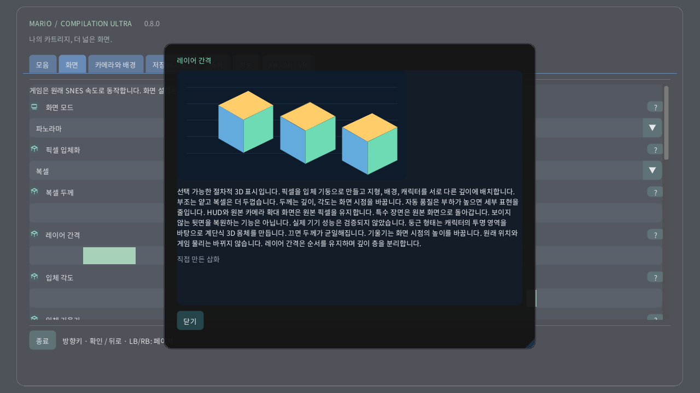

# 픽셀 입체화

[English](../en/VOXELS.md) · [Français](../fr/VOXELS.md) · [Español](../es/VOXELS.md) · [日本語](../ja/VOXELS.md) · [Deutsch](../de/VOXELS.md) · [Italiano](../it/VOXELS.md) · [Português](../pt/VOXELS.md) · [Русский](../ru/VOXELS.md) · [简体中文](../zh/VOXELS.md) · [한국어](../ko/VOXELS.md)

컴퓨터나 터치 기기에서 화면 → 픽셀 입체화를 엽니다. 은은한 깊이를 원하면 픽셀 부조를 먼저 사용한 뒤 복셀을 선택하세요. 두께는 각 픽셀의 몸체를 바꾸고 간격은 순서를 유지하며 레이어를 벌립니다. Quest에서는 공간 리모컨의 입체 페이지를 사용합니다. 시계의 크라운은 전체 구역에서 원본 화면까지 확대합니다.

선택 가능한 절차적 3D 표시입니다. 픽셀을 입체 기둥으로 만들고 지형, 배경, 캐릭터를 서로 다른 깊이에 배치합니다. 부조는 얕고 복셀은 더 두껍습니다. 두께는 깊이, 각도는 화면 시점을 바꿉니다. 자동 품질은 부하가 높으면 세부 표현을 줄입니다. HUD와 원본 카메라 확대 화면은 원본 픽셀을 유지합니다. 특수 장면은 원본 화면으로 돌아갑니다. 보이지 않는 뒷면을 복원하는 기능은 아닙니다. 실제 기기 성능은 검증되지 않았습니다. 둥근 형태는 캐릭터의 투명 영역을 바탕으로 계단식 3D 몸체를 만듭니다. 끄면 두께가 균일해집니다. 기울기는 화면 시점의 높이를 바꿉니다. 원래 위치와 게임 물리는 바뀌지 않습니다. 레이어 간격은 순서를 유지하며 깊이 층을 분리합니다.

| 픽셀 입체화 | |
|---|---|
| 0 | 원본 2D |
| 1 | 픽셀 부조 |
| 2 | 복셀 |

- **복셀 두께**: 1–16 px
- **레이어 간격**: 1–12 px
- **입체 각도**: −30° … +30°
- **입체 기울기**: −30° … +30°
- **둥근 복셀 형태**

[모음](README.md) · [그림으로 보는 설정](SETTINGS.md) · [HTML](voxels.html) · [Technical research](../VOXEL_RESEARCH.md)
