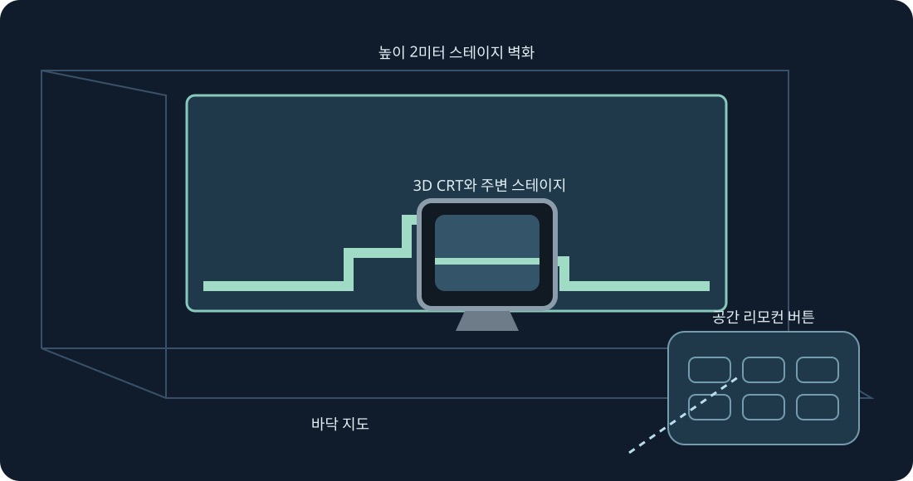

# Mario Compilation Ultra 0.4.0 · Quest VR / AR

[English](../en/XR.md) · [Français](../fr/XR.md) · [Español](../es/XR.md) · [日本語](../ja/XR.md) · [Deutsch](../de/XR.md) · [Italiano](../it/XR.md) · [Português](../pt/XR.md) · [Русский](../ru/XR.md) · [简体中文](../zh/XR.md) · [한국어](../ko/XR.md)

스테이지 벽, 바닥, 아케이드 테이블, CRT와 곡면 갤러리. 실험적 XR 미리 보기입니다. 양쪽 그립으로 크기를 조절하세요.

실험적 미리보기입니다. 컴파일, lint, 기하와 입력 자동 검사를 수행합니다. 이 버전은 헤드셋 연결, 설치, 실기 테스트를 하지 않았습니다. 추적, 편안함, 패스스루 및 프레임 간격은 실기 확인이 필요합니다.

나중에 시험할 때 개발자 모드를 켜고 SideQuest 또는 adb install -r로 공개 ARM64 APK를 설치하세요. 알 수 없는 출처에서 Mario Compilation Ultra XR을 열고 시스템 선택기로 카트리지나 ZIP을 고른 후 플레이하세요. All-Stars + World와 Yoshi’s Island는 별도로 가져옵니다. 공개 APK에는 ROM이나 진행 정보가 없습니다.

공간 화면 | 스캔한 벽에 맞추기 | 높이 2미터 스테이지 벽화 | 바닥 지도 | 아케이드 테이블 | 3D CRT와 주변 스테이지 | 곡면 스테이지 갤러리

레벨, 원래 CRT, 리모컨 또는 옵션을 대상으로 고릅니다. 한 그립으로 이동·회전하고 두 그립으로 위치 잠금 중에도 레벨 크기를 바꿉니다. 미세 조정, 절반, 두 배, 초기화도 가능합니다. 복구로 화면을 가까이 되돌립니다. Y는 옵션을 열며 플레이 페이지에 모든 SNES 버튼이 있습니다.

핀치로 스틱을 끌고 다른 손으로 버튼을 누르세요. 중지 핀치로 손잡이를 잡습니다. 추적이 끊기면 입력을 해제합니다.

새 설치는 90 Hz와 높이 2m의 투명 AR 벽화를 요청합니다. 지원하지 않으면 가능한 주사율로 전환하며 게임 속도는 그대로입니다. 자동 벽 배치에 선택적 장면·앵커 권한과 방 스캔을 씁니다. 수동 배치와 바닥 보정도 가능합니다. 패스스루는 런타임이 제공하며 인터넷, 마이크, 카메라 영상 권한을 요청하지 않습니다.

반투명 미리 보기는 안내용이며 먼 물체를 시뮬레이션하지 않습니다. 검증된 위치는 시작부터 표시할 수 있고 학습한 이미지는 기기의 게임에서만 얻습니다.

아케이드 테이블은 불러온 구역을 표시합니다. 원래 물리와 오브젝트 활성화 규칙을 유지합니다.

PC 빠른 조작: 오른쪽 스틱을 누른 채 방향키 좌우로 확대·축소, 위는 1:1, 아래는 전체 지도, A 고정, B 원래 카메라, X 캡처, Y 플레이어 추적입니다. 놓으면 SNES 조작으로 복귀합니다. F1 또는 메뉴 Y 도움말로 그림 설명을 엽니다.

SNES: D-pad · A · B · X · Y · L · R · Start · Select

Touch: A → SNES B · B → SNES Y · X → SNES A · RT → SNES X · R3 → Start · LT → Rewind · Y → 설정 패널 이동

[HTML](xr.html) · [Guide](README.md) · [Build](../BUILD.md) · [Parity](../PARITY.md) · [Validation](../TEST_REPORT.md)

[Meta developer mode](https://developers.meta.com/vr/documentation/android-apps/enable-developer-mode/) · [Meta refresh API](https://developers.meta.com/vr/documentation/native/android/mobile-display-refresh-rate/) · [Meta passthrough](https://developers.meta.com/vr/documentation/native/android/mobile-passthrough/)
