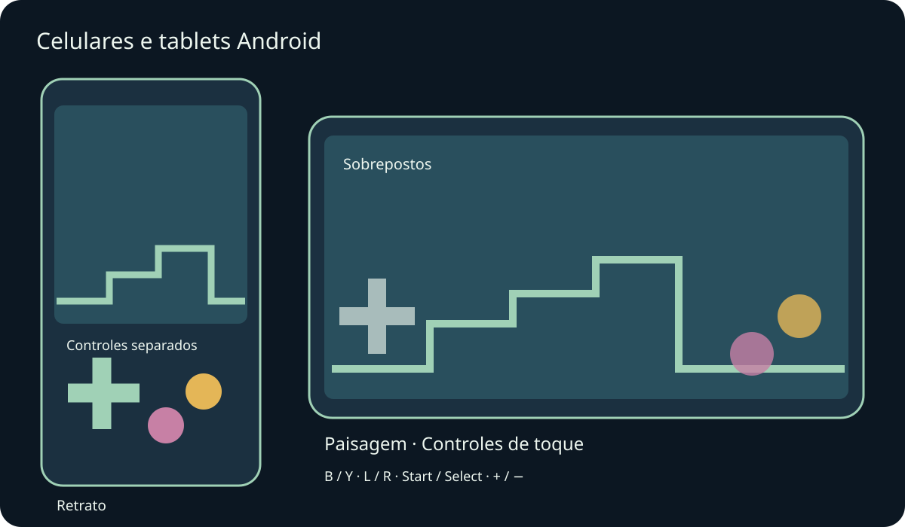
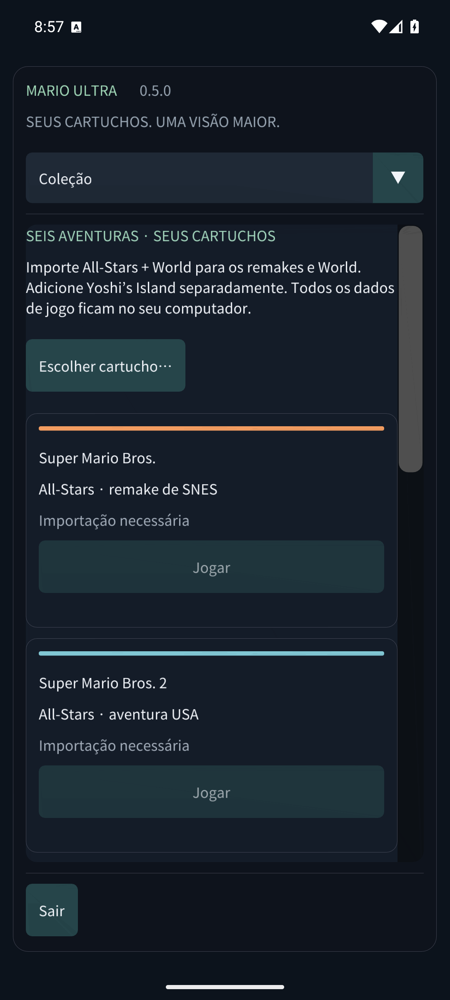

# Mario Compilation Ultra 0.5.0 · Celulares e tablets Android

[English](../en/MOBILE.md) · [Français](../fr/MOBILE.md) · [Español](../es/MOBILE.md) · [日本語](../ja/MOBILE.md) · [Deutsch](../de/MOBILE.md) · [Italiano](../it/MOBILE.md) · [Português](../pt/MOBILE.md) · [Русский](../ru/MOBILE.md) · [简体中文](../zh/MOBILE.md) · [한국어](../ko/MOBILE.md)

Instale o APK Android para celular/tablet e abra Mario Compilation Ultra. O APK público do GitHub pede seus cartuchos; a edição pessoal com ROMs já contém os seis jogos. O APK Quest é um aplicativo separado para o headset. Requer Android 8 ou mais recente e OpenGL ES 3; inclui ARM64, ARMv7 e x86_64.

Rotação e redimensionamento preservam a partida. As margens respeitam recortes e navegação do sistema.

Use vários dedos para mover, correr e pular ao mesmo tempo. Um controle conectado oculta os botões automáticos. Voltar do Android abre o menu.

As letras correspondem ao SNES: B pula e Y corre na maioria dos Mario. L, R, Start e Select continuam disponíveis. Vista alterna cinco modos; menos/mais ajustam o zoom. Segure retroceder para voltar no tempo. Opções pausa imediatamente. Role os menus com o dedo; em telas estreitas escolha a seção na lista superior.

- Orientação móvel
- Controles de toque
- Disposição de toque
- Tamanho dos botões de toque
- Opacidade dos controles de toque
- Controles para canhotos
- Vibração ao toque
- Manter a tela ligada durante o jogo

Estados, retrocesso e progresso usam armazenamento privado. Ao ir para segundo plano, o aplicativo grava a bateria e, se ativado, o estado de retomada 0. Atualizações com a mesma assinatura preservam o progresso. Desinstalar ou limpar os dados remove cartuchos e partidas locais. Os estados ficam em Jogos salvos e som.

Os testes em emuladores de celular e tablet são separados do hardware físico. Desempenho, controles, recortes e janelas podem variar por aparelho. macOS continua experimental e não foi testado em um Mac físico. O relatório detalha a cobertura.

[Android APK](https://github.com/vhaloo/MarioCompilationUltra/releases/download/v0.5.0/MarioCompilationUltra-0.5.0-Android-public.apk) · [HTML](mobile.html) · [Guide](README.md) · [Quest](XR.md) · [Validation](../TEST_REPORT.md)

[Adaptive Android apps](https://developer.android.com/develop/adaptive-apps/guides/support-different-display-sizes) · [16 KiB page sizes](https://developer.android.com/guide/practices/page-sizes)
