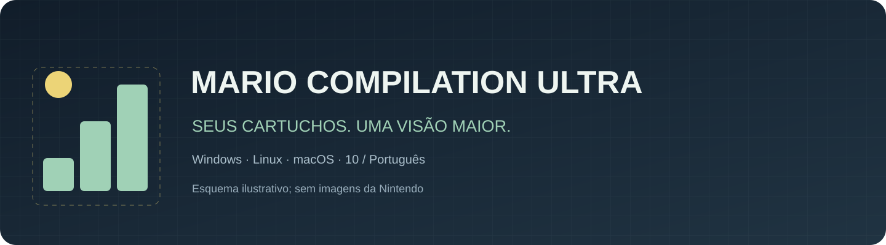
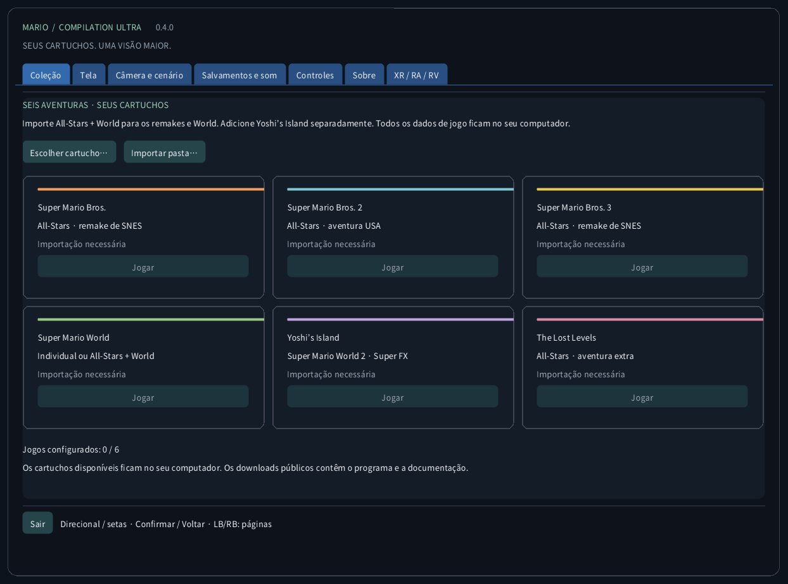
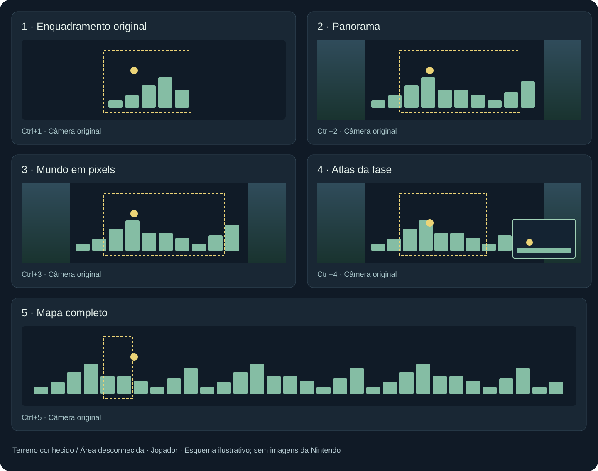
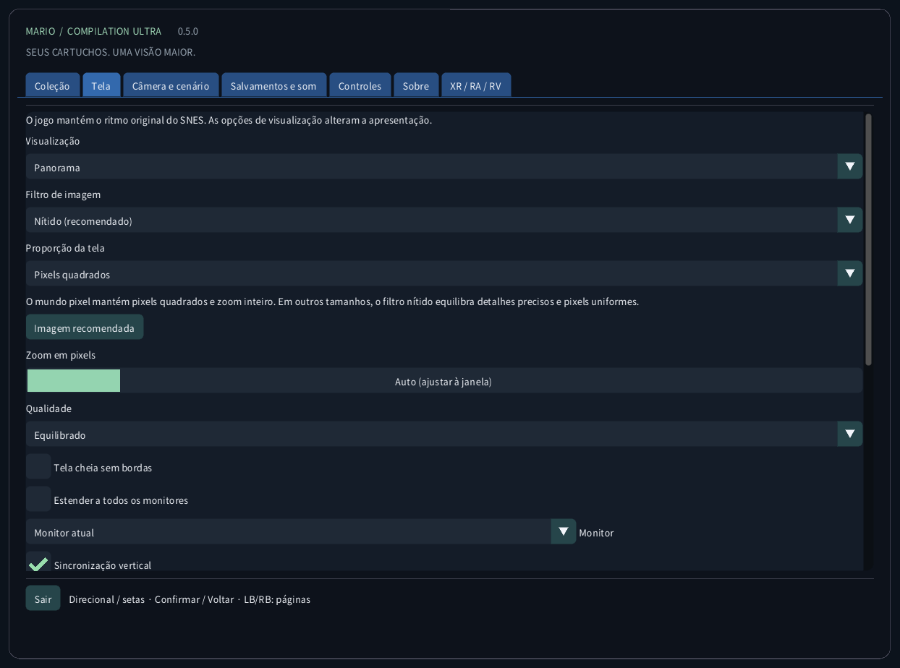
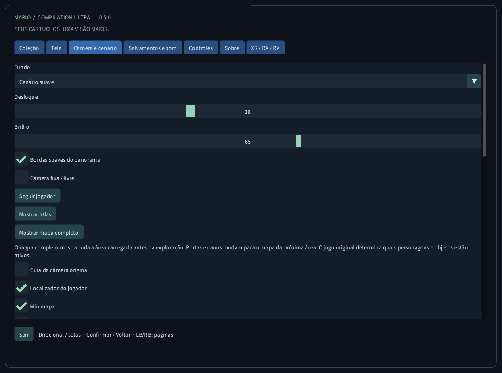
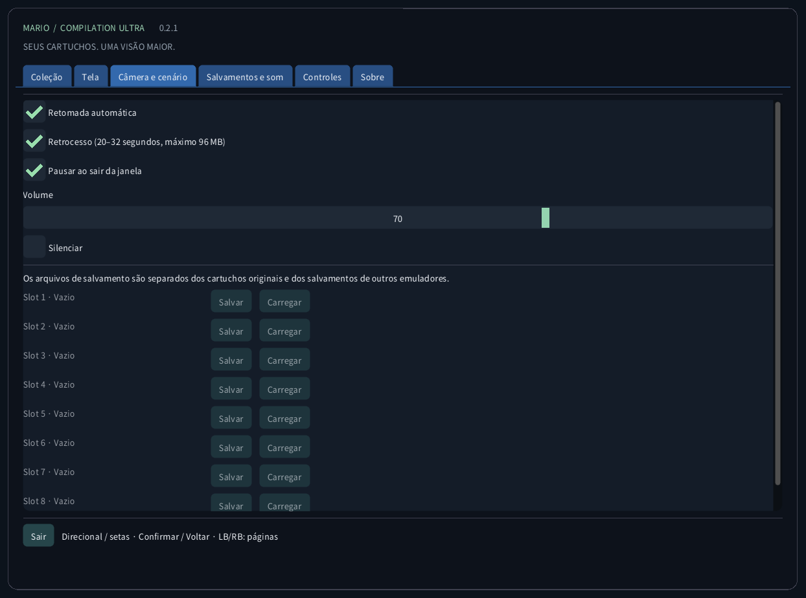
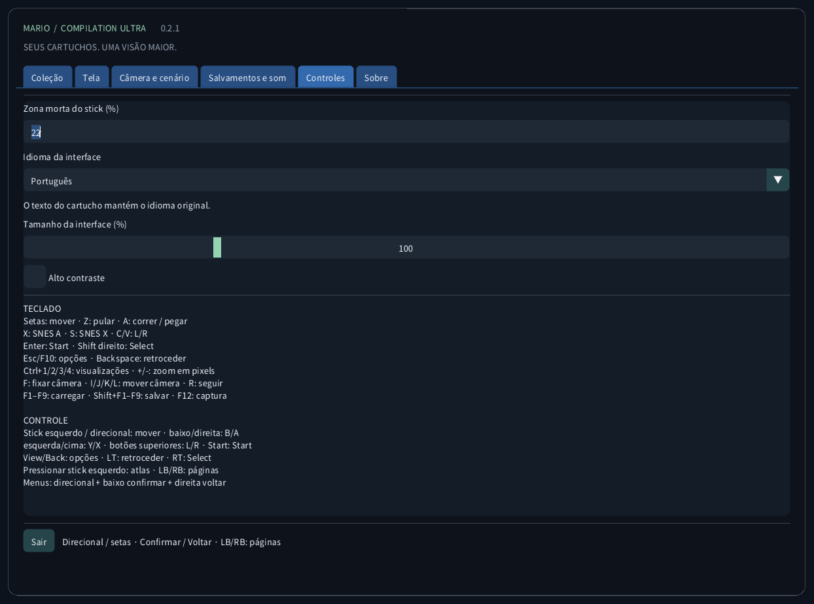
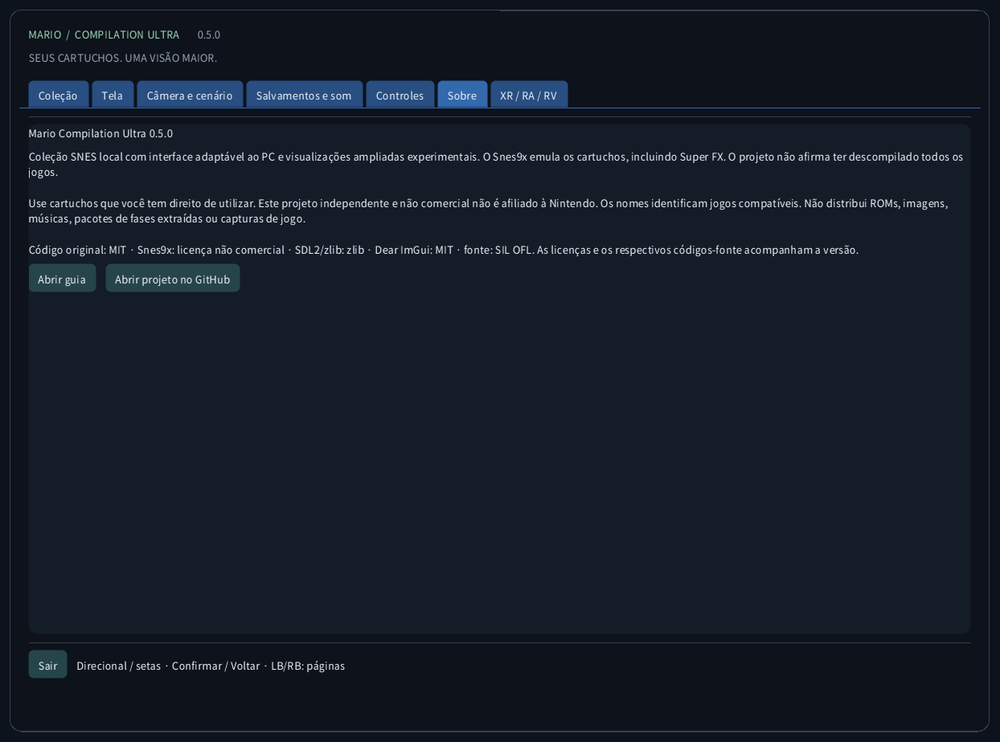

<!-- Generated by tools/guides.py; edit docs/guide-texts.json and assets/locales. -->


[English](../en/README.md) · [Français](../fr/README.md) · [Español](../es/README.md) · [日本語](../ja/README.md) · [Deutsch](../de/README.md) · [Italiano](../it/README.md) · [Português](../pt/README.md) · [Русский](../ru/README.md) · [简体中文](../zh/README.md) · [한국어](../ko/README.md)

# Mario Compilation Ultra 0.2.2

Coleção SNES local com interface adaptável ao PC e visualizações ampliadas experimentais. O Snes9x emula os cartuchos, incluindo Super FX. O projeto não afirma ter descompilado todos os jogos.

[Download e início pela área de trabalho](https://github.com/vhaloo/MarioCompilationUltra/releases/tag/v0.2.2) · [HTML](guide.html) · [GitHub](https://github.com/vhaloo/MarioCompilationUltra)

## Download e início pela área de trabalho

1. Baixe o pacote para seu computador e extraia todo o ZIP. Mantenha o executável, SDL, recursos e guias juntos. Windows: abra MarioCompilationUltra.exe. Linux: execute Play.sh. Mac: abra o aplicativo.
2. Importe seus arquivos .sfc, .smc ou ZIP com um único cartucho usando Escolher cartucho, Importar pasta ou arrastar e soltar. O seletor abre a pasta de dados do aplicativo. Cartuchos compatíveis colocados diretamente nela são detectados na próxima execução.
3. All-Stars + Super Mario World inclui Mario Bros. 1, Mario Bros. 2 USA, Mario Bros. 3, World e The Lost Levels. Adicione Yoshi’s Island separadamente. Escolha Jogar e pressione Enter ou Start na tela original; pressione novamente se houver uma demonstração.

Windows: execute Install-Windows.ps1 para copiar o pacote completo para Programs do usuário e criar o atalho. Linux: execute Install-Linux.sh para registrar esta pasta no menu e na área de trabalho. Mac: mova o app para Aplicativos e crie um alias. Mantenha a pasta portátil escolhida.

```powershell
# Windows
powershell -NoProfile -ExecutionPolicy Bypass -File .\Install-Windows.ps1
```

```sh
# Linux
sh ./Install-Linux.sh
```



*As capturas são do aplicativo real sem cartucho carregado. Os diagramas usam geometria ilustrativa original, não arte dos jogos. Os downloads públicos não incluem ROMs Nintendo, sprites, música, fases extraídas ou capturas de partidas.*

## Pacotes e validação

- Windows x64: inicialização local e execução de cartuchos verificadas; também há testes automáticos.
- Linux x64: compilação e verificações sem ROM automatizadas. Jogo em computador Linux físico não testado.
- **macOS Intel x64 e Apple Silicon arm64: EXPERIMENTAL, NÃO TESTADO EM MAC FÍSICO. Os testes automáticos cobrem compilação e interface sem ROM. Assinatura ad hoc, sem notarização; controle, som, gráficos e Gatekeeper não verificados em hardware real.**

## Modos de visualização



Imagem recomendada: Panorama, zoom Auto, filtro Nítido, pixels quadrados, bordas suaves e fundo ambiente atenuado. Tela → Imagem recomendada não altera idioma, som ou partidas salvas. Também há Pixels exatos, Suave e TV 4:3. O mundo pixel mantém zoom inteiro e pixels quadrados. As linhas seguem as linhas do jogo e são desativadas abaixo de 2× para evitar moiré.

O atlas de World cobre a área carregada. Outras cenas ampliadas comuns mapeiam o terreno observado durante o movimento. Regiões desconhecidas revelam o fundo ambiente. O atlas mostra terreno decodificado e uma visão próxima maior permite jogar. Fora da câmera original, efeitos e sprites podem diferir; objetos fora da câmera não são simulados. Projeções especiais mantêm o enquadramento original.

Os perfis de memória e a seleção automática All-Stars usam as edições dos EUA listadas. Uma edição reconhecida sem perfil verificado usa o enquadramento original. A tradução da interface não traduz a história nem os gráficos do cartucho comercial. Não se afirma uma nova descompilação nativa dos cinco jogos.

| CRC32 | SNES |
|---|---|
| `f84305b1` | All-Stars + World (US) |
| `925637c7` | All-Stars (US) |
| `b19ed489` | Super Mario World (US) |
| `d138f224` | Yoshi’s Island 1.0 (US) |
| `cf98ddaa` | Yoshi’s Island 1.1 (US) |

## Controles

TECLADO<br>
Setas: mover · Z: pular · A: correr / pegar<br>
X: SNES A · S: SNES X · C/V: L/R<br>
Enter: Start · Shift direito: Select<br>
Esc/F10: opções · Backspace: retroceder<br>
Ctrl+1/2/3/4: visualizações · +/-: zoom em pixels<br>
F: fixar câmera · I/J/K/L: mover câmera · R: seguir<br>
F1–F9: carregar · Shift+F1–F9: salvar · F12: captura<br>
<br>
CONTROLE<br>
Stick esquerdo / direcional: mover · baixo/direita: B/A<br>
esquerda/cima: Y/X · botões superiores: L/R · Start: Start<br>
View/Back: opções · LT: retroceder · RT: Select<br>
Pressionar stick esquerdo: atlas · LB/RB: páginas<br>
Menus: direcional + baixo confirmar + direita voltar

## Salvamentos e som

Cada jogo tem nove espaços, retomada automática, SRAM e retrocesso limitado. Usa até 96 MiB para cerca de 20–32 segundos. F1–F9 carregam; Shift+F1–F9 salvam. CRC, versão do núcleo e integridade são verificados. Os saves de outros emuladores ficam separados.

## Arquivos locais

Esta pasta contém settings.ini, referências aos cartuchos, states/, saves/ e screenshots/. A importação não envia o cartucho nem modifica o original. Faça backup antes de trocar de computador. Os estados dependem do cartucho e núcleo exatos; SRAM é um arquivo separado.

| OS | Pasta local dos cartuchos |
|---|---|
| Windows | `%APPDATA%/ValentinWittwe/MarioCompilationUltra/` |
| Linux | `$XDG_DATA_HOME/ValentinWittwe/MarioCompilationUltra/` or `~/.local/share/ValentinWittwe/MarioCompilationUltra/` |
| macOS | `~/Library/Application Support/ValentinWittwe/MarioCompilationUltra/` |

--data-dir substitui o caminho padrão. A atualização do atalho Windows preserva essa opção. Arquivos locais mostra a pasta utilizada.

## Se o jogo ainda pede importação

Escolha o cartucho novamente se o arquivo foi movido ou a unidade desconectada. O ZIP deve conter um único .sfc ou .smc, sem criptografia, armazenado ou DEFLATE. Confira as edições e cabeçalhos compatíveis. Se faltar fonte ou SDL, extraia o pacote completo novamente.

## Galeria da interface real

### Coleção


### Tela



### Câmera e cenário



### Salvamentos e som



### Controles



### Sobre



## Pacotes e validação · 0.2.2

As verificações públicas cobrem 104 testes em três suítes, 176 mensagens em dez catálogos, fontes e 240 capturas reais. Os testes privados no Windows incluem seis jogos, 2.160 configurações de regressão, 1.188 casos de imagem, partidas salvas, SRAM, retomada e retrocesso. O Direct3D foi medido pelo atalho da área de trabalho nas quatro vistas em 7680×1440. São cenas limitadas, não campanhas completas; botões físicos e áudio audível seguem não verificados. Veja o relatório.

[CTest / CI](https://github.com/vhaloo/MarioCompilationUltra/actions) · [Report](../TEST_REPORT.md) · [Build](../BUILD.md) · [Source / research](../RESEARCH.md)

Use cartuchos que você tem direito de utilizar. Este projeto independente e não comercial não é afiliado à Nintendo. Os nomes identificam jogos compatíveis. Não distribui ROMs, imagens, músicas, pacotes de fases extraídas ou capturas de jogo.

Código original: MIT · Snes9x: licença não comercial · SDL2/zlib: zlib · Dear ImGui: MIT · fonte: SIL OFL. As licenças e os respectivos códigos-fonte acompanham a versão.

[Licence](../../LICENSE) · [Third-party notices](../../THIRD_PARTY_NOTICES.md)
