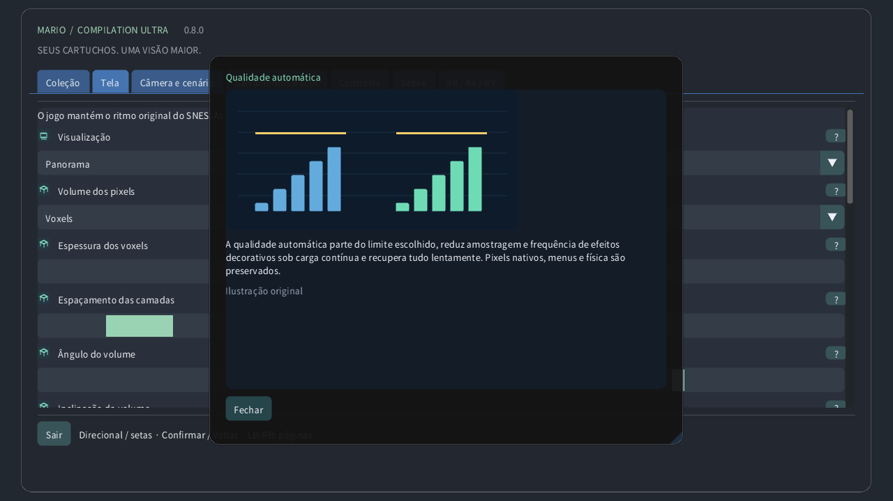

# Configurações ilustradas

## Coleção

Escolha um cartucho local, inicie um jogo ou abra o guia. Os downloads públicos não incluem jogos nem seus dados salvos.

## Visualização

Original mantém a tela do console e Panorama a amplia. Atlas enquadra o terreno disponível; Mapa completo lê toda a área carregada quando o formato é compatível, inclusive sem exploração. Uma porta pode mudar de área.

## Câmera e cenário

Escolha se a vista segue a câmera original, o personagem ou uma posição fixa. Isso muda o enquadramento, sem mover o personagem nem ativar inimigos distantes.

## Zoom do relógio

O zoom muda quanto terreno cabe na tela. No relógio, 0% mostra toda a área carregada e 100% chega à câmera original. A velocidade do jogo não muda.

## Fisheye para tela redonda

Em relógios redondos, a lente curva o retângulo inteiro do jogo para um círculo sem cortar suas bordas. Controles e textos ficam planos. Desative para um retângulo sem distorção.

## Sensibilidade da coroa

A coroa ou aro giratório detectado ajusta o zoom no jogo e rola os menus. Sensibilidade muda o efeito de cada giro; Inverter troca o sentido. O zoom por toque funciona sem coroa.

## Filtro de imagem

Pixels próximos mantém bordas duras. Nítido preserva a clareza em tamanhos não inteiros. Suave ameniza a ampliação. Imagem original e colisões não mudam.

## Proporção da tela

Pixels quadrados mantém o formato dos pixels originais; TV 4:3 reproduz as proporções de uma televisão. Mundo pixel usa pixels quadrados e zoom inteiro.

## Qualidade automática

A qualidade automática parte do limite escolhido, reduz amostragem e frequência de efeitos decorativos sob carga contínua e recupera tudo lentamente. Pixels nativos, menus e física são preservados.

## Reserva de desempenho

A reserva deixa tempo livre para tarefas inesperadas. Uma reserva maior favorece a fluidez. Extra fluido usa 40%; Quest mantém pelo menos 35%. A qualidade sobe quando há margem.

## Adaptar ao calor do aparelho

O estado térmico local do Android pode reduzir detalhes decorativos antes que o calor aumente. Não precisa de permissão extra nem rede. O sistema controla frequências reais e atualização.

## Sincronização vertical

A sincronização acompanha a tela para reduzir rasgos na imagem. O jogo mantém seu próprio ritmo. Quest usa a frequência escolhida do headset; a reserva é calculada para ela.

## Shader de RV

CRT eficiente mantém o visual retrô com menos cálculos. Automático começa leve e permite a referência após medir folga GPU contínua. Referência força o cálculo mais caro.

## Tela

Escolha janela, monitor ou tela cheia. Essas opções mudam onde a imagem aparece, sem alterar a área carregada nem seus dados salvos.

## Fundo

O fundo preenche o espaço ao redor do jogo. Cenário suave usa suas cores; Meia-noite e Preto são mais discretos. Desfoque e brilho afetam esse entorno.

## Desfoque

O desfoque suaviza o cenário ao redor e o brilho ajusta sua luz. A imagem nativa não muda. Sob carga, a qualidade automática pode atualizar essa decoração com menor frequência.

## Bordas suaves do panorama

Bordas suaves misturam a cena ampliada ao fundo perto da câmera original. Desative para uma junção mais marcada. Mapas completos mantêm seu enquadramento.

## Localizador do jogador

O localizador marca o personagem, a guia contorna a câmera original e o minimapa mostra sua posição. O close mantém a tela nativa legível quando o mapa está distante.

## Prever inimigos posicionados

As prévias mostram posições verificadas ou aparências observadas localmente. Objetos esmaecidos e contornos são guias, não inimigos ativos extras. Opacidade e rótulos ajustam sua visibilidade.

## Mostrar estado

Escolha canto, tamanho, opacidade e duração dos lembretes. Tempo zero mantém a indicação visível. Essas sobreposições não mudam o jogo nem a câmera.

## Idioma

Ajuste idioma, tamanho e contraste dos menus para ler com conforto. Os guias ilustrados funcionam offline. Renderização e idioma do cartucho são independentes.

## Controles

Escolha o mapeamento dos botões e as zonas mortas. Uma zona maior ignora mais movimentos pequenos. Controles rápidos acrescentam atalhos de câmera, mantendo as ações normais.

## Controles de toque

Os botões de toque aceitam vários dedos ao mesmo tempo. Automático os mostra sem gamepad conectado. Posição, tamanho, opacidade e lado mudam os controles, não a física.

## Retroceder

Segure o comando escolhido para voltar por estados recentes exatos. A duração depende da memória e do cartucho. Áudio reverso e indicador são opcionais; os salvamentos em disco são separados.

## Salvamentos e som

Um espaço guarda o estado atual da máquina. Carregar volta a ele; a retomada automática usa outro espaço. O progresso da bateria é separado. Substituir exige confirmação.

## Volume

Volume e silêncio controlam a reprodução local. Não mudam a velocidade nem apagam dados salvos. O áudio da volta no tempo é ajustado separadamente.

## Pausar ao sair da janela

A pausa solta os comandos mantidos. Foco e rastreamento definem pausas automáticas. Retomar mantém a partida; sair grava o progresso da bateria.

## Modo de apresentação

Escolha tela flutuante, parede, atlas no chão, mesa arcade, sala CRT ou tela curva. A mesma partida continua; só a apresentação no espaço muda.

## Distância de visualização

Tamanho, distância, altura, inclinação e espaço posicionam o objeto virtual na sala. Use as unidades mostradas. Recentralizar o traz ao alcance sem reiniciar o jogo.

## Fixação da tela

A parede automática usa dados de cena autorizados, quando disponíveis. Travar ou salvar mantém o local escolhido. Perda de rastreamento pode pausar; a posição manual continua disponível.

## Usar controles Quest Touch

Controle virtual, mãos e toque direto usam as mesmas ações do jogo. Tamanho e dicas melhoram o uso. A força háptica muda o retorno, não o instante dos botões.

## Monitor CRT nativo móvel

CRT acrescenta linhas de varredura, máscara RGB, vidro curvo e reflexos. Mais intensidade é uma escolha visual, não novos detalhes do jogo. A qualidade automática pode simplificar decoração cara.

## Ambiente de RV

Passthrough mostra sua sala real; o ambiente virtual fornece o fundo quando ele está desligado. Transparência, cenário ao redor e brilho mudam o que cerca o jogo.

## Detalhe periférico adaptativo

Detalhe da tela do jogo e dos olhos limita camadas diferentes. A qualidade automática ajusta ambas. O menu independente fica nítido; a foveação periférica é opcional quando suportada.

## Ajuda ilustrada das opções

Use a interrogação para uma explicação ilustrada. O cursor ou foco do controle mostra uma prévia; o toque abre a ficha. As ilustrações são exemplos originais, não capturas de cartuchos.

## Qualidade manual

A qualidade manual desativa a adaptação e mantém o detalhe escolhido. Qualidade automática restaura a adaptação; Extra fluido deixa mais reserva de desempenho.

## Detalhe periférico adaptativo

Em Quest compatíveis, carga prolongada pode reduzir detalhes periféricos preservando o centro. Menus usam uma camada nítida separada. Sem suporte, o renderizador normal assume. A qualidade no headset físico ainda não foi testada.

## Volume dos pixels

3D procedural opcional: os pixels tornam-se colunas sólidas, com terreno, fundos e personagens em planos separados. O relevo é raso; os voxels são mais espessos. A espessura altera a profundidade e o ângulo altera a vista na tela. A qualidade automática reduz detalhes sob carga. HUD e ampliações mantêm os pixels originais. Cenas especiais usam a tela original. É uma interpretação, não uma reconstrução de faces ocultas. Desempenho físico não testado. As formas arredondadas geram corpos 3D em degraus a partir da transparência dos personagens; desativá-las mantém a extrusão uniforme. A inclinação altera a elevação da vista na tela. As posições e a física originais não mudam. O espaçamento separa as camadas em profundidade mantendo a ordem.

[Guide](README.md) · [Watch](WATCH.md)
