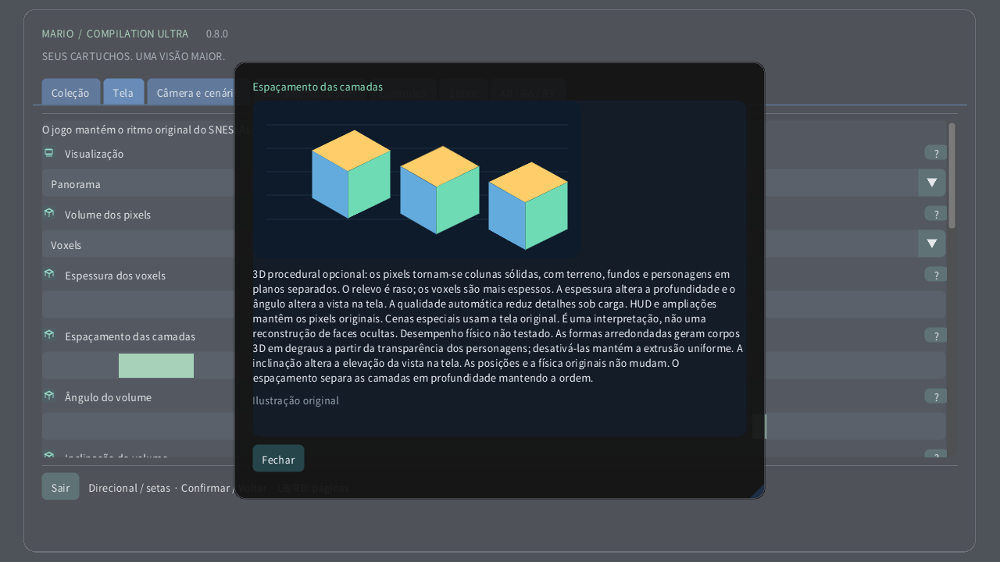

# Volume dos pixels

[English](../en/VOXELS.md) · [Français](../fr/VOXELS.md) · [Español](../es/VOXELS.md) · [日本語](../ja/VOXELS.md) · [Deutsch](../de/VOXELS.md) · [Italiano](../it/VOXELS.md) · [Português](../pt/VOXELS.md) · [Русский](../ru/VOXELS.md) · [简体中文](../zh/VOXELS.md) · [한국어](../ko/VOXELS.md)

No computador ou dispositivo com toque, abra Tela → Volume dos pixels. Comece com Relevo de pixels para profundidade sutil e depois experimente Voxels. A espessura muda o corpo de cada pixel; o espaçamento afasta as camadas sem alterar a ordem. No Quest, use a página Volume do controle espacial. No relógio, a coroa aproxima da área inteira até a tela original.

3D procedural opcional: os pixels tornam-se colunas sólidas, com terreno, fundos e personagens em planos separados. O relevo é raso; os voxels são mais espessos. A espessura altera a profundidade e o ângulo altera a vista na tela. A qualidade automática reduz detalhes sob carga. HUD e ampliações mantêm os pixels originais. Cenas especiais usam a tela original. É uma interpretação, não uma reconstrução de faces ocultas. Desempenho físico não testado. As formas arredondadas geram corpos 3D em degraus a partir da transparência dos personagens; desativá-las mantém a extrusão uniforme. A inclinação altera a elevação da vista na tela. As posições e a física originais não mudam. O espaçamento separa as camadas em profundidade mantendo a ordem.

| Volume dos pixels | |
|---|---|
| 0 | 2D original |
| 1 | Relevo dos pixels |
| 2 | Voxels |

- **Espessura dos voxels**: 1–16 px
- **Espaçamento das camadas**: 1–12 px
- **Ângulo do volume**: −30° … +30°
- **Inclinação do volume**: −30° … +30°
- **Formas de voxels arredondadas**

[Coleção](README.md) · [Configurações ilustradas](SETTINGS.md) · [HTML](voxels.html) · [Technical research](../VOXEL_RESEARCH.md)
