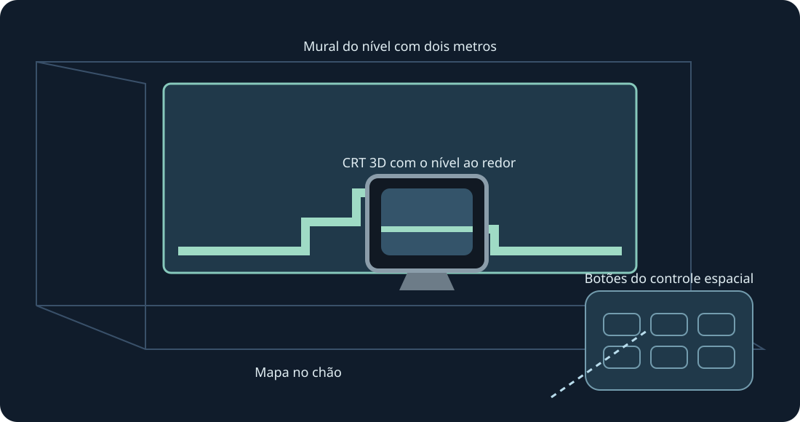

# Mario Compilation Ultra 0.4.0 · Quest RV / RA

[English](../en/XR.md) · [Français](../fr/XR.md) · [Español](../es/XR.md) · [日本語](../ja/XR.md) · [Deutsch](../de/XR.md) · [Italiano](../it/XR.md) · [Português](../pt/XR.md) · [Русский](../ru/XR.md) · [简体中文](../zh/XR.md) · [한국어](../ko/XR.md)

Paredes, chão, mesa de arcade, CRT e galeria curva. Prévia XR experimental. Use ambas as pegas para redimensionar.

Prévia experimental. Compilação, lint, geometria e entrada são verificados. Nenhum headset foi conectado, instalado ou usado nesta versão; rastreamento, conforto, passthrough e fluidez aguardam seu teste físico.

Para testar depois, ative o modo de desenvolvedor e instale o APK ARM64 público com SideQuest ou adb install -r. Abra Mario Compilation Ultra XR em Fontes desconhecidas, escolha cartucho ou ZIP pelo seletor do sistema e jogue. Importe All-Stars + World e Yoshi’s Island separadamente. O APK público não contém ROMs nem progresso.

Tela espacial | Ajustar à parede mapeada | Mural do nível com dois metros | Mapa no chão | Mesa de arcade | CRT 3D com o nível ao redor | Galeria curva do nível

Escolha nível, CRT nativo, controle ou opções como alvo. Uma empunhadura move e gira; duas redimensionam o nível mesmo com posição travada. Há ajustes finos e metade/dobro/redefinir. Recuperar traz a interface de volta. Y abre opções; a página Jogar tem todos os botões SNES.

Pince e arraste o analógico; use a outra mão nos botões. A pinça com o dedo médio segura alças. Perder o rastreamento solta os comandos.

Uma nova instalação pede 90 Hz e um mural AR transparente de dois metros. Há frequência alternativa compatível; a simulação mantém o ritmo original. Varredura da sala e permissões de cena/âncoras são opcionais para paredes automáticas. Posicionamento manual e calibração do chão continuam disponíveis. O runtime fornece passthrough; sem permissões de Internet, microfone ou imagens da câmera.

As imagens fantasma são informativas e não simulam objetos distantes. Posições verificadas aparecem no início; imagens aprendidas vêm apenas do jogo local.

A mesa arcade mostra a área carregada. A física e a ativação dos objetos continuam originais.

Atalhos no PC: segure o clique do analógico direito; direcional esquerda/direita muda zoom, cima 1:1, baixo mapa inteiro, A trava, B câmera original, X captura, Y segue o jogador. Soltar restaura os controles SNES. F1 ou ajuda Y no menu abre a explicação ilustrada.

SNES: D-pad · A · B · X · Y · L · R · Start · Select

Touch: A → SNES B · B → SNES Y · X → SNES A · RT → SNES X · R3 → Start · LT → Rewind · Y → Mover opções

[HTML](xr.html) · [Guide](README.md) · [Build](../BUILD.md) · [Parity](../PARITY.md) · [Validation](../TEST_REPORT.md)

[Meta developer mode](https://developers.meta.com/vr/documentation/android-apps/enable-developer-mode/) · [Meta refresh API](https://developers.meta.com/vr/documentation/native/android/mobile-display-refresh-rate/) · [Meta passthrough](https://developers.meta.com/vr/documentation/native/android/mobile-passthrough/)
