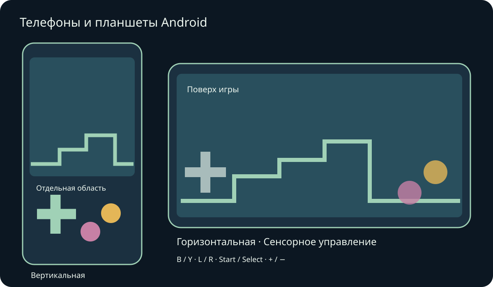
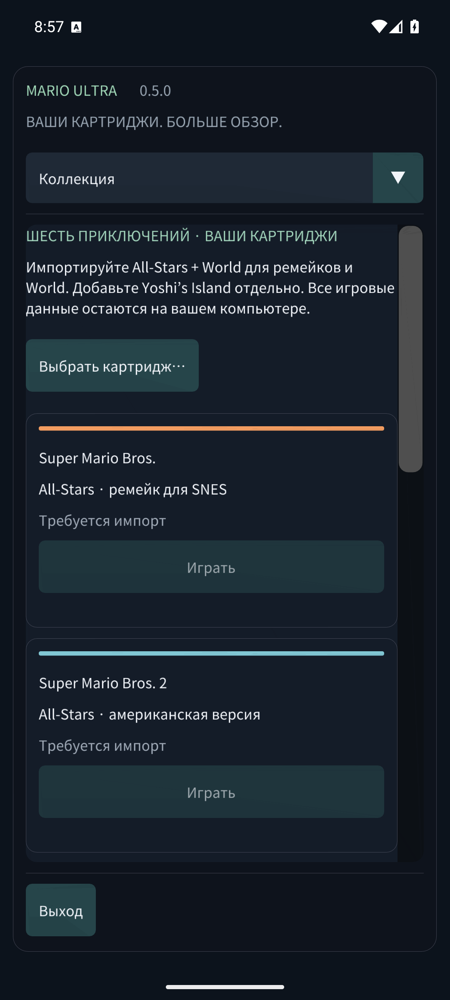

# Mario Compilation Ultra 0.5.0 · Телефоны и планшеты Android

[English](../en/MOBILE.md) · [Français](../fr/MOBILE.md) · [Español](../es/MOBILE.md) · [日本語](../ja/MOBILE.md) · [Deutsch](../de/MOBILE.md) · [Italiano](../it/MOBILE.md) · [Português](../pt/MOBILE.md) · [Русский](../ru/MOBILE.md) · [简体中文](../zh/MOBILE.md) · [한국어](../ko/MOBILE.md)

Установите APK для телефона/планшета Android и откройте Mario Compilation Ultra. Публичный APK GitHub просит выбрать ваши картриджи; личная версия с ROM уже содержит шесть игр. APK Quest — отдельное приложение для шлема. Нужны Android 8 или новее и OpenGL ES 3; включены ARM64, ARMv7 и x86_64.

Поворот и изменение размера окна сохраняют игру. Поля учитывают вырезы и системную навигацию.

Несколькими пальцами можно двигаться, бежать и прыгать одновременно. При подключённом геймпаде автоматические кнопки скрываются. Назад Android открывает меню.

Кнопки соответствуют SNES: обычно B — прыжок, Y — бег. Доступны L, R, Start и Select. Вид переключает пять режимов, минус/плюс меняют масштаб. Удерживайте перемотку для возврата назад. Настройки сразу ставят игру на паузу. Меню прокручивается пальцем; на узком экране раздел выбирается сверху.

- Ориентация экрана
- Сенсорное управление
- Расположение кнопок
- Размер сенсорных кнопок
- Непрозрачность кнопок
- Режим для левшей
- Вибрация при касании
- Не выключать экран во время игры

Состояния, перемотка и сохранения картриджа находятся в закрытом хранилище приложения. В фоне записывается батарейное сохранение и, если включено, слот продолжения 0. Обновление с той же подписью сохраняет прогресс. Удаление приложения или очистка данных удаляет локальные картриджи и сохранения. Слоты находятся в разделе сохранений и звука.

Проверки эмуляторов телефона и планшета отделены от испытаний на реальном устройстве. Производительность, геймпады, вырезы и окна зависят от модели. Версии macOS остаются экспериментальными и не проверены на реальном Mac. Точный охват приведён в отчёте.

[Android APK](https://github.com/vhaloo/MarioCompilationUltra/releases/download/v0.5.0/MarioCompilationUltra-0.5.0-Android-public.apk) · [HTML](mobile.html) · [Guide](README.md) · [Quest](XR.md) · [Validation](../TEST_REPORT.md)

[Adaptive Android apps](https://developer.android.com/develop/adaptive-apps/guides/support-different-display-sizes) · [16 KiB page sizes](https://developer.android.com/guide/practices/page-sizes)
