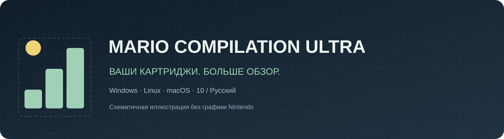
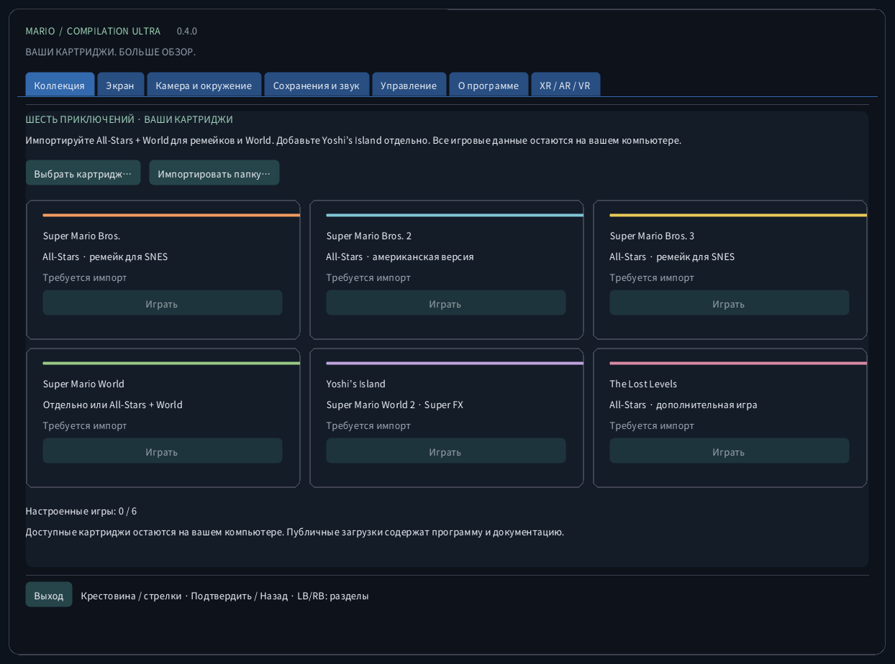
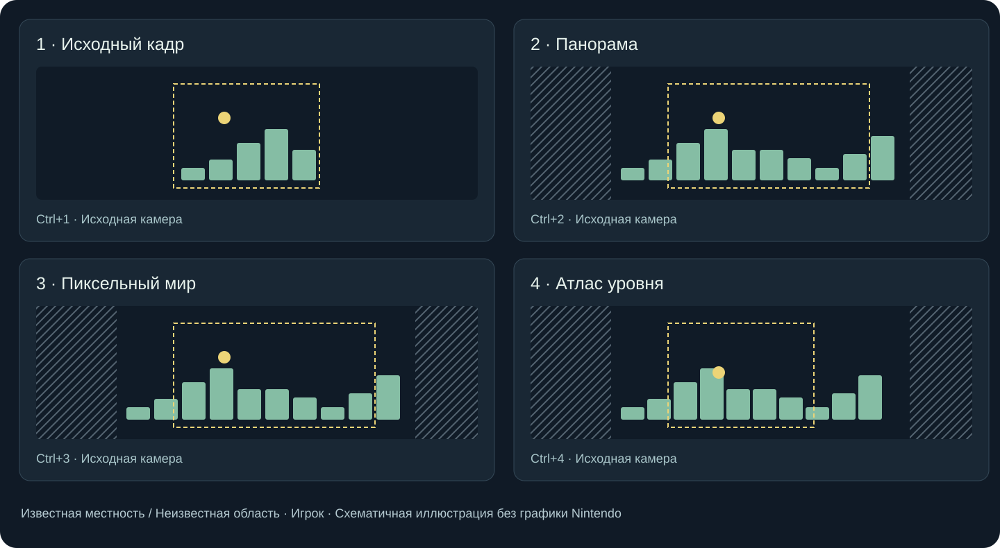
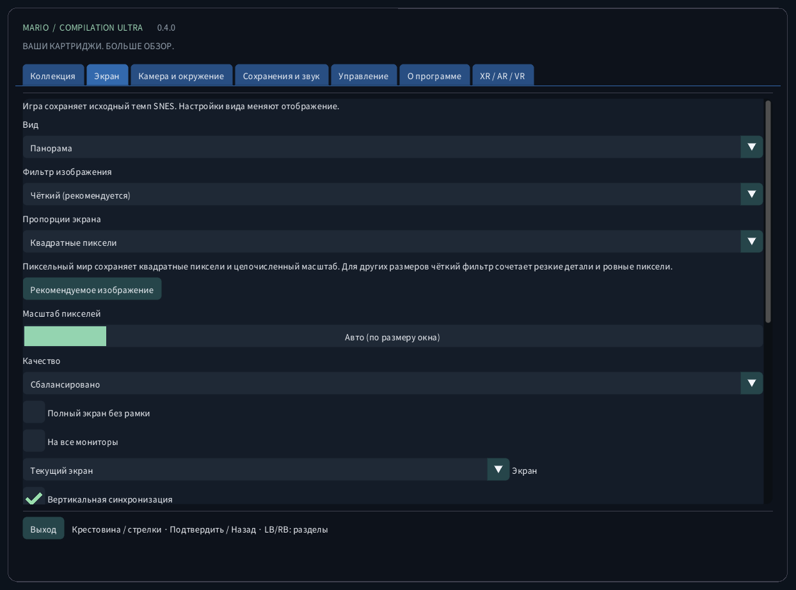
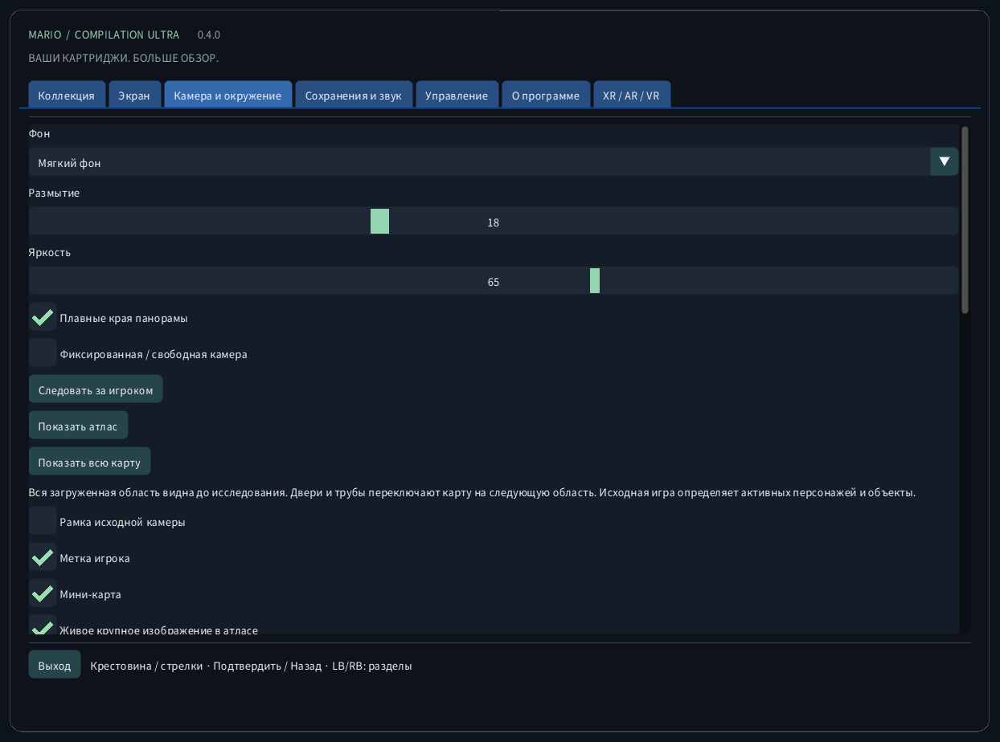
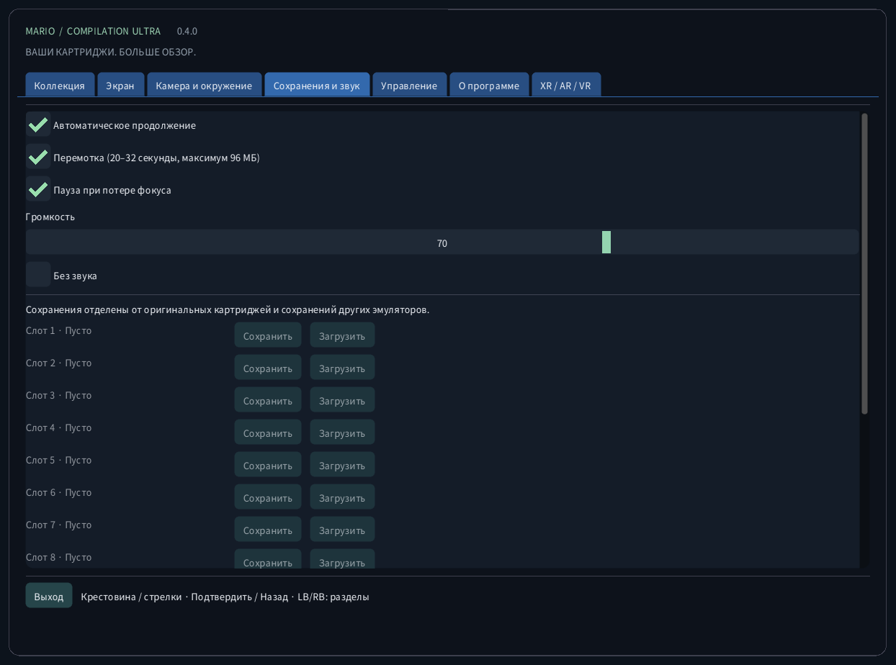
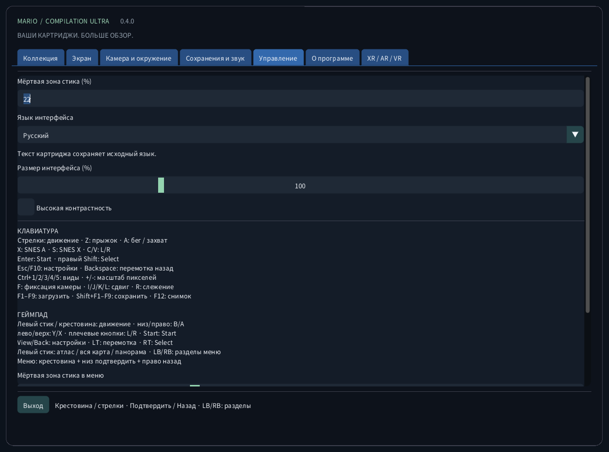
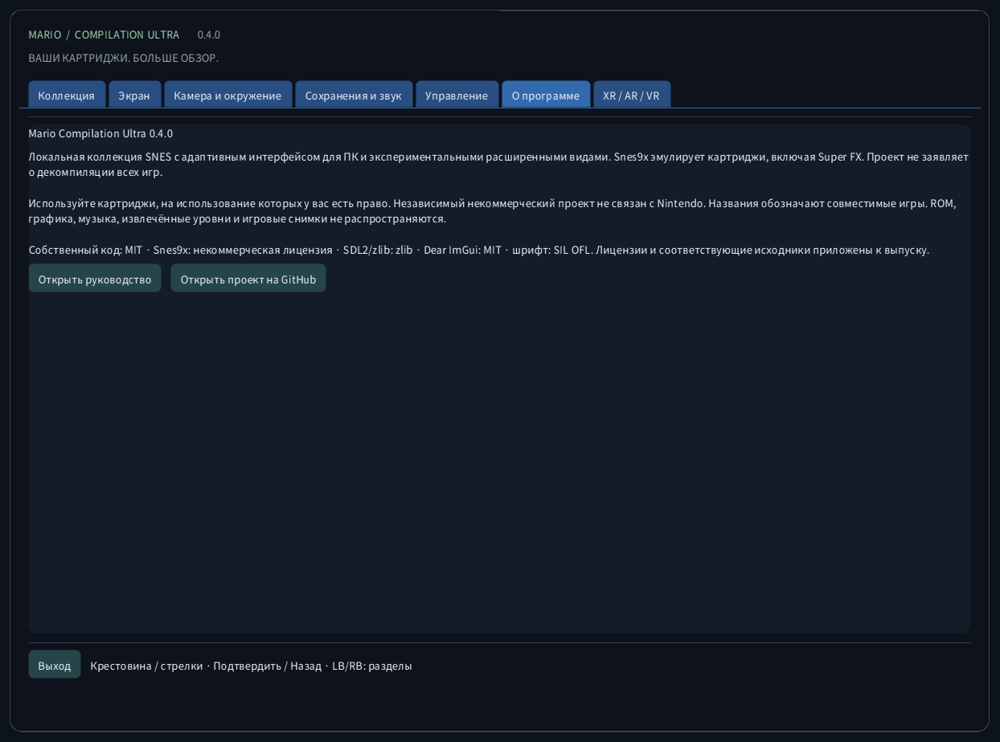
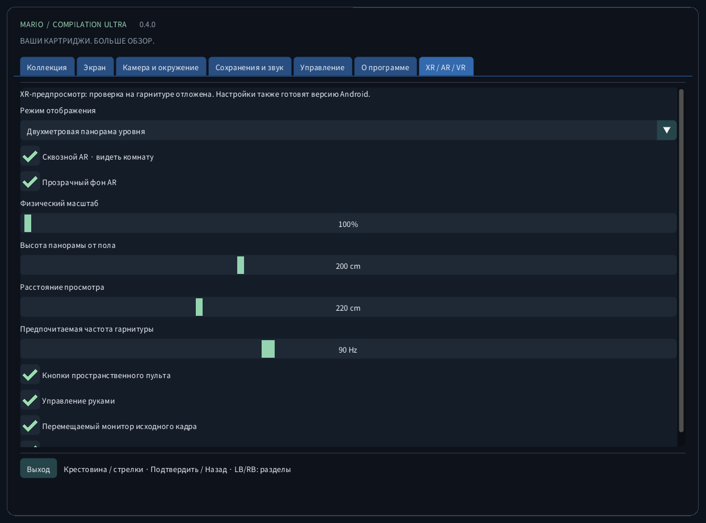

<!-- Generated by tools/guides.py; edit docs/guide-texts.json and assets/locales. -->


[English](../en/README.md) · [Français](../fr/README.md) · [Español](../es/README.md) · [日本語](../ja/README.md) · [Deutsch](../de/README.md) · [Italiano](../it/README.md) · [Português](../pt/README.md) · [Русский](../ru/README.md) · [简体中文](../zh/README.md) · [한국어](../ko/README.md)

# Mario Compilation Ultra 0.4.0

Локальная коллекция SNES с адаптивным интерфейсом для ПК и экспериментальными расширенными видами. Snes9x эмулирует картриджи, включая Super FX. Проект не заявляет о декомпиляции всех игр.

[Загрузка и запуск с рабочего стола](https://github.com/vhaloo/MarioCompilationUltra/releases/tag/v0.4.0) · [HTML](guide.html) · [GitHub](https://github.com/vhaloo/MarioCompilationUltra)

## Загрузка и запуск с рабочего стола

1. Скачайте пакет для своего компьютера и полностью распакуйте ZIP. Программа, SDL, ресурсы и руководства должны оставаться вместе. Windows: откройте MarioCompilationUltra.exe. Linux: запустите Play.sh. Mac: откройте приложение.
2. Импортируйте свои .sfc, .smc или ZIP с одним картриджем через выбор файла, импорт папки или перетаскивание. Диалог открывает папку данных приложения. Совместимые картриджи, помещённые прямо в неё, обнаруживаются при следующем запуске.
3. All-Stars + Super Mario World содержит Mario Bros. 1, Mario Bros. 2 USA, Mario Bros. 3, World и The Lost Levels. Yoshi’s Island добавляется отдельно. Выберите запуск, затем Enter или Start на исходном титульном экране; во время демо нажмите ещё раз.

Windows: Install-Windows.ps1 копирует весь пакет в Programs пользователя и создаёт ярлык. Linux: Install-Linux.sh регистрирует эту папку в меню и на рабочем столе. Mac: перенесите приложение в Applications и создайте псевдоним. Не перемещайте выбранную переносную папку.

```powershell
# Windows
powershell -NoProfile -ExecutionPolicy Bypass -File .\Install-Windows.ps1
```

```sh
# Linux
sh ./Install-Linux.sh
```



*Снимки получены из настоящего приложения без загруженного картриджа. Схемы используют оригинальную условную геометрию, а не графику игр. Публичные загрузки не содержат ROM Nintendo, спрайтов, музыки, извлечённых уровней или кадров игры.*

## Пакеты и проверка

- Windows x64: проверены запуск с рабочего стола и выполнение картриджей; также есть автотесты.
- Linux x64: автоматическая сборка и проверки без ROM. Игра на физическом Linux-компьютере не проверена.
- **macOS Intel x64 и Apple Silicon arm64: ЭКСПЕРИМЕНТАЛЬНО, НЕ ПРОВЕРЕНО НА ФИЗИЧЕСКОМ MAC. Автотесты проверяют сборку и интерфейс без ROM. Подпись ad hoc, без нотарификации; контроллер, звук, графика и Gatekeeper на реальном устройстве не проверены.**

## Режимы вида



Рекомендуемое изображение: панорама, автомасштаб, чёткий фильтр, квадратные пиксели, плавные края и приглушённый окружающий фон. Экран → Рекомендуемое изображение не меняет язык, звук и сохранения. Доступны также ближайшие пиксели, плавный фильтр и ТВ 4:3. Пиксельный мир сохраняет целочисленный масштаб и квадратные пиксели. Линии следуют строкам игры и отключаются ниже 2× во избежание муара.

Вся карта (Ctrl+5) показывает весь рельеф загруженной области с первого игрового кадра во всех шести играх, без предварительного обхода. Двери и трубы сменяют карту; отдельные комнаты не склеиваются. Mario World показывает оба слоя рельефа, если они есть. Стрелка отмечает игрока, а при свободном месте появляется крупный план. Четыре прежних вида сохранены; вне World они по-прежнему накапливают увиденный рельеф. Персонажи, подвижные платформы и эффекты сохраняют исходную симуляцию и дальность активации. Особые арены без карты рельефа используют исходный вид. Нажатие левого стика: Атлас → Вся карта → Панорама.

Расширенные профили памяти и автоматический выбор All-Stars рассчитаны на перечисленные версии США. Распознанная версия без проверенного профиля использует исходный кадр. Перевод интерфейса не переводит сюжет или графику коммерческого картриджа. Новая нативная декомпиляция всех пяти игр не заявляется.

| CRC32 | SNES |
|---|---|
| `f84305b1` | All-Stars + World (US) |
| `925637c7` | All-Stars (US) |
| `b19ed489` | Super Mario World (US) |
| `d138f224` | Yoshi’s Island 1.0 (US) |
| `cf98ddaa` | Yoshi’s Island 1.1 (US) |

## Quest VR / AR

[Quest ARM64 APK](https://github.com/vhaloo/MarioCompilationUltra/releases/download/v0.4.0/MarioCompilationUltra-0.4.0-Quest-public.apk) · [Quest VR / AR](XR.md) · [HTML](xr.html) · [Parity](../PARITY.md)

## Управление

КЛАВИАТУРА<br>
Стрелки: движение · Z: прыжок · A: бег / захват<br>
X: SNES A · S: SNES X · C/V: L/R<br>
Enter: Start · правый Shift: Select<br>
Esc/F10: настройки · Backspace: перемотка назад<br>
Ctrl+1/2/3/4/5: виды · +/-: масштаб пикселей<br>
F: фиксация камеры · I/J/K/L: сдвиг · R: слежение<br>
F1–F9: загрузить · Shift+F1–F9: сохранить · F12: снимок<br>
<br>
ГЕЙМПАД<br>
Левый стик / крестовина: движение · низ/право: B/A<br>
лево/верх: Y/X · плечевые кнопки: L/R · Start: Start<br>
View/Back: настройки · LT: перемотка · RT: Select<br>
Левый стик: атлас / вся карта / панорама · LB/RB: разделы меню<br>
Меню: крестовина + низ подтвердить + право назад

## Сохранения и звук

Для каждой игры доступны девять ячеек, автовозобновление, SRAM и ограниченная перемотка. До 96 МиБ хватает примерно на 20–32 секунды. F1–F9 загружают; Shift+F1–F9 сохраняют. Проверяются CRC картриджа, версия ядра и целостность. Сохранения других эмуляторов хранятся отдельно.

## Локальные файлы

Папка содержит settings.ini, ссылки на картриджи, states/, saves/ и screenshots/. Импорт не отправляет картридж в сеть и не меняет оригинал. Сделайте резервную копию перед сменой компьютера. Состояния зависят от точного картриджа и ядра; SRAM хранится отдельно.

| OS | Локальная папка картриджей |
|---|---|
| Windows | `%APPDATA%/ValentinWittwe/MarioCompilationUltra/` |
| Linux | `$XDG_DATA_HOME/ValentinWittwe/MarioCompilationUltra/` or `~/.local/share/ValentinWittwe/MarioCompilationUltra/` |
| macOS | `~/Library/Application Support/ValentinWittwe/MarioCompilationUltra/` |

Папка --data-dir заменяет стандартный путь. Обновление ярлыка Windows сохраняет эту опцию. Локальные файлы показывают используемую папку.

## Если игра всё ещё просит импорт

Выберите картридж снова, если файл перемещён или диск отключён. ZIP должен содержать один .sfc или .smc без шифрования, с хранением без сжатия или DEFLATE. Проверьте список версий и заголовков. Если отсутствует шрифт или SDL, распакуйте весь пакет заново.

## Галерея настоящего интерфейса

### Коллекция


### Экран



### Камера и окружение



### Сохранения и звук



### Управление



### О программе



### Quest VR / AR



## Пакеты и проверка · 0.4.0

Пять автоматических наборов проверяют собственные тестовые данные, меню, пространственные действия и отрисовку. Интерфейс на десяти языках снят в четырёх размерах. Шесть локальных игр проверяются отдельно. Quest AR/VR и игра на реальном Mac остаются экспериментальными и не проверены. См. отчёт.

[CTest / CI](https://github.com/vhaloo/MarioCompilationUltra/actions) · [Report](../TEST_REPORT.md) · [Build](../BUILD.md) · [Source / research](../RESEARCH.md)

Используйте картриджи, на использование которых у вас есть право. Независимый некоммерческий проект не связан с Nintendo. Названия обозначают совместимые игры. ROM, графика, музыка, извлечённые уровни и игровые снимки не распространяются.

Собственный код: MIT · Snes9x: некоммерческая лицензия · SDL2/zlib: zlib · Dear ImGui: MIT · шрифт: SIL OFL. Лицензии и соответствующие исходники приложены к выпуску.

[Licence](../../LICENSE) · [Third-party notices](../../THIRD_PARTY_NOTICES.md)
