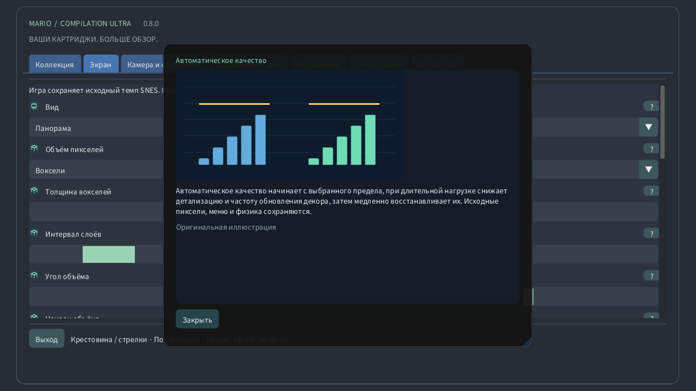

# Настройки с иллюстрациями

## Коллекция

Выберите локальный картридж, запустите игру или откройте руководство. Публичные загрузки не содержат игр и ваших сохранений.

## Вид

Оригинал сохраняет экран консоли, панорама расширяет его. Атлас охватывает доступный рельеф; полная карта при поддерживаемом формате читает всю загруженную область, включая неизученную. Дверь может загрузить другую область.

## Камера и окружение

Вид может следовать за исходной камерой, персонажем или оставаться неподвижным. Меняется только обзор: персонаж не перемещается, далёкие враги не активируются.

## Масштаб на часах

Масштаб определяет видимую область. На часах 0% показывает всю загруженную карту, а 100% — исходную камеру. Скорость игры не меняется.

## Рыбий глаз для круглого экрана

На круглых часах линза преобразует весь прямоугольник игры в круг, сохраняя края изображения. Кнопки и текст не искажаются. Отключите её для обычного прямоугольника.

## Чувствительность коронки

Обнаруженная коронка или вращающийся безель управляет масштабом в игре и прокруткой меню. Чувствительность меняет шаг вращения, инверсия — направление. Сенсорный масштаб работает и без коронки.

## Фильтр изображения

Ближайшие пиксели сохраняют жёсткие края. Чёткий фильтр улучшает нецелый масштаб, мягкий сглаживает увеличение. Исходное изображение и столкновения не меняются.

## Пропорции экрана

Квадратные пиксели сохраняют исходную форму пикселей; ТВ 4:3 воспроизводит пропорции телевизора. Пиксельный мир использует квадратные пиксели и целочисленный масштаб.

## Автоматическое качество

Автоматическое качество начинает с выбранного предела, при длительной нагрузке снижает детализацию и частоту обновления декора, затем медленно восстанавливает их. Исходные пиксели, меню и физика сохраняются.

## Резерв производительности

Резерв оставляет время на непредвиденную работу. Больший резерв улучшает плавность. Режим повышенной плавности использует 40%, Quest — не менее 35%. При устойчивом запасе качество восстанавливается.

## Учитывать нагрев устройства

Локальное тепловое состояние Android позволяет снизить декоративные детали при нагреве. Дополнительные разрешения и сеть не нужны. Реальные частоты и обновление экрана по-прежнему определяет система.

## Вертикальная синхронизация

Вертикальная синхронизация следует за экраном и уменьшает разрывы. Игра сохраняет исходный такт. Quest использует выбранную частоту гарнитуры; резерв рассчитывается относительно неё.

## Шейдер VR

Эффективный ЭЛТ сохраняет ретростиль с меньшим объёмом вычислений. Автоматический режим разрешает эталонный вариант только после устойчивого измеренного запаса GPU. Эталонный принудительно использует более тяжёлый расчёт.

## Экран

Выберите окно, дисплей и полноэкранный режим. Эти параметры меняют место показа, не затрагивая загруженный уровень и сохранения.

## Фон

Фон заполняет пространство вокруг игры. Мягкий пейзаж использует её цвета; полночь и чёрный выглядят спокойнее. Размытие и яркость действуют на это окружение.

## Размытие

Размытие смягчает окружающий пейзаж, яркость меняет его свет. Исходное изображение игры остаётся прежним. При нагрузке автоматический режим может реже обновлять этот декор.

## Плавные края панорамы

Мягкие края соединяют расширенный пейзаж с фоном возле исходной камеры. Отключение делает границу резкой. Полная карта сохраняет собственное кадрирование.

## Метка игрока

Метка указывает персонажа, рамка — исходную камеру, миникарта — её положение в области. Крупный план сохраняет читаемость исходного экрана при отдалении карты.

## Показывать размещённых врагов

Предпросмотр показывает проверенные позиции или облик, наблюдавшийся локально. Бледные объекты и контуры — подсказки, а не дополнительные активные враги. Видимость меняют прозрачность и подписи.

## Показывать состояние

Выберите угол, размер, прозрачность и время подсказок. Нулевое время оставляет подсказку на экране. Эти элементы не меняют игру или камеру.

## Язык

Настройте язык, размер и контраст меню для удобного чтения. Иллюстрированные руководства доступны без сети. Отрисовка игры и язык картриджа от этого не зависят.

## Управление

Выберите раскладку кнопок и мёртвые зоны стиков. Большая зона игнорирует мелкие движения. Быстрое управление добавляет команды камеры, сохраняя обычные игровые действия.

## Сенсорное управление

Сенсорные кнопки поддерживают несколько пальцев одновременно. Автоматический режим показывает их без подключённого геймпада. Положение, размер, прозрачность и сторона меняют управление, но не физику.

## Назад

Удерживайте выбранную кнопку для перемотки по точным недавним состояниям. Длительность зависит от памяти и игры. Обратный звук и индикатор необязательны; сохранения на диске отделены.

## Сохранения и звук

Слот хранит текущее состояние машины. Загрузка возвращает его; автовозобновление использует отдельный слот. Прогресс картриджа хранится отдельно. Для замены требуется подтверждение.

## Громкость

Громкость и отключение звука управляют локальным воспроизведением. Они не меняют скорость и не удаляют сохранения. Звук перемотки настраивается отдельно.

## Пауза при потере фокуса

Пауза освобождает удерживаемые кнопки. Фокус и отслеживание определяют автоматические паузы. Возобновление продолжает игру, выход записывает прогресс картриджа.

## Режим отображения

Выберите плавающий экран, стену, напольный атлас, аркадный стол, комнату ЭЛТ или изогнутый экран. Та же игра продолжается; меняется только её расположение в пространстве.

## Расстояние просмотра

Размер, расстояние, высота, наклон и отступ размещают виртуальный объект в комнате. Используйте показанные единицы. Центрирование возвращает его в доступную зону без перезапуска игры.

## Привязка экрана

Автоматическая стена использует разрешённые данные комнаты, если они доступны. Фиксация и сохранение удерживают выбранное место. Потеря отслеживания может ставить игру на паузу; ручное размещение остаётся доступным.

## Использовать Quest Touch

Виртуальный пульт, руки и прямое касание вызывают те же игровые действия. Размер и подсказки улучшают удобство. Сила вибрации меняет отклик, но не время нажатий.

## Перемещаемый монитор исходного кадра

ЭЛТ добавляет строки развёртки, RGB-маску, изогнутое стекло и отражения. Усиление меняет стиль, а не информацию игры. Автоматический режим может упрощать затратный декор.

## Окружение VR

Сквозной просмотр показывает настоящую комнату; при его отключении фон создаёт виртуальное окружение. Прозрачность, пейзаж и яркость меняют пространство вокруг игры.

## Адаптивная детализация периферии

Детализация полотна и глаз ограничивает разные слои. Автоматическое качество регулирует оба. Отдельный слой меню остаётся чётким; периферийная фовеация необязательна и зависит от поддержки.

## Иллюстрированная справка

Знак вопроса открывает иллюстрированное пояснение. Наведение мыши или фокус геймпада показывает краткий просмотр, касание — карточку. Иллюстрации созданы специально и не являются снимками игр.

## Ручное качество

Ручное качество отключает адаптацию и сохраняет выбранную детализацию. Автоматическое качество возвращает адаптацию; повышенная плавность оставляет больший запас времени.

## Адаптивная детализация периферии

На совместимых Quest длительная нагрузка может снизить детализацию по краям, сохраняя центр. Меню остаются на отдельном чётком слое. Без поддержки включается обычный рендеринг. Качество в физическом шлеме не проверено.

## Объём пикселей

Необязательная процедурная 3D-визуализация: пиксели становятся столбиками, а ландшафт, фон и персонажи занимают разные слои глубины. Рельеф неглубокий, воксели толще. Толщина меняет глубину, угол меняет вид на экране. Автокачество снижает детализацию под нагрузкой. HUD и крупный план сохраняют исходные пиксели. Особые сцены используют исходный экран. Это интерпретация, а не восстановление скрытых сторон. Производительность на физических устройствах не проверена. Скруглённые формы создают ступенчатые 3D-тела по прозрачности персонажей. При отключении толщина равномерная. Наклон меняет высоту экранного ракурса. Исходные позиции и физика игры сохраняются. Интервал раздвигает слои по глубине, сохраняя их порядок.

[Guide](README.md) · [Watch](WATCH.md)
