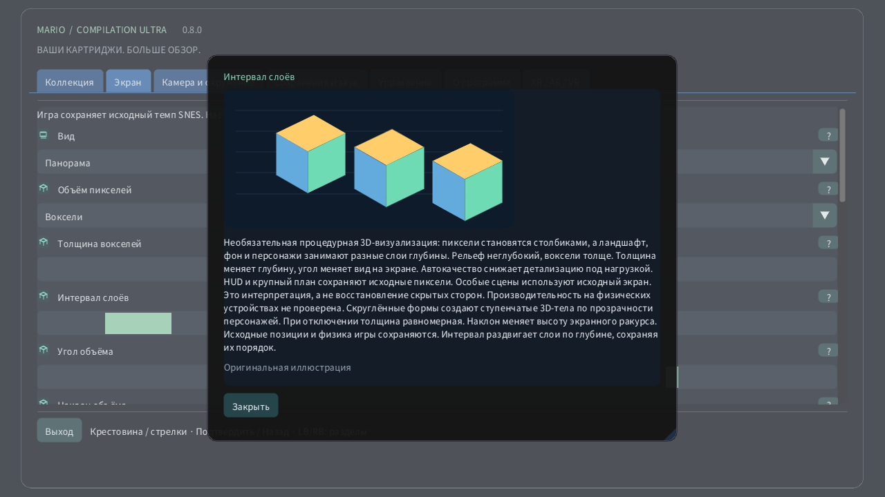

# Объём пикселей

[English](../en/VOXELS.md) · [Français](../fr/VOXELS.md) · [Español](../es/VOXELS.md) · [日本語](../ja/VOXELS.md) · [Deutsch](../de/VOXELS.md) · [Italiano](../it/VOXELS.md) · [Português](../pt/VOXELS.md) · [Русский](../ru/VOXELS.md) · [简体中文](../zh/VOXELS.md) · [한국어](../ko/VOXELS.md)

На компьютере или мобильном устройстве откройте Экран → Объём пикселей. Сначала попробуйте Рельеф пикселей для небольшой глубины, затем Воксели. Толщина меняет объём каждого пикселя, а интервал раздвигает слои без изменения их порядка. На Quest используйте вкладку Объём пространственного пульта. На часах коронка приближает изображение от всей области до исходного экрана.

Необязательная процедурная 3D-визуализация: пиксели становятся столбиками, а ландшафт, фон и персонажи занимают разные слои глубины. Рельеф неглубокий, воксели толще. Толщина меняет глубину, угол меняет вид на экране. Автокачество снижает детализацию под нагрузкой. HUD и крупный план сохраняют исходные пиксели. Особые сцены используют исходный экран. Это интерпретация, а не восстановление скрытых сторон. Производительность на физических устройствах не проверена. Скруглённые формы создают ступенчатые 3D-тела по прозрачности персонажей. При отключении толщина равномерная. Наклон меняет высоту экранного ракурса. Исходные позиции и физика игры сохраняются. Интервал раздвигает слои по глубине, сохраняя их порядок.

| Объём пикселей | |
|---|---|
| 0 | Исходное 2D |
| 1 | Рельеф пикселей |
| 2 | Воксели |

- **Толщина вокселей**: 1–16 px
- **Интервал слоёв**: 1–12 px
- **Угол объёма**: −30° … +30°
- **Наклон объёма**: −30° … +30°
- **Скруглённые формы вокселей**

[Коллекция](README.md) · [Настройки с иллюстрациями](SETTINGS.md) · [HTML](voxels.html) · [Technical research](../VOXEL_RESEARCH.md)
