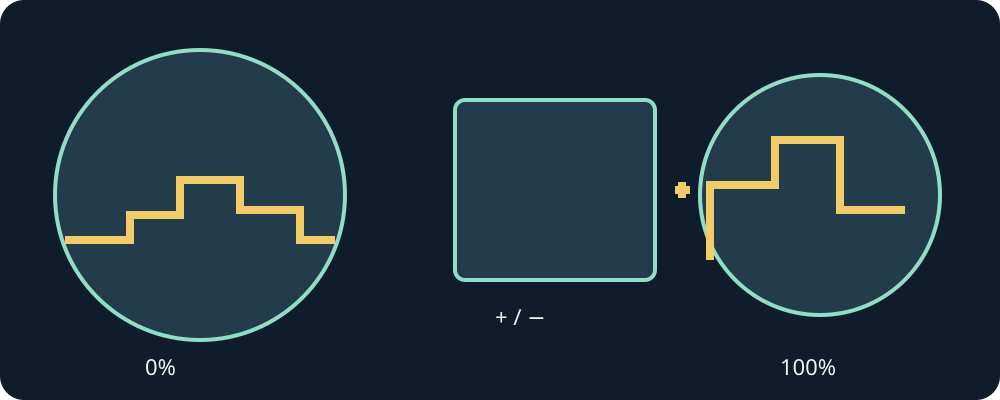
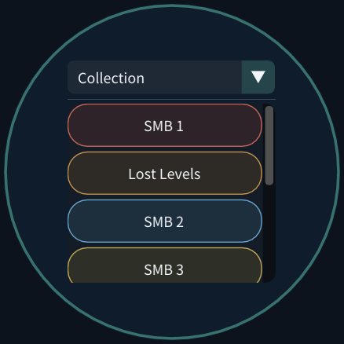

# Mario Compilation Ultra 0.12.2 · Вид на часах

[English](../en/WATCH.md) · [Français](../fr/WATCH.md) · [Español](../es/WATCH.md) · [日本語](../ja/WATCH.md) · [Deutsch](../de/WATCH.md) · [Italiano](../it/WATCH.md) · [Português](../pt/WATCH.md) · [Русский](../ru/WATCH.md) · [简体中文](../zh/WATCH.md) · [한국어](../ko/WATCH.md)



Вращайте коронку или безель для масштаба. В меню это прокрутка; сенсорные + и - тоже работают.

0% — вся загруженная область. 100% — исходная камера. Двери и трубы могут загрузить другую область.

Поверните заводную головку, чтобы приблизить изображение. От 85 до 100 % оно остаётся плоским. При отдалении можно выбрать мягкий изгиб, изгиб по краям с более плоским центром или рыбий глаз. Режим «Без изгиба» сохраняет прямые линии при любом масштабе.

В большинстве игр B — прыжок, Y — бег или захват. Удерживайте направление и действие разными пальцами.

Пауза — значок паузы или Назад Android. Возобновление продолжает игру. Выход находится внизу коллекции.

Персональный пакет содержит ваши локальные картриджи. Публичной версии нужны собственные совместимые файлы.

Передайте картриджи в CartridgeInbox, затем проверьте переданные картриджи или перезапустите приложение. Существующие файлы сохраняются.

Обновление подписанного APK сохраняет данные. Удаление приложения или его данных удаляет локальные картриджи и сохранения.

Сенсорный и поворотный ввод проверен на Galaxy Watch8 Classic с помощью программных событий. Удобство на запястье и производительность при долгой игре ещё предстоит оценить.



```text
/sdcard/Android/data/com.vhaloo.mariocompilationultra.wear/files/CartridgeInbox/

adb install -r MarioCompilationUltra-0.12.2-Wear-public.apk
adb push cartridge.sfc /sdcard/Android/data/com.vhaloo.mariocompilationultra.wear/files/CartridgeInbox/
```

[Wear APK](https://github.com/vhaloo/MarioCompilationUltra/releases/download/v0.12.2/MarioCompilationUltra-0.12.2-Wear-public.apk) · [HTML](watch.html) · [Настройки с иллюстрациями](SETTINGS.md) · [Guide](README.md)
