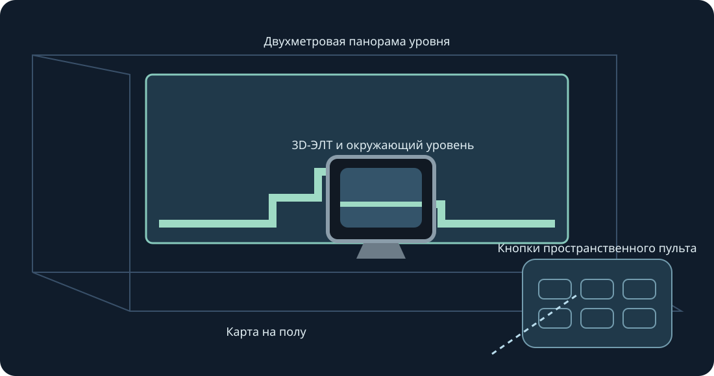

# Mario Compilation Ultra 0.5.0 · Quest VR / AR

[English](../en/XR.md) · [Français](../fr/XR.md) · [Español](../es/XR.md) · [日本語](../ja/XR.md) · [Deutsch](../de/XR.md) · [Italiano](../it/XR.md) · [Português](../pt/XR.md) · [Русский](../ru/XR.md) · [简体中文](../zh/XR.md) · [한국어](../ko/XR.md)

Стены, пол, аркадный стол, ЭЛТ и изогнутая галерея. Экспериментальная XR-версия. Изменяйте размер обеими рукоятками.

Экспериментальная XR-версия. Пользователь подтвердил видимость коллекции 0.4 на Quest 3 после установки; отправка кадров записана. Сборка 0.5 проверяется отдельно. Отслеживание, комфорт, сквозной режим, размещение в комнате и длительная игра требуют физических испытаний.

Для последующего теста включите режим разработчика и установите публичный ARM64 APK через SideQuest или adb install -r. Откройте Mario Compilation Ultra XR в неизвестных источниках, выберите картридж или ZIP системным диалогом и начните игру. All-Stars + World и Yoshi’s Island импортируются отдельно. Публичный APK не содержит ROM и сохранений.

Пространственный экран | Подогнать под отсканированную стену | Двухметровая панорама уровня | Карта на полу | Аркадный стол | 3D-ЭЛТ и окружающий уровень | Изогнутая галерея уровня

Выберите уровень, исходный CRT, пульт или настройки. Один захват перемещает и вращает, два меняют размер уровня даже при фиксации позиции. Есть точная настройка, половина/двойной размер/сброс. Возврат приближает интерфейс. Y открывает настройки; игровая страница содержит все кнопки SNES.

Щипком двигайте стик, другой рукой нажимайте кнопки. Щипок средним пальцем захватывает ручки. Потеря отслеживания отпускает ввод.

Новая установка запрашивает 90 Гц и прозрачную AR-панораму высотой два метра. При необходимости выбирается доступная частота; темп игры остаётся исходным. Для автоматических стен необязательны скан комнаты и разрешения сцен/якорей. Есть ручное размещение и калибровка пола. Сквозное изображение предоставляет среда; нет разрешений Интернета, микрофона или кадров камеры.

Силуэты служат подсказками и не симулируют далёкие объекты. Проверенные позиции доступны сразу; изученные изображения берутся только из локальной игры.

Аркадный стол показывает загруженную область. Физика и активация объектов остаются исходными.

Быстрые команды ПК: удерживайте нажатие правого стика; крестовина влево/вправо — масштаб, вверх — 1:1, вниз — вся карта, A — фиксация, B — исходная камера, X — снимок, Y — следить за игроком. Отпускание возвращает SNES-ввод. F1 или справка Y в меню открывает иллюстрацию.

SNES: D-pad · A · B · X · Y · L · R · Start · Select

Touch: A → SNES B · B → SNES Y · X → SNES A · RT → SNES X · R3 → Start · LT → Rewind · Y → Переместить настройки

[HTML](xr.html) · [Guide](README.md) · [Build](../BUILD.md) · [Parity](../PARITY.md) · [Validation](../TEST_REPORT.md)

[Meta developer mode](https://developers.meta.com/vr/documentation/android-apps/enable-developer-mode/) · [Meta refresh API](https://developers.meta.com/vr/documentation/native/android/mobile-display-refresh-rate/) · [Meta passthrough](https://developers.meta.com/vr/documentation/native/android/mobile-passthrough/)
